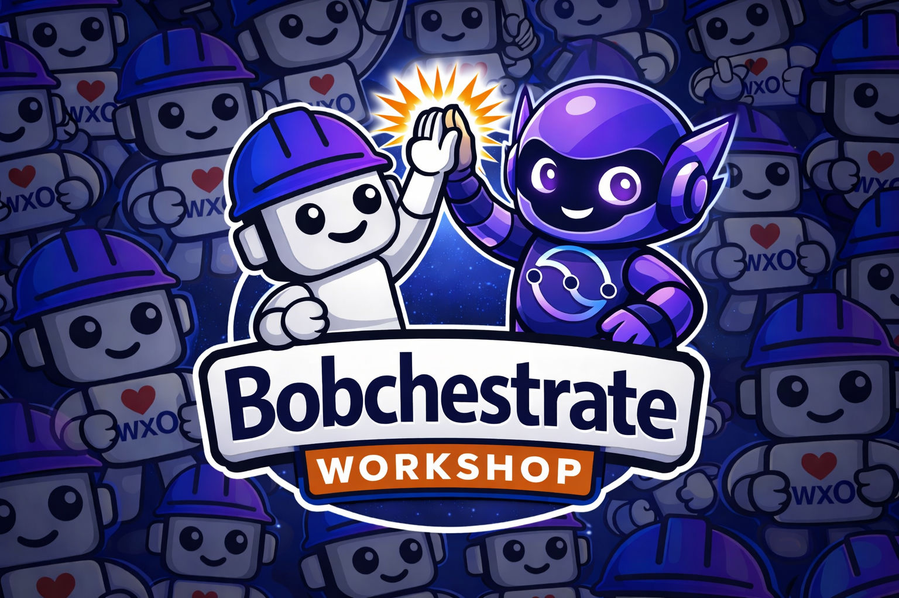

# Bobchestrate Workshop - Building AI Agents with watsonx Orchestrate and IBM Bob

<p align="center">
  
</p>


## A Hands-On Workshop for Agentic AI Development

Welcome! This workshop will guide you through building AI agents using IBM watsonx Orchestrate. You'll use IBM Bob, an AI coding assistant, to help you along the way.

## Workshop Overview

**Duration:** 75-90 minutes

This estimate includes:

- Core instruction time: 55-65 minutes (all parts)
- Setup and troubleshooting: 10-15 minutes
- Q&A and discussion: 10-15 minutes

**Level:** Beginner (Parts 1-3) to Advanced (Part 4)

**Prerequisites:** 
- Computer with internet access, Windows, macOS, or Linux operating system, at least 8GB RAM and 500 MB of free disk space
- Basic Python knowledge and Python 3.11-3.13 installed (https://www.python.org/downloads/)
- uv installed (https://pypi.org/project/uv/)
- watsonx Orchestrate SaaS access (provided by your instructor or you can use your own)
- IBM Bob IDE installed (trial or one provided by your instructor)

## What You'll Build

### 1. Hello World Agent (Part 2)
Your first simple agent to understand the basics of agent configuration and behavior.

### 2. A Bob That Knows Your Project (Part 3)
Custom rules that teach Bob the watsonx Orchestrate ADK conventions, so the code it generates is consistent from the start.

### 3. Travel Concierge System (Part 4)
A **multi-agent system** with an orchestrator and four specialist agents:
- Flight, hotel, activity and budget specialists, each with domain-specific tools
- An orchestrator agent with intelligent routing
- Context management and handoffs between agents

## Workshop Structure

### [Part 1: Setup & Environment](./part1-setup/README.md) (15 min)
- Configure watsonx Orchestrate credentials
- Verify Bob is working as your AI development partner
- Understand the project structure
- Set up your development environment

### [Part 2: Building Your First Agent](./part2-first-agent/README.md) (20 min)
- Create a simple "Hello World" agent
- Understand agent instructions and behavior
- Test your agent with the chat interface
- Learn how to use Bob to help debug issues

### [Part 3: Using Custom Rules with Bob IDE](./part3-bob-custom-rules/README.md) (10 min)
- Learn how to configure Bob with custom development rules
- Understand the watsonx Orchestrate development rule
- Set up project-specific conventions for Bob
- Create your own custom rules for consistent development

### [Part 4: Multi-Agent Orchestration](./part4-multi-agent-orchestration/README.md) (30 min)
- Understand when and why to use multi-agent systems
- Design focused specialist agents for specific domains
- Create orchestrator agents with intelligent routing
- Manage context and handoffs between agents
- Implement complex multi-agent workflows
- Learn best practices for agent hierarchies
- **Advanced exercise** - Build a complete travel planning system

## Advanced Workshop

A separate advanced workshop lives in [`advanced/`](./advanced/README.md). It assumes a working watsonx Orchestrate SaaS environment and the ADK CLI:

| Part | Topic |
|------|-------|
| [0 — Setup & Environment](./advanced/part0-setup/README.md) | Bob IDE, MCP servers, wxO connection, API keys |
| [1 — LangGraph Agents](./advanced/part1-langgraph/README.md) | Build, package and deploy custom LangGraph agents |
| [2 — Event-Driven AI Agents](./advanced/part2-confluent/README.md) | Confluent Cloud + Flink SQL + watsonx Orchestrate (uses [`retail-inventory-optimization/`](./retail-inventory-optimization/README.md)) |

## How Bob Helps You

Throughout this workshop, you'll use Bob to:
- **Generate code**: "Bob, create a Python tool that checks order status"
- **Debug issues**: "Bob, why is my agent not calling the refund tool?"
- **Explain concepts**: "Bob, explain how agent instructions work"
- **Refactor code**: "Bob, improve the error handling in my tool"
- **Create tests**: "Bob, write tests for my order status tool"

## Repository Layout

```
bobchestrate-workshop/
├── README.md (this file)
├── Bobchestrate_Workshop_logo_new.png
├── mkdocs.yml                               # Foundation workshop site config
├── mkdocs-advanced.yml                      # Advanced workshop site config
│
├── bob-prompts/
│   └── helpful-prompts.md                   # Useful Bob prompts for the workshop
│
├── part1-setup/                             # Setup & Environment (15 min)
│   ├── README.md
│   ├── verify-setup.py
│   ├── files/
│   │   └── wxo-agent-architect-export.yaml  # Pre-configured mode export
│   └── images/
│
├── part2-first-agent/                       # Building Your First Agent (20 min)
│   ├── README.md
│   ├── hello-agent-EXAMPLE.yaml
│   ├── exercises.md
│   └── images/
│
├── part3-bob-custom-rules/                  # Using Custom Rules with Bob (10 min)
│   ├── README.md
│   ├── wxo-dev-rule.md
│   └── wxo-dev-rule-enhanced.md
│
├── part4-multi-agent-orchestration/         # Multi-Agent Orchestration (30 min)
│   ├── README.md
│   ├── travel-concierge-agent.yaml          # Orchestrator agent
│   ├── flight-specialist-agent.yaml         # Specialist agents
│   ├── hotel-specialist-agent.yaml
│   ├── activity-planner-agent.yaml
│   ├── budget-advisor-agent.yaml
│   └── *_tools.py                           # Domain-specific tools
│
├── advanced/                                # Advanced workshop content
│   ├── README.md
│   ├── part0-setup/
│   ├── part1-langgraph/
│   └── part2-confluent/
│
├── retail-inventory-optimization/           # Pre-built lab code for advanced Part 2
│
├── docs/                                    # MkDocs source (symlinks to the folders above)
└── docs-advanced/                           # Advanced MkDocs source (symlinks into advanced/)
```

### Documentation site

The workshop website is built with MkDocs. `docs/` and `docs-advanced/` contain **symlinks** to the content folders above, so each file exists in only one place. Edit the top-level folders (`part*/`, `advanced/`, `bob-prompts/`), never the symlinks. Pushing to `main` builds and deploys both sites via GitHub Actions.

To preview locally:

```bash
pip install mkdocs-material mkdocs-glightbox
mkdocs serve                                  # foundation workshop
mkdocs serve -f mkdocs-advanced.yml           # advanced workshop
```

## Getting Started

1. Clone or download this workshop repository
2. Open the workshop folder in Bob IDE
3. Make sure Bob is installed and active
4. Start with [Part 1: Setup](./part1-setup/README.md)

## Learning Objectives

By the end of this workshop, you will:

✅ Understand watsonx Orchestrate agent architecture
✅ Create and configure agents using YAML specifications
✅ Teach Bob your project conventions for consistent code generation
✅ Design and orchestrate multi-agent systems
✅ Leverage Bob as an AI pair programmer

## Tips for Success

1. **Ask Bob for help**: Don't hesitate to ask Bob questions throughout the workshop
2. **Experiment**: Try modifying the examples to see what happens
3. **Read error messages**: They often tell you exactly what's wrong
4. **Test incrementally**: Build and test one feature at a time
5. **Use the documentation**: Bob can search the watsonx Orchestrate docs for you

## Additional Resources

- [Bob Helpful Prompts](./bob-prompts/helpful-prompts.md)
- [watsonx Orchestrate Documentation](https://developer.watson-orchestrate.ibm.com/)
- [Python Tools Guide](https://developer.watson-orchestrate.ibm.com/tools/create_tool)
- [Agent Builder API Reference](https://developer.watson-orchestrate.ibm.com/apis/agents/)
- [Community Forum](https://community.ibm.com/community/user/groups/community-home?CommunityKey=3ad46381-9535-462e-85c9-568b21f4b067)

## Need Help?

- Ask Bob: "Bob, I'm stuck on [specific issue]"
- Review the [bob-prompts guide](./bob-prompts/helpful-prompts.md) for helpful prompts
- Consult the watsonx Orchestrate documentation

Let's get started! Head to [Part 1: Setup](./part1-setup/README.md) →
