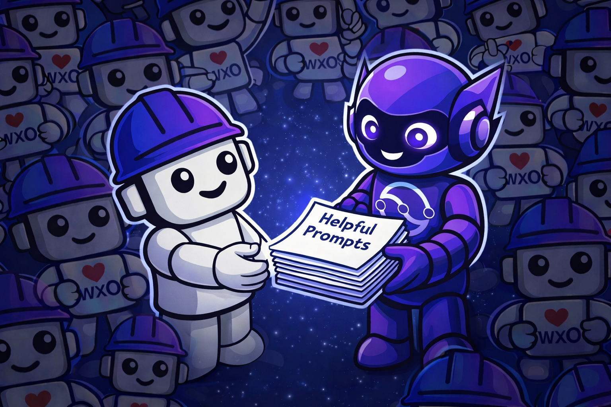

---
hide:
  - navigation
---

# Prompts útils de Bob per al desenvolupament amb watsonx Orchestrate

<p align="center">
  
</p>

Aquesta guia conté prompts útils per ajudar-te a treballar amb Bob durant el taller i més enllà.

## Desenvolupament general d'agents

### Comprendre els conceptes
```
Bob, explain what watsonx Orchestrate agents are and how they differ from regular chatbots
```

```
Bob, what are the key components of a watsonx Orchestrate agent?
```

```
Bob, explain the difference between native, external, and assistant agents
```

### Primers passos
```
Bob, help me set up my watsonx Orchestrate development environment
```

```
Bob, show me how to verify my watsonx Orchestrate connection is working
```

```
Bob, what's the basic structure of an agent YAML file?
```

## Crear agents

### Creació bàsica d'agents
```
Bob, create a YAML file for a customer service agent that can help with orders and refunds
```

```
Bob, create an agent that acts as a Python programming tutor
```

```
Bob, build an agent specification for a travel booking assistant
```

### Millorar les instruccions dels agents
```
Bob, review these agent instructions and suggest improvements: [paste instructions]
```

```
Bob, make these agent instructions more specific and actionable: [paste instructions]
```

```
Bob, add error handling guidance to these agent instructions: [paste instructions]
```

### Configuració de l'agent
```
Bob, explain what the 'hide_reasoning' configuration option does
```

```
Bob, help me choose the right LLM model for my agent
```

```
Bob, what's the difference between agent styles (default, react, planner)?
```

## Construir eines

### Creació d'eines
```
Bob, create a Python tool that checks order status given an order ID
```

```
Bob, build a tool that validates email addresses and returns detailed feedback
```

```
Bob, create a tool that calls the OpenWeather API to get current weather
```

### Millora d'eines
```
Bob, add input validation to this tool: [paste tool code]
```

```
Bob, improve the error handling in this tool: [paste tool code]
```

```
Bob, add type hints and better documentation to this tool: [paste tool code]
```

### Depuració d'eines
```
Bob, why isn't my agent calling this tool? Here's the agent YAML and tool code: [paste both]
```

```
Bob, this tool is returning an error. Can you help debug it? [paste error and code]
```

```
Bob, review this tool for potential issues: [paste tool code]
```

## Treballar amb bases de coneixement

### Configuració de bases de coneixement
```
Bob, create a knowledge base YAML file for FAQ documents
```

```
Bob, help me structure my knowledge base for best retrieval performance
```

```
Bob, explain how to connect a knowledge base to my agent
```

### Optimització de bases de coneixement
```
Bob, how should I format my documents for optimal knowledge base performance?
```

```
Bob, what's the best way to organize multiple knowledge bases?
```

## Col·laboració entre agents

### Crear agents col·laboradors
```
Bob, create a specialized escalation agent that handles complex customer issues
```

```
Bob, build a technical support agent that can collaborate with a billing agent
```

```
Bob, design an agent hierarchy for a customer service system
```

### Enrutament i delegació
```
Bob, improve the routing logic in these agent instructions: [paste instructions]
```

```
Bob, help me decide when my agent should delegate to a collaborator
```

## Proves i depuració

### Generació de casos de prova
```
Bob, generate test cases for this customer support agent
```

```
Bob, create a test script that validates my order status tool
```

```
Bob, write test scenarios that cover edge cases for my refund tool
```

### Depuració
```
Bob, my agent isn't responding correctly. Here's the conversation: [paste conversation]
```

```
Bob, analyze this error message and suggest a fix: [paste error]
```

```
Bob, why is my agent calling the wrong tool? [paste agent YAML and conversation]
```

### Optimització del rendiment
```
Bob, how can I make my agent respond faster?
```

```
Bob, review my agent's instructions for efficiency: [paste instructions]
```

```
Bob, suggest ways to reduce token usage in my agent
```

## Integració i desplegament

### Integració d'API
```
Bob, create a tool that calls this REST API: [paste API documentation]
```

```
Bob, add authentication to this API tool: [paste tool code]
```

```
Bob, help me handle rate limiting in this API tool: [paste tool code]
```

### Desplegament
```
Bob, create a deployment checklist for my agent
```

```
Bob, help me test my agent before deploying to production
```

```
Bob, generate webchat embed code for my agent
```

## Revisió de codi i refactorització

### Revisió de codi
```
Bob, review this agent YAML for best practices: [paste YAML]
```

```
Bob, check this tool for security issues: [paste tool code]
```

```
Bob, review my entire agent setup and suggest improvements: [paste all files]
```

### Refactorització
```
Bob, refactor this tool to be more modular: [paste tool code]
```

```
Bob, split this complex agent into multiple specialized agents: [paste agent YAML]
```

```
Bob, improve the code organization in my tool: [paste tool code]
```

## Documentació

### Generar documentació
```
Bob, create documentation for this tool: [paste tool code]
```

```
Bob, write a README for my agent project
```

```
Bob, generate API documentation for my custom tools
```

### Guies d'usuari
```
Bob, create a user guide for interacting with my customer service agent
```

```
Bob, write instructions for deploying this agent
```

## Temes avançats

### Fluxos de treball personalitzats
```
Bob, design a multi-step workflow using agent collaborators
```

```
Bob, create a planner-style agent with structured output
```

```
Bob, build an agent that uses chain-of-thought reasoning
```

### Servidors MCP
```
Bob, help me create an MCP server for my custom tools
```

```
Bob, explain how to connect an MCP server to watsonx Orchestrate
```

### Configuració de models
```
Bob, create a custom model configuration for Azure OpenAI
```

```
Bob, set up a model policy with fallback models
```

## Resolució de problemes habituals

### Problemes de connexió
```
Bob, I'm getting a connection refused error. How do I fix it?
```

```
Bob, my API key isn't working. What should I check?
```

### L'agent no respon
```
Bob, my agent isn't responding to user messages. Help me debug this.
```

```
Bob, the agent is giving generic responses instead of using tools. Why?
```

### Problemes amb les eines
```
Bob, my tool isn't being imported. What could be wrong?
```

```
Bob, the agent sees my tool but never calls it. How do I fix this?
```

### Problemes de rendiment
```
Bob, my agent is slow. How can I improve response time?
```

```
Bob, I'm hitting rate limits. What's the best approach?
```

## Bones pràctiques

### Demana a Bob les bones pràctiques
```
Bob, what are the best practices for writing agent instructions?
```

```
Bob, how should I structure my tools for maintainability?
```

```
Bob, what's the recommended way to handle errors in agents?
```

```
Bob, how do I make my agents more reliable in production?
```

## Aprenentatge i exploració

### Explorar funcionalitats
```
Bob, what are some advanced features of watsonx Orchestrate I should know about?
```

```
Bob, show me examples of creative ways to use agent collaborators
```

```
Bob, what are some real-world use cases for watsonx Orchestrate agents?
```

### Mantenir-se al dia
```
Bob, what's new in the latest version of watsonx Orchestrate?
```

```
Bob, are there any deprecated features I should be aware of?
```

## Consells per a prompts eficaços amb Bob

### ✅ FES:
- **Sigues específic**: Inclou codi rellevant, missatges d'error o context
- **Indica el teu objectiu**: Explica què intentes aconseguir
- **Proporciona exemples**: Mostra què has provat o què vols
- **Fes preguntes de seguiment**: Aprofundeix en les respostes de Bob amb preguntes aclaridores
- **Demana explicacions**: Demana a Bob que expliqui el raonament darrere dels suggeriments

### ❌ NO FACIS:
- **Ser vague**: "Bob, fix this" sense context
- **Ometre el context**: No proporcionar el codi o la configuració rellevants
- **Esperar que Bob endevini**: Bob necessita informació sobre la teva situació concreta
- **Ignorar els suggeriments**: Les recomanacions de Bob es basen en bones pràctiques
- **Fer diverses preguntes no relacionades**: Centra't en un sol tema cada vegada

## Exemple de flux de conversa

Aquest és un exemple d'una conversa eficaç amb Bob:

```
You: Bob, I need to create a customer support agent that can check order status and process refunds.

Bob: [Provides initial agent structure]

You: Thanks! Can you also add a tool that checks order status? It should take an order ID and return the status, items, and delivery date.

Bob: [Creates order status tool]

You: Great! Now I'm getting an error when I import the tool. Here's the error: [paste error]

Bob: [Analyzes error and provides fix]

You: Perfect! Can you now update the agent YAML to use this tool?

Bob: [Updates agent configuration]

You: Excellent! Can you generate some test cases for this agent?

Bob: [Provides test scenarios]
```

## Referència ràpida

### Prompts més habituals

1. **Crear**: "Bob, create a [type] that does [function]"
2. **Depurar**: "Bob, why is [thing] not working? Here's the [code/error]"
3. **Millorar**: "Bob, improve [code/config] by [specific improvement]"
4. **Explicar**: "Bob, explain [concept] in the context of [use case]"
5. **Revisar**: "Bob, review [code/config] for [issues/best practices]"

---

**💡 Consell professional:** Com més context proporcionis a Bob, millors seran les respostes. Inclou el codi rellevant, els missatges d'error i explica què intentes aconseguir!

**🎯 Recorda:** Bob és el teu company de programació amb IA. Fes servir Bob per aprendre, no només per obtenir respostes. Demana a Bob que expliqui el raonament darrere dels suggeriments!
