---
hide:
  - navigation
---

# Part 1: Configuració de l'entorn

<p align="center">
  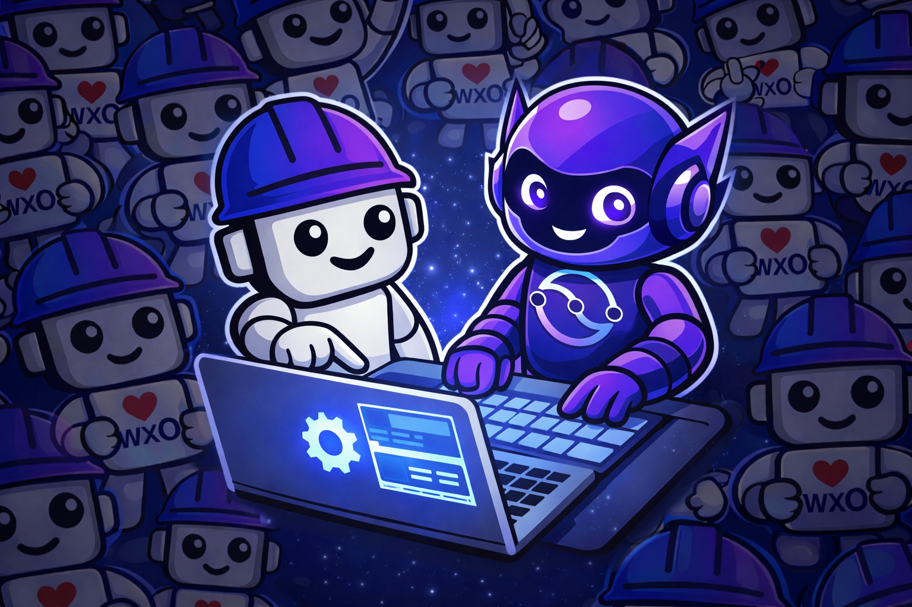
</p>

**Durada:** 15 minuts

**Objectiu:** Preparar el teu entorn de desenvolupament per construir agents de watsonx Orchestrate

## Verificació de prerequisits

Abans de començar, assegura't de tenir:

- [ ] Python 3.11-3.13 instal·lat
- [ ] uv instal·lat
- [ ] IBM Bob IDE instal·lat
- [ ] Accés a watsonx Orchestrate (SaaS o Developer Edition)

### ⚠️ Advertència ⚠️ ###

> **Assegura't de complir tots els prerequisits! Per exemple, una versió incorrecta de Python pot causar molts problemes. Segueix els passos en l'ordre correcte per garantir que el procediment de configuració funcioni tal com s'ha dissenyat.**

## Pas 1: Verificar la instal·lació de Python

### macOS / Linux

Obre un terminal i executa:
```bash
python3 --version
```

#### ❗️ IMPORTANT ❗️ ####
> Si veus una versió diferent de 3.11.x, 3.12.x o 3.13.x, has d'instal·lar una de les versions compatibles (3.11.x - 3.13.x) al teu ordinador.

### Windows 11

Obre PowerShell o el Terminal de Windows i executa:
```powershell
python --version
```
> **Nota:** A Windows fes servir `python` en lloc de `python3`. Si en escriure `python` s'obre la Microsoft Store en lloc de mostrar una versió, desactiva el stub des de **Configuració → Aplicacions → Configuració avançada d'aplicacions → Àlies d'execució d'aplicacions** i desactiva les entrades de Python.

#### ❗️ IMPORTANT ❗️ ####
> Si veus una versió diferent de 3.11.x, 3.12.x o 3.13.x, has d'instal·lar una de les versions compatibles (3.11.x - 3.13.x) al teu ordinador.

Durant la instal·lació, assegura't de marcar:
- ✅ **Add Python to PATH**
- ✅ **Install pip**

---

Descarrega la versió de Python compatible: ([https://www.python.org/downloads/](https://www.python.org/downloads/))

## Pas 2: Verificar la instal·lació d'uv

### macOS / Linux

Obre un terminal i executa:
```bash
uv --version
```

Si no està instal·lat, instal·la'l mitjançant Homebrew:
```bash
brew install uv
```

### Windows 11

Obre PowerShell i executa:
```powershell
uv --version
```

Si no està instal·lat, instal·la'l mitjançant PowerShell:
```powershell
powershell -ExecutionPolicy ByPass -c "irm https://astral.sh/uv/install.ps1 | iex"
```
O mitjançant pip:
```powershell
pip install uv
```

---

#### ❗️ IMPORTANT ❗️ ####
> Hauries de veure un número de versió. El número concret no importa, només necessites tenir uv instal·lat.

Descarrega uv: ([https://pypi.org/project/uv/](https://pypi.org/project/uv/))

## Pas 3: Crear una carpeta nova per al taller

> **⚠️ ADVERTÈNCIA: Evita espais a la ruta de la carpeta.** L'extensió ADK fallarà si alguna part de la ruta conté espais (per exemple, `My Projects/bobchestrate-ws` causarà problemes). Fes servir guions o guions baixos en el seu lloc — per exemple `bobchestrate-ws` o `bobchestrate_ws`. Això s'aplica també a totes les carpetes superiors de la ruta.

Crea una carpeta dedicada per al teu projecte del taller — pots col·locar-la on vulguis.

### macOS / Linux

```bash
mkdir bobchestrate-ws
cd bobchestrate-ws
```

### Windows 11

```powershell
mkdir bobchestrate-ws
cd bobchestrate-ws
```

> **Nota:** Les ordres són les mateixes, però les rutes a Windows fan servir barres invertides (per exemple, `C:\Users\ElTeuNom\bobchestrate-ws`). PowerShell accepta tant barres cap endavant com cap enrere.

Aquesta carpeta contindrà tots els teus fitxers, agents i eines del taller.

## Pas 4: Obrir IBM Bob IDE i iniciar sessió amb el teu IBM ID

> **Descarregar IBM Bob IDE:** Si encara no has instal·lat IBM Bob IDE, descarrega'l des de [bob.ibm.com/download](https://bob.ibm.com/download) i instal·la'l al teu ordinador. Assegura't de fer servir la versió **Bob IDE**.


> **Instruccions d'instal·lació detallades:** Per a una guia d'instal·lació completa, visita [bob.ibm.com/docs/ide/getting-started/install](https://bob.ibm.com/docs/ide/getting-started/install)

#### ❗️ IMPORTANT ❗️ ####
> Has d'iniciar sessió per fer servir les capacitats d'IA de Bob durant el taller. Si tens algun problema per iniciar sessió, contacta amb el teu instructor.

## Pas 5: Obrir la carpeta a IBM Bob IDE

1. Un cop IBM Bob IDE estigui obert:
2. Fes clic a **File** → **Open Folder**
   
      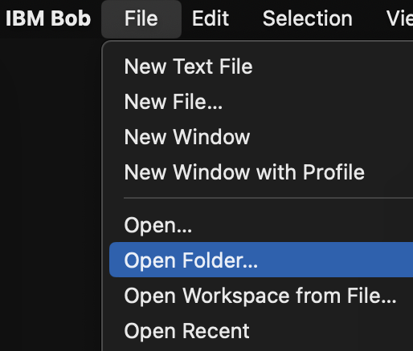

3. Navega fins a la carpeta `bobchestrate-ws` i selecciona-la
4. Fes clic a **Open**
5. Fes clic a **Yes, I trust the author** per confiar en l'espai de treball

      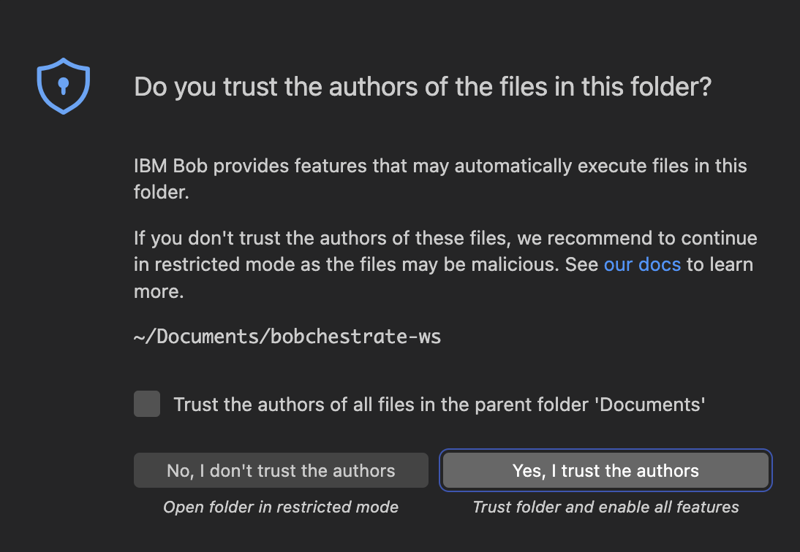

S'obrirà l'espai de treball buit.

## Pas 6: Crear l'entorn virtual de Python

#### ❗️ IMPORTANT ❗️ ####
> L'entorn virtual de Python és fonamental per al taller. Assegura't de completar aquest pas abans de procedir a instal·lar l'extensió VS Code de wxO i el wxO ADK en si.

### macOS / Linux

Crea un entorn virtual fent servir les ordres integrades d'IBM Bob IDE:

1. Obre la Paleta d'ordres a IBM Bob IDE (prem `Cmd+Shift+P`)
2. Comença a escriure "Python: Create Environment" i selecciona'l
3. Tria "Venv" com a tipus d'entorn
4. Selecciona el teu intèrpret de Python (Python 3.11-3.13) i espera que es creï l'entorn virtual

   **IMPORTANT:** _Assegura't de seleccionar la versió d'intèrpret de Python compatible (3.11-3.13). Si no veus la versió correcta, potser has d'instal·lar-la primer. Si ja l'has instal·lada i continua sense aparèixer, reinicia IBM Bob IDE._

Ara pots veure la carpeta `.venv` a l'explorador del teu espai de treball.

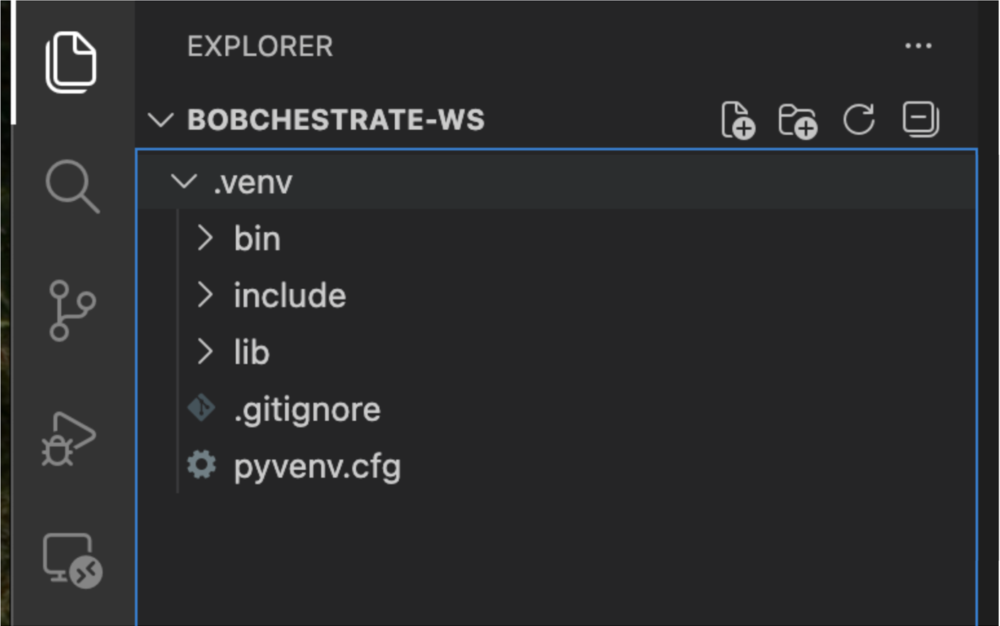

IBM Bob IDE realitzarà automàticament els passos següents:<br>
- Crear una carpeta `.venv` al teu espai de treball<br>
- Activar l'entorn virtual als terminals nous<br>
- Mostrar `(.venv)` a l'indicador del teu terminal

> **NOTA:** L'entorn virtual s'activarà automàticament quan obris terminals nous a IBM Bob IDE.

### Windows 11

Pots crear l'entorn virtual mitjançant IBM Bob IDE (recomanat) o manualment a PowerShell.

#### Opció A: Fent servir IBM Bob IDE (Recomanat)

1. Obre la Paleta d'ordres a IBM Bob IDE (prem `Ctrl+Shift+P`)
2. Comença a escriure "Python: Create Environment" i selecciona'l
3. Tria "Venv" com a tipus d'entorn
4. Selecciona el teu intèrpret de Python (Python 3.11-3.13) i espera que es creï l'entorn virtual

   **IMPORTANT:** _Assegura't de seleccionar la versió d'intèrpret de Python compatible (3.11-3.13). Si no veus la versió correcta, potser has d'instal·lar-la primer. Si ja l'has instal·lada i continua sense aparèixer, reinicia IBM Bob IDE._

IBM Bob IDE crearà i activarà automàticament `.venv` als terminals nous.

#### Opció B: Configuració manual amb PowerShell

Si prefereixes el terminal o tens problemes amb l'IDE:

```powershell
# Navigate to your project folder
cd C:\Users\YourName\bobchestrate-ws

# Create the virtual environment
python -m venv .venv
```

Activa'l:
```powershell
# PowerShell
.venv\Scripts\Activate.ps1

# CMD (if you must)
.venv\Scripts\activate.bat
```

> **⚠️ Política d'execució de PowerShell:** Si obtens un error d'execució d'script, executa això una vegada:
> ```powershell
> Set-ExecutionPolicy -ExecutionPolicy RemoteSigned -Scope CurrentUser
> ```

Verifica l'activació — el teu indicador mostrarà `(.venv)` i:
```powershell
where python   # Should point to .venv\Scripts\python.exe
pip --version  # Should show pip inside .venv
```

> **NOTA:** Afegeix `.venv` al teu `.gitignore` — mai confirmis la carpeta de l'entorn virtual al repositori.

#### Eines alternatives que convé conèixer

| Eina | Quan fer-la servir |
|---|---|
| venv (integrat) | Opció per defecte per a la majoria de projectes |
| conda / miniconda | Ciència de dades / computació científica (també gestiona versions de Python) |
| pyenv-win | Necessites gestionar diverses versions de Python a la mateixa màquina |
| uv | Alternativa moderna més ràpida; reemplaçament directe de pip+venv |
| pipenv | Gestió combinada de dependències + venv (més pesat, menys popular ara) |
| poetry | Gestió completa de dependències/empaquetatge per a autors de llibreries |

## Pas 7: Instal·lar l'extensió VS Code del watsonx Orchestrate ADK

#### ❗️ IMPORTANT ❗️ ####
> **Si ja tens l'extensió instal·lada**, recarrega la finestra de Bob IDE! Això garanteix que l'extensió detecti correctament el teu nou entorn virtual. Obre la Paleta d'ordres a IBM Bob IDE (prem `Cmd+Shift+P` a Mac / `Ctrl+Shift+P` a Windows/Linux), comença a escriure "**Developer: Reload Window**" i selecciona'l. La finestra de Bob IDE es recarregarà i l'extensió es reiniciarà. Després pots passar directament al Pas 8. **NO** facis servir l'extensió per inicialitzar l'espai de treball!

Instal·la l'extensió de watsonx Orchestrate per a IBM Bob IDE:

1. Obre la vista d'Extensions a IBM Bob IDE (fes clic a la icona d'Extensions a la Barra d'activitat o prem `Cmd+Shift+X` a Mac / `Ctrl+Shift+X` a Windows/Linux)
   
      

2. Cerca "**watsonx Orchestrate**"

      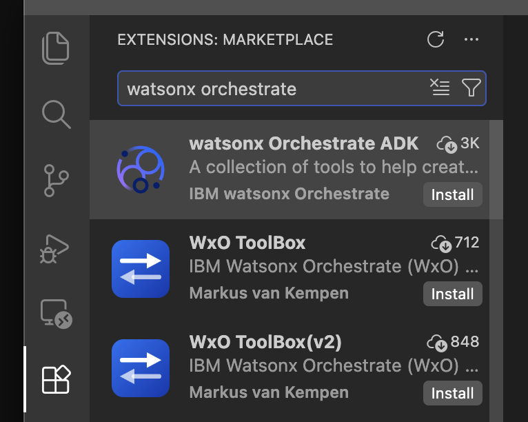

3. Fes clic a **Install** a l'extensió "_**watsonx Orchestrate ADK**_"
4. Espera que es completi la instal·lació
5. Recarrega VS Code si se't demana
6. Ara hauries de veure la icona de l'extensió a la Barra d'activitat — **NO** necessites obrir-la. Si ho fas, **NO** inicialitzis l'espai de treball des d'allà, ja que pot causar problemes amb el procediment de configuració que estem seguint:
   
      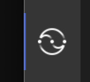

L'extensió VS Code IBM watsonx Orchestrate ADK proporciona:

- Gestió de l'espai de treball: Crea i inicialitza automàticament estructures de carpetes per al desenvolupament d'agents
- Gestió de versions de l'ADK: Instal·la i actualitza el watsonx Orchestrate ADK directament des de VS Code
- Creació de fitxers d'agents i eines: Ajuda a crear fitxers d'agents i eines
- Control del servidor Developer Edition: Inicia/atura el servidor watsonx Orchestrate Developer Edition directament des de la interfície
- Assistent d'IA Orchestrate Builder: Assistent d'IA interactiu que et guia en la construcció i el perfeccionament d'agents mitjançant prompts

#### ❗️ IMPORTANT ❗️ ####
> **NO** obris l'extensió en si mateixa, només necessites tenir-la instal·lada. Fer servir l'extensió per inicialitzar l'espai de treball pot causar problemes!

## Pas 8: Instal·lar el watsonx Orchestrate ADK

### macOS / Linux

Ara que tens instal·lada l'extensió watsonx Orchestrate ADK, veuràs la informació de l'ADK a la Barra d'estat inferior. Com que acabem de crear un entorn virtual Python net al nostre espai de treball, hauries de veure una creu vermella ❌ que indica que necessites instal·lar l'ADK.

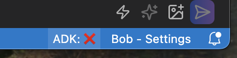

Fes clic a la creu vermella per instal·lar l'ADK. Això obrirà un parell d'ordres a la barra de cerca/ordres. **Selecciona la que instal·la l'ADK**.

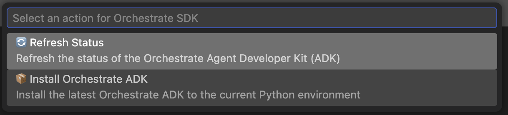

Espera que es completi la instal·lació. Al cap d'un moment, hauries de veure una notificació i una marca de verificació verda a la Barra d'estat amb el número de versió més recent de l'ADK.

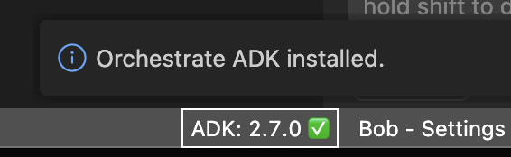

>**NOTA**: El número de versió que veus a la Barra d'estat és la versió de l'ADK instal·lada. Pot ser diferent de la que es mostra a la imatge de dalt. Es publiquen noves versions de l'ADK amb regularitat, de manera que el número de versió canviarà amb el temps.

### Windows 11

Pots instal·lar l'ADK mitjançant IBM Bob IDE (igual que a macOS més amunt) o manualment mitjançant PowerShell.

#### Opció A: Fent servir IBM Bob IDE (Recomanat)

Segueix els mateixos passos que a macOS — fes clic a la creu vermella ❌ a la Barra d'estat i selecciona l'opció d'instal·lació.

#### Opció B: Instal·lació manual mitjançant PowerShell

Amb el teu entorn virtual activat, executa:

```powershell
pip install --upgrade ibm-watsonx-orchestrate
```

Valida la instal·lació:
```powershell
orchestrate --version
```

Hauries de veure el número de versió de l'ADK imprès al terminal.

## Pas 9: Instal·lar els servidors MCP de watsonx Orchestrate

Instal·la els servidors MCP de watsonx Orchestrate a través de l'extensió ADK:

1. Obre la Paleta d'ordres a IBM Bob IDE (prem `Cmd+Shift+P` a Mac / `Ctrl+Shift+P` a Windows/Linux)
2. Comença a escriure "**watsonx Orchestrate: Install WXO MCP Servers**" i selecciona'l
3. Espera que es completi la instal·lació
4. Hauries de veure un missatge de confirmació que indiqui que els servidors MCP s'han instal·lat correctament

**Verifica la instal·lació:**

Per confirmar que els servidors MCP estan instal·lats i funcionant:

1. Obre el panell de xat de Bob a IBM Bob IDE
2. Pregunta a Bob: "What MCP servers are available?"
3. Hauries de veure els següents servidors MCP de watsonx Orchestrate a la llista:
   - `watsonx-orchestrate-adk` - Proporciona eines per interactuar amb watsonx Orchestrate (llistar agents, eines, etc.)
   - `watsonx-orchestrate-adk-docs` - Proporciona accés a la documentació de watsonx Orchestrate

Com a alternativa, pots comprovar la configuració dels servidors MCP:
1. Obre la Paleta d'ordres (`Cmd+Shift+P` / `Ctrl+Shift+P`)
2. Escriu "MCP Servers" i selecciona'l
3. Verifica que els servidors MCP de watsonx Orchestrate apareixen a la configuració i que tots dos estan marcats amb un punt verd

   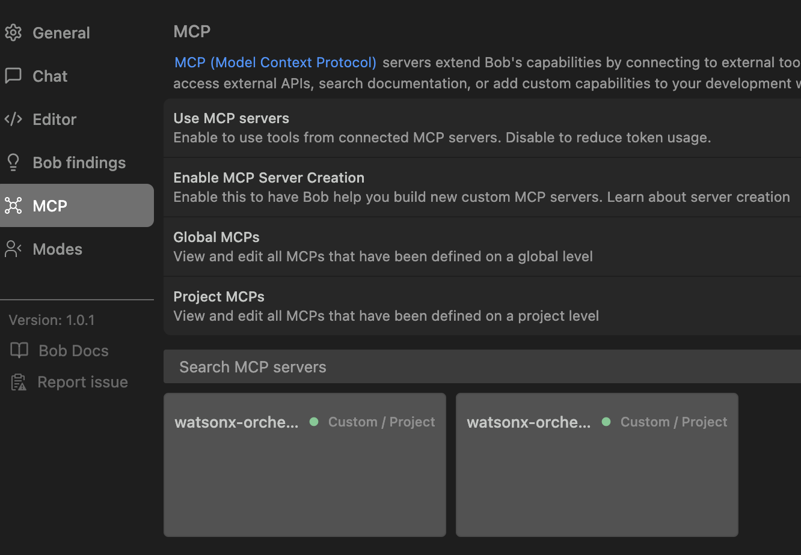

>**NOTA**: Pot trigar un parell de segons després de la instal·lació perquè tots dos servidors MCP apareguin a la llista.

Els servidors MCP proporcionen:

- Accés a la documentació de watsonx Orchestrate
- Integració amb el watsonx Orchestrate ADK
- Eines per llistar agents, eines i altres recursos
- Capacitats millorades de Bob per al desenvolupament de watsonx Orchestrate

## Pas 10: Importar el mode WXO Agent Architect

Importa un mode personalitzat preconfigurat i especialitzat per construir agents de watsonx Orchestrate.

>**NOTA**: IBM Bob Marketplace té molts modes preconfigurats per a IBM Bob IDE, inclòs un mode per construir agents de watsonx Orchestrate. Malauradament, el marketplace no està disponible actualment per a persones externes a IBM, tot i que ho estarà en un futur proper. Aquest pas et guiarà sobre com importar un mode personalitzat manualment.

Descarrega el fitxer de configuració del mode:

1. El fitxer és a: [wxo_agent_architect_export.yaml](../../part1-setup/files/wxo_agent_architect_export.yaml)
2. Fes clic al botó **Download raw file**

      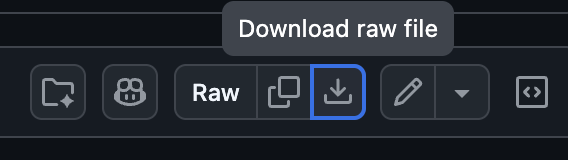

3. Desa el fitxer a la teva carpeta de Descàrregues o en una ubicació de fàcil accés
4. Obre la Paleta d'ordres a IBM Bob IDE (prem `Cmd+Shift+P` a Mac / `Ctrl+Shift+P` a Windows/Linux)
5. Escriu "**Modes**" i selecciona'l
6. Fes clic a la icona **Import** del panell de modes

      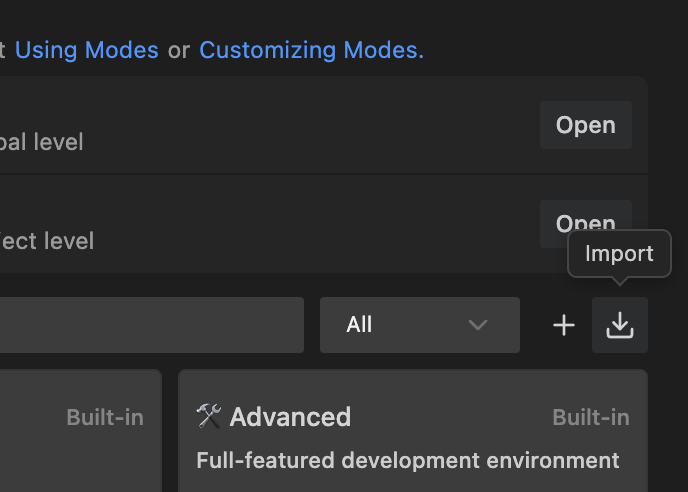

7. Selecciona el fitxer `wxo_agent_architect_export.yaml` que has descarregat i fes clic a **Open**
8. Hauries de veure un missatge de confirmació que indiqui que el mode s'ha importat correctament i veure'l aparèixer al panell de modes

El mode "WXO Agent Architect" importat inclou:

- **Definició de rol**: Especialitzat en la construcció d'agents de watsonx Orchestrate
- **Instruccions personalitzades**: Guia sobre l'ús de servidors MCP per al desenvolupament d'agents
- **Integració de servidors MCP**: Fa servir automàticament els servidors `watsonx-orchestrate-adk` i `watsonx-orchestrate-adk-docs`
- **Grups d'eines**: Accés a eines de lectura, edició, navegador, ordres i MCP

**Verifica el mode:**

1. Obre el panell de xat de Bob si no està obert ja
2. Fes clic al selector de mode (normalment mostra el mode actual com a "Code" o "Ask")
3. Hauries de veure "WXO Agent Architect" a la llista de modes disponibles
4. Selecciona el mode "**WXO Agent Architect**"
5. Pregunta a Bob: "What can you help me with in this mode?"
6. Bob hauria de respondre amb informació sobre la construcció d'agents de watsonx Orchestrate i esmentar els servidors MCP disponibles

## Pas 11: Obtenir la teva clau API i la URL de l'API de watsonx Orchestrate

Per al taller, farem servir el watsonx Orchestrate ADK per interactuar amb una instància SaaS de watsonx Orchestrate. L'ADK requereix la teva clau API i la URL de l'API per autenticar-se i connectar-se a la teva instància de watsonx Orchestrate.

> **_Nota:_** `El teu instructor et proporcionarà la clau API i la URL de l'API de la teva instància de watsonx Orchestrate.` Si fas servir la teva pròpia instància, pots seguir les instruccions següents per obtenir la clau API i la URL necessàries.

### OPCIONAL: Fer servir la teva pròpia instància SaaS de watsonx Orchestrate

<ins>Per generar una clau API per a l'ADK:</ins>

1. A la teva consola de watsonx Orchestrate, fes clic a la **icona de perfil** a l'extrem superior dret
2. Selecciona **Settings** al menú desplegable
3. Navega a la pestanya **API details**
4. Fes clic al botó **Generate API key**

      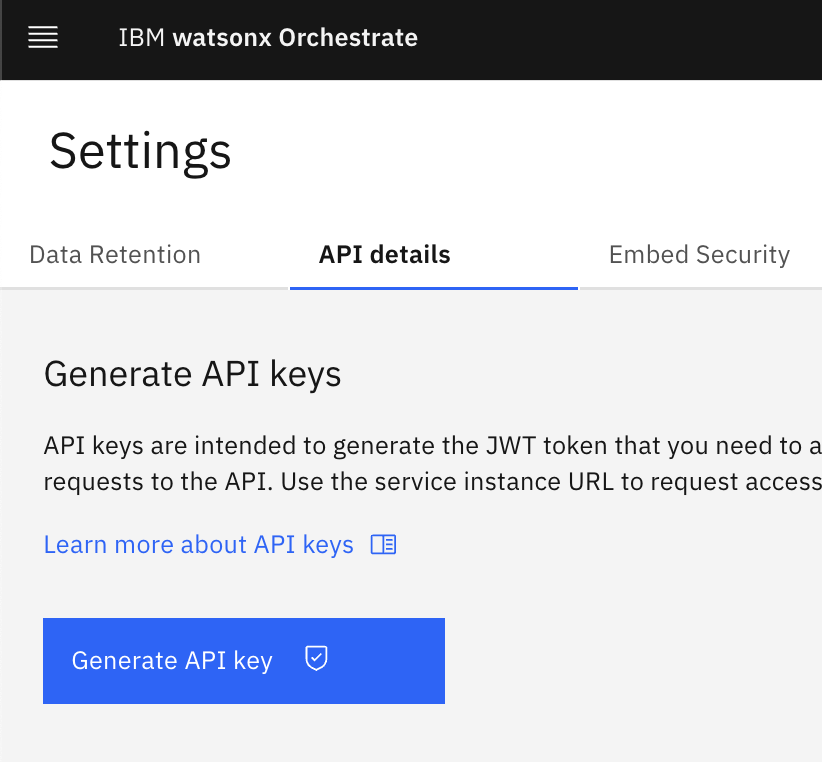

5. Quan es generi la clau, fes clic a **Copy** per desar-la al porta-retalls
6. **Important**: Copia la clau API immediatament i _desa-la_ de manera segura
   - La clau només es mostrarà una vegada
   - Si la perds, hauràs de crear-ne una de nova

> **Bona pràctica de seguretat**: Tracta la teva clau API com una contrasenya. No la confirmis mai en un repositori de versions ni la comparteixis públicament.

<ins>Per obtenir la URL de l'API:</ins>

Copia la **Service instance URL** de la informació de detalls de l'API. Aquesta és la URL base de la teva instància de watsonx Orchestrate.

   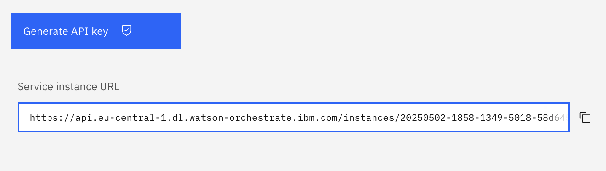

## Pas 12: Configurar l'entorn ADK

#### Opció A: Fent servir la CLI de l'ADK — fes un cop d'ull a l'Opció B abans de decidir quina fer servir 😉

1. Obre una finestra de terminal dins de Bob IDE:

   - Des de la barra de menú principal de Bob, selecciona **Terminal** > **New Terminal**

      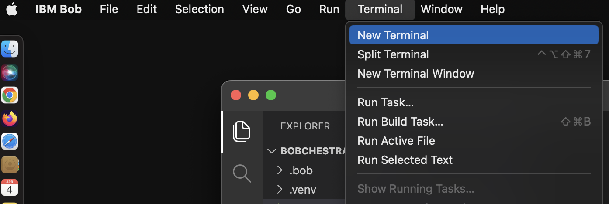
   
   - S'obrirà una finestra de terminal a Bob IDE — observa que el teu entorn virtual de Python s'activa automàticament

      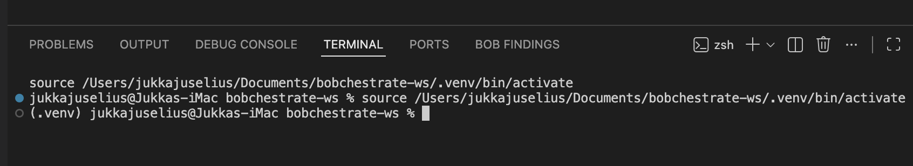

2. Executa l'ordre següent al teu terminal per **afegir** el teu entorn:

   ```bash
   orchestrate env add -n <your-env-name> -u <your-api-url>
   ```
   On `<your-env-name>` és el nom que triïs per al teu entorn (per exemple, "my-wxo-cloud") i `<your-api-url>` és la URL que has obtingut al Pas 11.
   
   Després d'executar l'ordre, hauries de veure el missatge: `[INFO] Environment '<your-env-name>' has been created`

3. Executa l'ordre següent per **activar** l'entorn:

   ```bash
   orchestrate env activate <your-env-name> -a <your-api-key>
   ```
   On `<your-env-name>` és el nom que has triat per al teu entorn (per exemple, "my-wxo-cloud") i `<your-api-key>` és la clau API que has obtingut al Pas 11.
   
   Després d'executar l'ordre, hauries de veure el missatge: `[INFO] Environment '<your-env-name>' is now active`. Això vol dir que el teu entorn està actiu i llest per fer-lo servir amb l'ADK. Pots ignorar l'avís sobre l'Auth Type.

#### ❗️ IMPORTANT ❗️ ####
> L'autenticació contra un entorn remot caduca cada dues hores. Després de la caducitat, has de tornar a executar orchestrate env activate. Per tant, mantén la teva clau API disponible i a punt per fer-la servir.

#### Opció B: Fent servir Bob perquè t'ajudi 😃

Ara que tens habilitats els servidors MCP de watsonx Orchestrate i el mode WXO Agent Architect, pots fer servir Bob perquè t'ajudi amb la configuració.

1. Assegura't de tenir el mode **WXO Agent Architect** seleccionat al teu xat de Bob. Després demana a Bob que creï un script per afegir i activar un nou entorn de watsonx Orchestrate per a l'ADK:

      ```
      Create a simple shell script to add and activate new watsonx Orchestrate SaaS environment for the ADK. I have the environment URL and API key ready.
      ```

      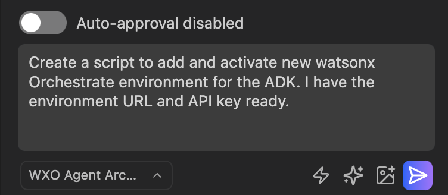

2. Quan Bob comenci a treballar, et demanarà permís per accedir al servidor MCP watsonx-orchestrate-adk-docs. Fes clic al botó **Approve** per permetre que Bob accedeixi a la documentació.

      >**NOTA**: També pots marcar la casella **Always allow** per permetre sempre que Bob accedeixi al servidor MCP. Una altra opció és habilitar l'**aprovació automàtica**. Si ho fas, pots especificar les diferents opcions que vols permetre.

      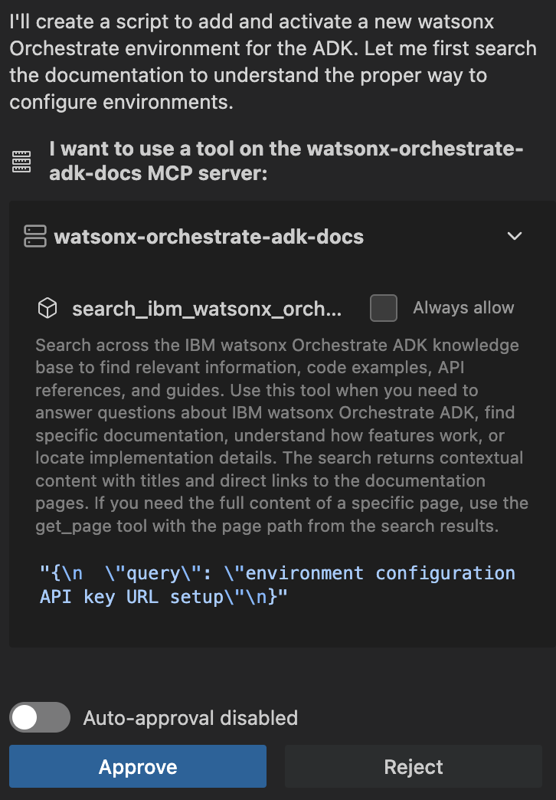

      >**NOTA**: Bob pot demanar-te que aprovis l'accés al servidor MCP diverses vegades. Això passa perquè Bob intenta accedir al servidor MCP per obtenir informació més detallada després d'aprendre sobre la configuració de l'entorn. Es recomana habilitar l'**aprovació automàtica** per als servidors MCP i així evitar concedir el permís manualment cada vegada.

3. Després que Bob hagi creat l'script (per exemple, _add_wxo_env.sh_; el nom podria ser diferent en el teu cas), et demanarà permís per desar-lo. Fes clic al botó **Save** per desar l'script.

4. A continuació, Bob crearà (o no, depèn del dia 😅) una documentació — un fitxer MD — per a l'script. Fes clic al botó **Save** per desar la documentació.

5. Després que Bob hagi desat la documentació, et demanarà permís per fer l'script executable. Fes clic a **Run** per executar l'ordre.

6. Finalment Bob et resumirà la tasca

    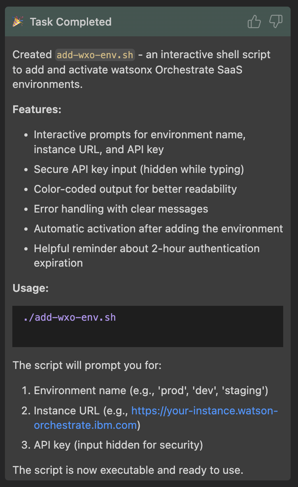

7. Obre una finestra de terminal dins de Bob IDE

   - Des de la barra de menú principal de Bob, selecciona **Terminal** > **New Terminal**

      
   
   - S'obrirà una finestra de terminal a Bob IDE — observa que el teu entorn de Python s'activa automàticament

      

8. Executa l'script creat al teu terminal per **afegir** el teu entorn

      `./<nom_del_teu_script_creat>, p. ex. ./add_wxo_env.sh`

9. Quan se't demani, proporciona un nom per al teu entorn, per exemple `my-wxo-cloud`

      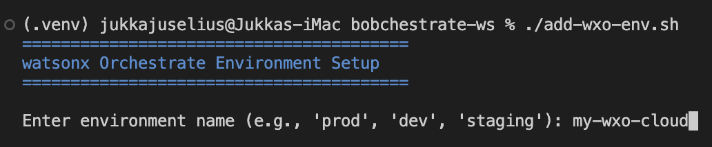

10. Quan se't demani, proporciona la URL de la teva instància d'Orchestrate que has obtingut abans

      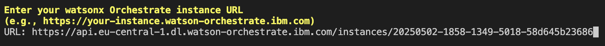

11. Quan se't demani, proporciona la clau API de la teva instància d'Orchestrate que has obtingut abans. L'script crearà un nou entorn i l'activarà.

      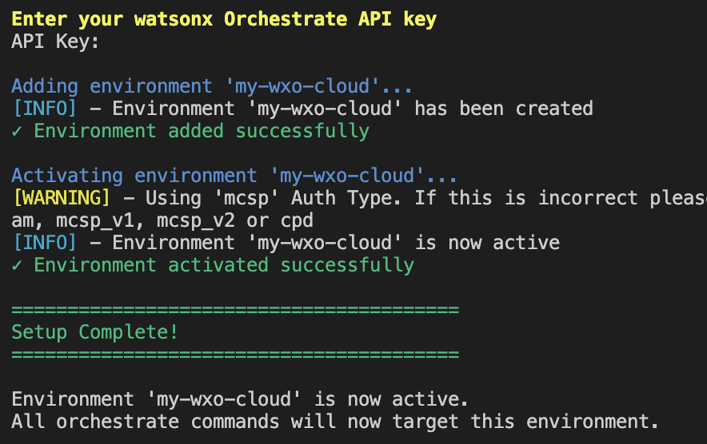

12. Verifica que la teva connexió funciona. Executa l'ordre següent al terminal de Bob IDE

      ```bash
      orchestrate agents list
      ```

      Si està configurat correctament, aquesta ordre llistarà els agents del teu entorn (o mostrarà una llista buida si encara no has creat cap agent).

#### ❗️ IMPORTANT ❗️ ####
> L'autenticació contra un entorn remot caduca cada dues hores. Després de la caducitat, has de tornar a executar orchestrate env activate. Per tant, mantén la teva clau API disponible i a punt per fer-la servir.

## Fer servir Bob durant el taller

Bob és el teu programador assistent d'IA per a aquest taller. Aquí t'expliquem com fer servir Bob de manera eficaç:

### Bons prompts per a Bob:
✅ "Bob, create a Python tool that checks order status given an order ID"  
✅ "Bob, why is my agent not responding to user messages?"  
✅ "Bob, explain what agent instructions do in watsonx Orchestrate"  
✅ "Bob, refactor this tool to handle errors better"  

### Prompts menys efectius:
❌ "Bob, fix this" (massa vague)  
❌ "Bob, make it work" (sense context)  
❌ "Bob, do everything for me" (no aprendràs!)  

### Els superpoders de Bob:
- 🔍 **Cercar documentació**: Bob pot cercar a la documentació de watsonx Orchestrate
- 💻 **Escriure codi**: Bob pot crear eines Python i especificacions d'agents
- 🐛 **Depurar**: Bob pot analitzar errors i suggerir solucions
- 📚 **Explicar**: Bob pot explicar conceptes i bones pràctiques
- 🔧 **Refactoritzar**: Bob pot millorar el teu codi

### Gestionar les sessions de xat de Bob:
- ✅ **Continuar a la mateixa sessió**: Quan treballes en tasques relacionades o en el mateix tema/artefactes, continua a la mateixa sessió de xat de Bob per mantenir el context
- 🆕 **Començar una tasca nova**: Quan canvies a un tema completament diferent o a una feina no relacionada, comença una tasca nova amb Bob per tenir un context net
  - Fes clic al botó "Start New Task" al panell de xat de Bob per iniciar una tasca nova
  - Això ajuda Bob a centrar-se en el tema nou sense confusió del context anterior
- 💡 **Bona pràctica**: Pensa en cada sessió de Bob com una sessió de treball enfocada — mantén junta la feina relacionada, separa la feina no relacionada

## Resolució de problemes

### Problema: "orchestrate: command not found"

#### macOS / Linux
Assegura't que el teu entorn virtual estigui activat — `(.venv)` hauria d'aparèixer al teu indicador. Després reinstal·la:
```bash
pip install --upgrade ibm-watsonx-orchestrate
```
Si l'ordre `orchestrate` continua sense trobar-se després de reinstal·lar, pot ser que el teu venv no estigui activat. Obre un terminal nou a IBM Bob IDE (que activa automàticament `.venv`) i torna-ho a provar.

#### Windows 11
Assegura't que el teu entorn virtual estigui activat — `(.venv)` hauria d'aparèixer al teu indicador. Després reinstal·la:
```powershell
pip install --upgrade ibm-watsonx-orchestrate
```
Si l'ordre `orchestrate` continua sense trobar-se, afegeix la carpeta Scripts al teu PATH:
```powershell
# Find the Scripts path
where.exe orchestrate

# If not found, manually add the venv Scripts folder to PATH
$env:PATH += ";C:\Users\YourName\bobchestrate-ws\.venv\Scripts"
```

### Problema: "Authentication failed"
**Solució:** Comprova la configuració del teu entorn:
```bash
# List environments
orchestrate env list

# Add/update environment
orchestrate env add

# Activate environment
orchestrate env activate <name>
```

### Problema: Bob no respon
**Solució:**

1. Reinicia Bob IDE
2. Comprova el panell de sortida de Bob per veure els errors

### Problema: A la Barra d'estat no apareix l'opció d'instal·lar l'ADK
**Solució:** Fes clic a l'element que apareix a la Barra d'estat i selecciona **Initialize Workspace** a la llista d'ordres. Després, torna a seguir el [Pas 8](#pas-8-installar-el-watsonx-orchestrate-adk) per instal·lar l'ADK.

### Problema: El servidor MCP `watsonx-orchestrate-adk-docs` apareix com a "Disconnected"
**Solució:** Obre el fitxer `.bob/mcp.json` i afegeix aquestes dues línies al principi de l'array `args` del servidor `watsonx-orchestrate-adk-docs`:

```json
"--with",
"mcp<2.0.0",
```

El resultat hauria de veure's així:

```json
"watsonx-orchestrate-adk-docs": {
  "command": "uvx",
  "args": [
    "--with",
    "mcp<2.0.0",
    "--from",
    "mcp-proxy==0.8.1",
    "mcp-proxy",
    "--transport",
    "streamablehttp",
    "https://developer.watson-orchestrate.ibm.com/mcp"
  ],
  ...
}
```

Desa el fitxer i torna a connectar el servidor des del panell MCP de Bob (o reinicia Bob IDE).

## Referència ràpida

### Ordres útils
```bash
# Add environment
orchestrate env add

# List environments
orchestrate env list

# Activate environment
orchestrate env activate <name>

# List agents
orchestrate agents list

# List tools
orchestrate tools list

# Get help
orchestrate --help

# Check version
orchestrate --version
```
**Recorda que sempre pots demanar ajuda a Bob!**

## Propers passos

Un cop verificada la teva configuració:

1. ✅ Pots connectar-te a watsonx Orchestrate
2. ✅ Bob respon a les teves preguntes
3. ✅ El teu espai de treball està llest per al desenvolupament

**Estàs llest per construir el teu primer agent!**

Continua amb la [Part 2: Construir el teu primer agent](../../part2-first-agent/README.md) →

## Recursos addicionals

- [Guia d'instal·lació](https://developer.watson-orchestrate.ibm.com/getting_started/installing)
- [Configuració de l'entorn](https://developer.watson-orchestrate.ibm.com/environment/initiate_environment)
- [Configuració de Developer Edition](https://developer.watson-orchestrate.ibm.com/developer_edition/wxOde_setup)

---

**💡 Consell professional:** Mantén el panell de xat de Bob obert durant tot el taller. Quan et quedis encallat, simplement demana ajuda a Bob!

---

## 🙏 Agraïments

Un agraïment especial a **Ryan Sparks** i **Mike McMahon** per les seves aportacions específiques per a Windows en aquesta guia de configuració.
