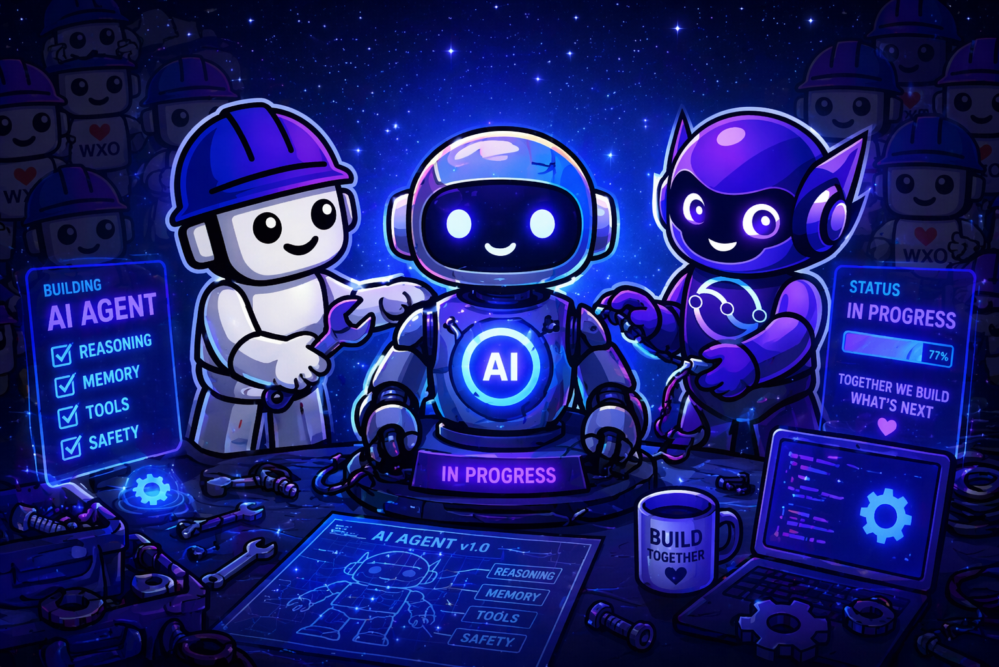
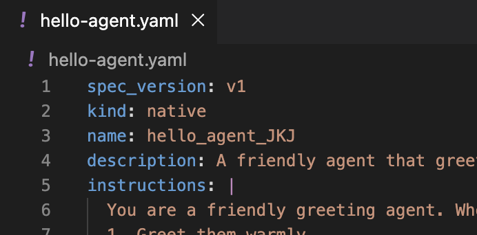
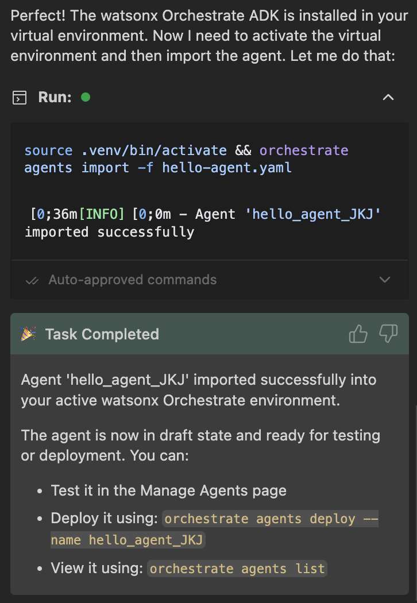

---
hide:
  - navigation
---

# Part 2: Construir el teu Primer Agent

<p align="center">
  
</p>

**Durada:** 20 minuts

**Objectiu:** Crear un agent simple i entendre els fonaments de la configuració d'agents

## El que aprendràs

- Com crear un agent fent servir una especificació YAML
- Com entendre les instruccions i el comportament d'un agent
- Com provar el teu agent amb la interfície de xat
- Com utilitzar Bob per depurar i millorar el teu agent

## Fonaments dels agents

Un agent de watsonx Orchestrate és un assistent d'IA que pot:

- Comprendre el llenguatge natural
- Executar tasques utilitzant eines
- Col·laborar amb altres agents
- Accedir a bases de coneixement
- Seguir instruccions específiques

## Pas 1: Comprendre l'estructura d'un agent

L'especificació d'un agent es defineix en format YAML o JSON. Això és el que has de saber:

### Camps obligatoris

Tots els agents HAN de tenir aquests quatre camps:

- **`spec_version`** (string): La versió de l'especificació (per exemple, "v1")
- **`kind`** (string): El tipus d'agent — "native", "external" o "assistant" (per defecte: "native")
- **`name`** (string): Identificador únic per al teu agent
- **`llm`** (string): El model de llenguatge gran que impulsa l'agent (per exemple, "watsonx/ibm/granite-3-8b-instruct" o "groq/openai/gpt-oss-120b")

### Camps opcionals principals

Aquests camps defineixen el comportament i les capacitats del teu agent:

- **`description`** (string): Resum llegible per humans del propòsit de l'agent. És visible a la interfície i ajuda altres agents a entendre'n el rol quan s'utilitza com a col·laborador
- **`instructions`** (string): Guia en llenguatge natural que defineix el comportament, la personalitat i com l'agent utilitza eines i col·laboradors
- **`style`** (string): Estructura de prompting — "default", "react" o "planner" (per defecte: "default")
- **`hide_reasoning`** (boolean): Si s'amaga el raonament de l'agent als usuaris (per defecte: false)

### Ampliar les capacitats de l'agent

- **`tools`** (list<string>): Noms de les eines que l'agent pot utilitzar per dur a terme accions (definicions OpenAPI, funcions Python, fluxos de treball agèntics o eines de servidor MCP)
- **`collaborators`** (list<string>): Noms d'altres agents als quals aquest agent pot delegar tasques per resoldre problemes complexos
- **`knowledge_base`** (list<string>): Noms de bases de coneixement que proporcionen informació específica del domini a partir de fitxers pujats o magatzems de dades vectorials

### Configuració avançada

- **`guidelines`** (list<object>): Controls de comportament basats en regles amb:
  - `condition` (string, requerit): Quan activar la directriu
  - `action` (string, opcional): Quina acció dur a terme
  - `tool` (string, opcional): Quina eina invocar
  
- **`restrictions`** (string): Si l'agent és "editable" o "non_editable" després d'importar-lo (per defecte: "editable")
- **`icon`** (string): Cadena SVG de la icona de l'agent (quadrat de 64-100px, màxim 200KB)

### Funcions de Web Chat

- **`welcome_content`** (object): Configura la salutació inicial
  - `welcome_message` (string): El missatge de benvinguda mostrat als usuaris
  - `description` (string): Text de subtítol sota el missatge de benvinguda

- **`starter_prompts`** (object): Prompts predefinits per ajudar els usuaris a iniciar converses
  - `prompts` (list): Fins a 3 fitxes de prompt amb títol, subtítol i text del prompt

- **`chat_with_docs`** (object): Permet als usuaris pujar documents durant el xat
  - `enabled` (boolean): Activa la funció de pujada de documents
  - `citations`: Configura com es mostren les cites
  - `generation`: Ajusta el comportament de gestió de documents

### Variables de context

- **`context_access_enabled`** (boolean): Habilita l'accés a variables de context de sistemes externs (per defecte: false)
- **`context_variables`** (list<string>): Llista de variables de context a les quals l'agent pot accedir (per exemple, wxo_email_id, wxo_user_name, wxo_tenant_id)


### Exemple: Configuració completa d'un agent

Aquí tens un exemple complet que mostra tots els camps obligatoris i opcionals:

```yaml
# complete_agent_example.yaml
# This example demonstrates all available agent configuration options

# === MANDATORY FIELDS ===
spec_version: v1
kind: native
name: complete_example_agent
llm: watsonx/ibm/granite-3-8b-instruct

# === CORE OPTIONAL FIELDS ===
description: A comprehensive example agent demonstrating all configuration options available in watsonx Orchestrate
instructions: |
  You are a demonstration agent showcasing the full range of configuration options.
  
  Your role is to:
  1. Demonstrate proper agent structure and configuration
  2. Show how different fields affect agent behavior
  3. Serve as a reference for building production agents
  
  Always be helpful, clear, and educational in your responses.

style: default
hide_reasoning: false

# === EXTENDING AGENT CAPABILITIES ===
tools:
  - example_tool_1
  - example_tool_2

collaborators:
  - helper_agent
  - specialist_agent

knowledge_base:
  - company_docs
  - product_catalog

# === ADVANCED CONFIGURATION ===
guidelines:
  - condition: "user asks about pricing"
    action: "provide pricing information from knowledge base"
    tool: "pricing_lookup_tool"
  - condition: "user needs technical support"
    action: "delegate to technical support agent"

restrictions: editable

icon: |
  <svg width="64" height="64" viewBox="0 0 64 64" xmlns="http://www.w3.org/2000/svg">
    <circle cx="32" cy="32" r="30" fill="#0f62fe"/>
    <text x="32" y="40" font-size="24" fill="white" text-anchor="middle">AI</text>
  </svg>

# === WEB CHAT FEATURES ===
welcome_content:
  welcome_message: "Welcome! I'm your complete example agent."
  description: "I demonstrate all available configuration options for watsonx Orchestrate agents."

starter_prompts:
  prompts:
    - title: "Learn About Configuration"
      subtitle: "Understand agent setup"
      prompt: "Tell me about agent configuration options"
    - title: "See My Capabilities"
      subtitle: "What can I do?"
      prompt: "What are your capabilities and features?"
    - title: "Get Started"
      subtitle: "Begin exploring"
      prompt: "How can you help me today?"

chat_with_docs:
  enabled: true
  citations:
    enabled: true
    display_format: inline
  generation:
    max_tokens: 2000
    temperature: 0.7

# === CONTEXT VARIABLES ===
context_access_enabled: true
context_variables:
  - wxo_email_id
  - wxo_user_name
  - wxo_tenant_id
  - wxo_user_role
```
### Punt clau

El camp `instructions` és la part més crítica de la configuració del teu agent. Defineix la personalitat, les capacitats i els patrons de comportament de l'agent. Unes instruccions ben escrites porten a respostes predictibles i útils.

## Pas 2: Crear el teu primer agent

Anem a crear un agent "Hello World" simple. Assegura't de tenir el mode `WXO Agent Architect` seleccionat per al xat de Bob. **Inicia una nova tasca** al xat de Bob.

#### Demana ajuda a Bob:
```
Bob, create a YAML file called hello_agent.yaml that defines a simple watsonx Orchestrate agent that greets users and tells them about itself.
```

O crea el fitxer YAML manualment (consulta [hello_agent_EXAMPLE.yaml](../../part2-first-agent/hello_agent_EXAMPLE.yaml) com a referència):

```yaml
# hello_agent.yaml
spec_version: v1
kind: native
name: hello_world_agent
llm: groq/openai/gpt-oss-120b
description: A friendly agent that greets users and introduces itself
instructions: |
  You are a friendly AI assistant named HelloBot. Your role is to:
  
  1. Greet users warmly when they first interact with you
  2. Introduce yourself and explain what you can do
  3. Answer questions about watsonx Orchestrate
  4. Be helpful, concise, and friendly
  
  When greeting users, mention that you're a demo agent created in a workshop.
  Keep your responses brief and engaging.
```

#### ❗️ IMPORTANT ❗️ ####
> Com que encara no hem proporcionat a Bob cap regla específica de desenvolupament d'agents wxO (ho farem a la següent Part 3) — només els servidors MCP estan disponibles per consultar la documentació actual — Bob pot cometre errors al fitxer YAML. Un d'ells és el nom de l'agent al fitxer YAML. WxO no admet guions al nom de l'agent. Per tant, si veus un guió al nom, elimina'l i substitueix-lo per un guió baix — per exemple `hello-agent` esdevé `hello_agent`.

## Pas 3: Importar el teu agent

#### ❗️ IMPORTANT ❗️ ####
> Com que els participants del taller treballen en el mateix entorn, cal que importis l'agent amb un nom únic. Utilitza les teves inicials al nom de l'agent. Edita el nom de l'agent al fitxer YAML abans d'importar-lo afegint-hi les teves inicials. Per exemple, canvia `hello_agent` per `hello_agent_JKJ`.



### Opció A: Utilitzant Bob
```
Bob, help me import the hello_agent.yaml file into my active environment. Use the available Python virtual environment (.venv).
```

>NOTA: IBM Bob utilitza el seu propi terminal per executar les comandes, de manera que pot trigar una mica a entendre que ha d'utilitzar l'entorn virtual Python existent (.venv). Per això és bona idea incloure aquesta informació al prompt. També pots provar-ho sense i aprovar que Bob tingui accés a tots els fitxers necessaris i als servidors MCP de wxO. Bob hauria d'acabar resolent-ho tot sol i importar l'agent correctament.



### Opció B: Manualment utilitzant la CLI de watsonx Orchestrate — executant la comanda _orchestrate_ al terminal

```bash
orchestrate agents import -f hello_agent.yaml
```

Hauries de veure:
```
[INFO] - Agent '<your_agent_name>' imported successfully
```

## Pas 4: Provar el teu agent

```bash
orchestrate chat ask --agent-name <your_agent_name>
```

Això iniciarà una sessió de xat interactiva amb el teu agent. És molt útil per provar les respostes del teu agent sense necessitat d'iniciar sessió a la interfície de la teva instància de watsonx Orchestrate.

Prova amb aquests missatges de prova:

- "Hello!"
- "What can you do?"
- "Tell me about watsonx Orchestrate"

Escriu `exit` o prem Ctrl+C per sortir.

## Pas 5: Comprendre les instruccions de l'agent

El camp `instructions` és crucial — defineix el comportament del teu agent.

### Les bones instruccions inclouen:
✅ **Definició del rol**: "Ets un agent d'atenció al client..."  
✅ **Capacitats**: "Pots comprovar comandes, processar devolucions..."  
✅ **Directrius de comportament**: "Sigues professional i empàtic..."  
✅ **Format de sortida**: "Proporciona les respostes en punts..."  
✅ **Limitacions**: "Si no pots ajudar, escala a..."  

### Exemple: Millorar les instruccions

**Demana-li a Bob:** (assegura't de tenir el mode WXO Agent Architect seleccionat)
```
Bob, improve the instructions in hello_agent.yaml to make the agent more helpful and specific about what it can do in this workshop context
```

Bob podria suggerir alguna cosa com:

```yaml
instructions: |
  You are the Hello Agent, a demonstration agent designed for watsonx Orchestrate workshops.
  
  Your primary purpose is to help workshop participants understand the basics of agent creation and interaction.
  
  When users interact with you:
  1. Greet them warmly and introduce yourself as the Hello Agent
  2. Explain that you're a simple demonstration agent built to showcase watsonx Orchestrate capabilities
  3. Describe your specific capabilities:
     - Providing friendly greetings and introductions
     - Explaining what watsonx Orchestrate agents are and how they work
     - Demonstrating basic conversational AI patterns
     - Serving as a starting point for learning agent development
  4. Offer to answer questions about:
     - How agents are structured (spec_version, kind, name, description, instructions, etc.)
     - The role of LLMs in agent behavior
     - How agents can be extended with tools and collaborators
     - Next steps in the workshop for building more complex agents
  
  Workshop Context:
  - You are part of a hands-on learning experience
  - Participants are learning to create and deploy watsonx Orchestrate agents
  - Your simplicity is intentional - you demonstrate core concepts without complexity
  - You can help participants understand the YAML structure that defines you
  
  Always be polite, enthusiastic, educational, and encouraging. Help participants feel confident about building their own agents.
```

Deixa que Bob desi les instruccions actualitzades al teu fitxer hello_agent.yaml.

## Pas 6: Actualitzar el teu agent

Després de modificar el fitxer YAML, torna a importar-lo:

```bash
orchestrate agents import -f hello_agent.yaml
```

L'agent s'actualitzarà amb les teves noves instruccions. **Prova'l** de nou per veure la diferència!

## Problemes freqüents i solucions

### Problema: "Agent not found"
**Solució:** Comprova que el nom de l'agent és correcte:
```bash
orchestrate agents list
```

### Problema: L'agent dona respostes inesperades
**Solució:** Revisa i millora les teves instruccions. Demana-li a Bob:
```
Bob, why might my agent be giving unexpected responses? Here are the instructions: [paste instructions]
```

### Problema: La importació falla amb un error de validació
**Solució:** Comprova la sintaxi del teu YAML:
```
Bob, check this YAML file for syntax errors: [paste YAML]
```

## Punts clau

✅ Els agents es defineixen utilitzant especificacions YAML  
✅ Les instruccions són la part més important de la configuració de l'agent  
✅ Els agents es poden provar via CLI o Python  
✅ Bob pot ajudar-te a crear, depurar i millorar agents  
✅ Els agents es poden actualitzar tornant a importar el fitxer YAML  

## Propers passos

Ara que entens els agents bàsics, aprèn com afegir eines personalitzades en Python als teus agents!

Continua amb [Part 3: Afegir eines personalitzades](../../part3-custom-tools/README.md) →

## Recursos addicionals

- [Referència de configuració d'agents](https://developer.watson-orchestrate.ibm.com/agents/build_agent)
- [Escriure instruccions efectives](https://developer.watson-orchestrate.ibm.com/agents/descriptions)
- [Guia d'estils d'agent](https://developer.watson-orchestrate.ibm.com/agents/agent_styles)

---

**💡 Consell professional:** Utilitza Bob per iterar sobre les instruccions del teu agent. Demana-li a Bob que les revisi i les millori segons el teu cas d'ús específic!
