---
hide:
  - navigation
---

# Part 1: Environment Setup

<p align="center">
  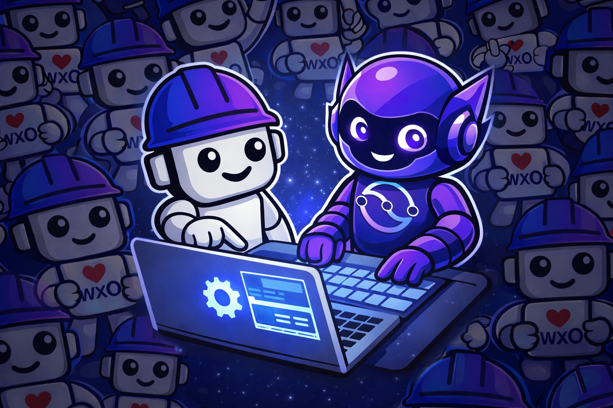
</p>

**Duration:** 15 minutes

**Goal:** Prepare your development environment to build watsonx Orchestrate agents

## Prerequisites check

Before you start, make sure you have:

- [ ] Python 3.11-3.13 installed
- [ ] uv installed
- [ ] IBM Bob IDE installed
- [ ] Access to watsonx Orchestrate (SaaS or Developer Edition)

### ⚠️ Warning ⚠️ ###

> **Make sure you meet all the prerequisites! For example, an incorrect Python version can cause many problems. Follow the steps in the right order to guarantee that the setup procedure works as designed.**

## Step 1: Verify the Python installation

### macOS / Linux

Open a terminal and run:
```bash
python3 --version
```

#### ❗️ IMPORTANT ❗️ ####
> If you see a version other than 3.11.x, 3.12.x or 3.13.x, you must install one of the supported versions (3.11.x - 3.13.x) on your computer.

### Windows 11

Open PowerShell or Windows Terminal and run:
```powershell
python --version
```
> **Note:** On Windows use `python` instead of `python3`. If typing `python` opens the Microsoft Store instead of showing a version, disable the stub from **Settings → Apps → Advanced app settings → App execution aliases** and turn off the Python entries.

#### ❗️ IMPORTANT ❗️ ####
> If you see a version other than 3.11.x, 3.12.x or 3.13.x, you must install one of the supported versions (3.11.x - 3.13.x) on your computer.

During installation, make sure to check:
- ✅ **Add Python to PATH**
- ✅ **Install pip**

---

Download the supported Python version: ([https://www.python.org/downloads/](https://www.python.org/downloads/))

## Step 2: Verify the uv installation

### macOS / Linux

Open a terminal and run:
```bash
uv --version
```

If it is not installed, install it using Homebrew:
```bash
brew install uv
```

### Windows 11

Open PowerShell and run:
```powershell
uv --version
```

If it is not installed, install it using PowerShell:
```powershell
powershell -ExecutionPolicy ByPass -c "irm https://astral.sh/uv/install.ps1 | iex"
```
Or using pip:
```powershell
pip install uv
```

---

#### ❗️ IMPORTANT ❗️ ####
> You should see a version number. The specific number does not matter, you only need to have uv installed.

Download uv: ([https://pypi.org/project/uv/](https://pypi.org/project/uv/))

## Step 3: Create a new folder for the workshop

> **⚠️ WARNING: Avoid spaces in the folder path.** The ADK extension will fail if any part of the path contains spaces (for example, `My Projects/bobchestrate-ws` will cause problems). Use hyphens or underscores instead — for example `bobchestrate-ws` or `bobchestrate_ws`. This also applies to all parent folders in the path.

Create a dedicated folder for your workshop project — you can place it wherever you like.

### macOS / Linux

```bash
mkdir bobchestrate-ws
cd bobchestrate-ws
```

### Windows 11

```powershell
mkdir bobchestrate-ws
cd bobchestrate-ws
```

> **Note:** The commands are the same, but paths on Windows use backslashes (for example, `C:\Users\YourName\bobchestrate-ws`). PowerShell accepts both forward and backward slashes.

This folder will hold all your workshop files, agents and tools.

## Step 4: Open IBM Bob IDE and sign in with your IBM ID

> **Download IBM Bob IDE:** If you haven't installed IBM Bob IDE yet, download it from [bob.ibm.com/download](https://bob.ibm.com/download) and install it on your computer. Make sure you use the **Bob IDE** version.


> **Detailed installation instructions:** For a complete installation guide, visit [bob.ibm.com/docs/ide/getting-started/install](https://bob.ibm.com/docs/ide/getting-started/install)

#### ❗️ IMPORTANT ❗️ ####
> You must sign in to use Bob's AI capabilities during the workshop. If you have any problem signing in, contact your instructor.

## Step 5: Open the folder in IBM Bob IDE

1. Once IBM Bob IDE is open:
2. Click **File** → **Open Folder**
   
      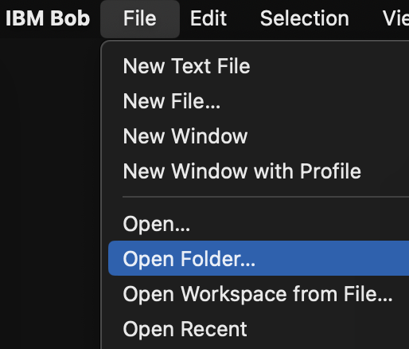

3. Navigate to the `bobchestrate-ws` folder and select it
4. Click **Open**
5. Click **Yes, I trust the author** to trust the workspace

      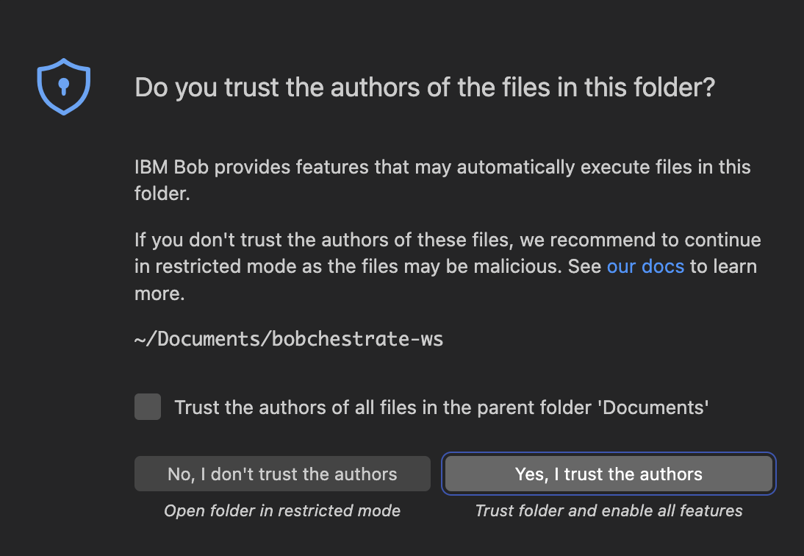

The empty workspace will open.

## Step 6: Create the Python virtual environment

#### ❗️ IMPORTANT ❗️ ####
> The Python virtual environment is essential for the workshop. Make sure you complete this step before proceeding to install the wxO VS Code extension and the wxO ADK itself.

### macOS / Linux

Create a virtual environment using IBM Bob IDE's built-in commands:

1. Open the Command Palette in IBM Bob IDE (press `Cmd+Shift+P`)
2. Start typing "Python: Create Environment" and select it
3. Choose "Venv" as the environment type
4. Select your Python interpreter (Python 3.11-3.13) and wait for the virtual environment to be created

   **IMPORTANT:** _Make sure you select the supported Python interpreter version (3.11-3.13). If you don't see the right version, you may need to install it first. If you have already installed it and it still doesn't appear, restart IBM Bob IDE._

You can now see the `.venv` folder in your workspace explorer.

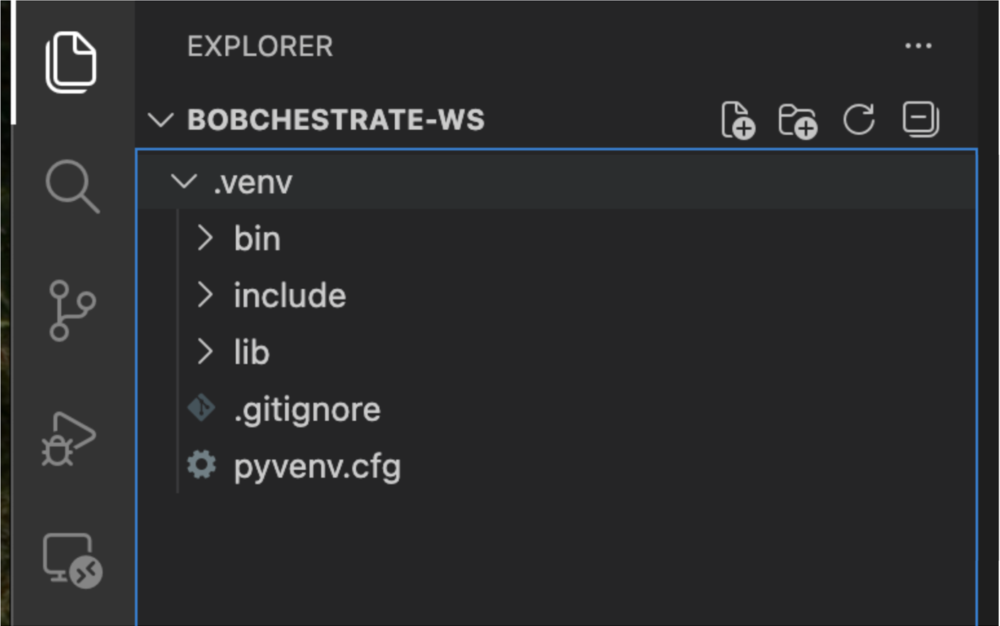

IBM Bob IDE will automatically perform the following steps:<br>
- Create a `.venv` folder in your workspace<br>
- Activate the virtual environment in new terminals<br>
- Show `(.venv)` in your terminal prompt

> **NOTE:** The virtual environment will be activated automatically when you open new terminals in IBM Bob IDE.

### Windows 11

You can create the virtual environment using IBM Bob IDE (recommended) or manually in PowerShell.

#### Option A: Using IBM Bob IDE (Recommended)

1. Open the Command Palette in IBM Bob IDE (press `Ctrl+Shift+P`)
2. Start typing "Python: Create Environment" and select it
3. Choose "Venv" as the environment type
4. Select your Python interpreter (Python 3.11-3.13) and wait for the virtual environment to be created

   **IMPORTANT:** _Make sure you select the supported Python interpreter version (3.11-3.13). If you don't see the right version, you may need to install it first. If you have already installed it and it still doesn't appear, restart IBM Bob IDE._

IBM Bob IDE will automatically create and activate `.venv` in new terminals.

#### Option B: Manual setup with PowerShell

If you prefer the terminal or have problems with the IDE:

```powershell
# Navigate to your project folder
cd C:\Users\YourName\bobchestrate-ws

# Create the virtual environment
python -m venv .venv
```

Activate it:
```powershell
# PowerShell
.venv\Scripts\Activate.ps1

# CMD (if you must)
.venv\Scripts\activate.bat
```

> **⚠️ PowerShell execution policy:** If you get a script execution error, run this once:
> ```powershell
> Set-ExecutionPolicy -ExecutionPolicy RemoteSigned -Scope CurrentUser
> ```

Verify the activation — your prompt will show `(.venv)` and:
```powershell
where python   # Should point to .venv\Scripts\python.exe
pip --version  # Should show pip inside .venv
```

> **NOTE:** Add `.venv` to your `.gitignore` — never commit the virtual environment folder to the repository.

#### Alternative tools worth knowing

| Tool | When to use it |
|---|---|
| venv (built-in) | Default option for most projects |
| conda / miniconda | Data science / scientific computing (also manages Python versions) |
| pyenv-win | You need to manage multiple Python versions on the same machine |
| uv | Faster modern alternative; drop-in replacement for pip+venv |
| pipenv | Combined dependency + venv management (heavier, less popular now) |
| poetry | Full dependency/packaging management for library authors |

## Step 7: Install the watsonx Orchestrate ADK VS Code extension

#### ❗️ IMPORTANT ❗️ ####
> **If you already have the extension installed**, reload the Bob IDE window! This ensures the extension correctly detects your new virtual environment. Open the Command Palette in IBM Bob IDE (press `Cmd+Shift+P` on Mac / `Ctrl+Shift+P` on Windows/Linux), start typing "**Developer: Reload Window**" and select it. The Bob IDE window will reload and the extension will restart. Then you can go straight to Step 8. Do **NOT** use the extension to initialize the workspace!

Install the watsonx Orchestrate extension for IBM Bob IDE:

1. Open the Extensions view in IBM Bob IDE (click the Extensions icon in the Activity Bar or press `Cmd+Shift+X` on Mac / `Ctrl+Shift+X` on Windows/Linux)
   
      

2. Search for "**watsonx Orchestrate**"

      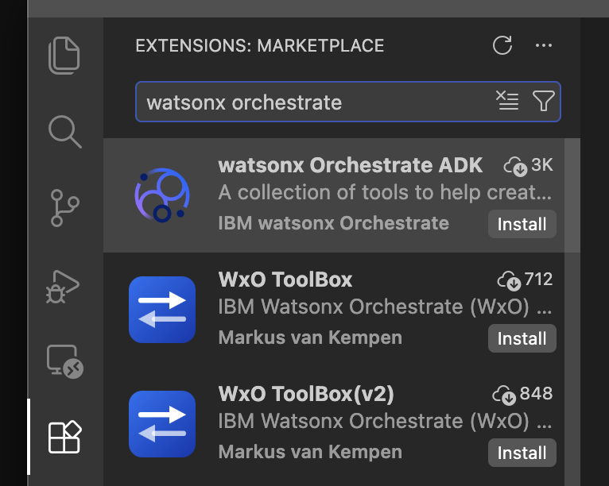

3. Click **Install** on the "_**watsonx Orchestrate ADK**_" extension
4. Wait for the installation to complete
5. Reload VS Code if prompted
6. You should now see the extension icon in the Activity Bar — you do **NOT** need to open it. If you do, do **NOT** initialize the workspace from there, as it may cause problems with the setup procedure we are following:
   
      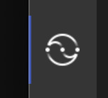

The IBM watsonx Orchestrate ADK VS Code extension provides:

- Workspace management: Automatically creates and initializes folder structures for agent development
- ADK version management: Installs and updates the watsonx Orchestrate ADK directly from VS Code
- Agent and tool file creation: Helps create agent and tool files
- Developer Edition server control: Starts/stops the watsonx Orchestrate Developer Edition server directly from the interface
- Orchestrate Builder AI assistant: Interactive AI assistant that guides you in building and refining agents through prompts

#### ❗️ IMPORTANT ❗️ ####
> Do **NOT** open the extension itself, you only need to have it installed. Using the extension to initialize the workspace can cause problems!

## Step 8: Install the watsonx Orchestrate ADK

### macOS / Linux

Now that you have the watsonx Orchestrate ADK extension installed, you will see the ADK information in the bottom Status Bar. Since we have just created a clean Python virtual environment in our workspace, you should see a red cross ❌ indicating that you need to install the ADK.

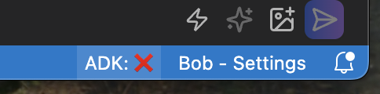

Click the red cross to install the ADK. This will open a couple of commands in the search/command bar. **Select the one that installs the ADK**.

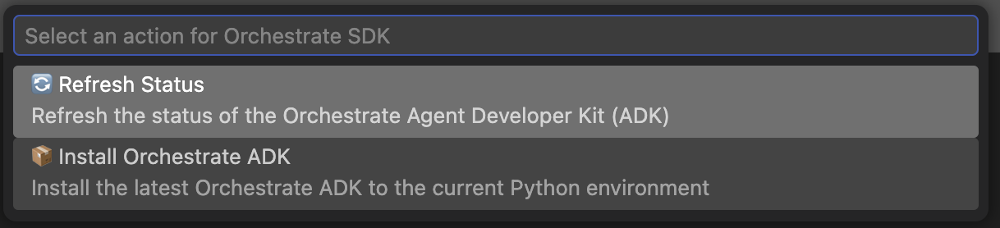

Wait for the installation to complete. After a moment, you should see a notification and a green check mark in the Status Bar with the latest ADK version number.

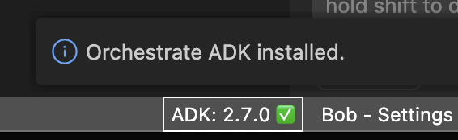

>**NOTE**: The version number you see in the Status Bar is the installed ADK version. It may differ from the one shown in the image above. New ADK versions are released regularly, so the version number will change over time.

### Windows 11

You can install the ADK using IBM Bob IDE (same as macOS above) or manually using PowerShell.

#### Option A: Using IBM Bob IDE (Recommended)

Follow the same steps as on macOS — click the red cross ❌ in the Status Bar and select the install option.

#### Option B: Manual installation using PowerShell

With your virtual environment activated, run:

```powershell
pip install --upgrade ibm-watsonx-orchestrate
```

Validate the installation:
```powershell
orchestrate --version
```

You should see the ADK version number printed in the terminal.

## Step 9: Install the watsonx Orchestrate MCP servers

Install the watsonx Orchestrate MCP servers through the ADK extension:

1. Open the Command Palette in IBM Bob IDE (press `Cmd+Shift+P` on Mac / `Ctrl+Shift+P` on Windows/Linux)
2. Start typing "**watsonx Orchestrate: Install WXO MCP Servers**" and select it
3. Wait for the installation to complete
4. You should see a confirmation message indicating that the MCP servers were installed successfully

**Verify the installation:**

To confirm that the MCP servers are installed and running:

1. Open the Bob chat panel in IBM Bob IDE
2. Ask Bob: "What MCP servers are available?"
3. You should see the following watsonx Orchestrate MCP servers in the list:
   - `watsonx-orchestrate-adk` - Provides tools to interact with watsonx Orchestrate (list agents, tools, etc.)
   - `watsonx-orchestrate-adk-docs` - Provides access to the watsonx Orchestrate documentation

Alternatively, you can check the MCP server configuration:
1. Open the Command Palette (`Cmd+Shift+P` / `Ctrl+Shift+P`)
2. Type "MCP Servers" and select it
3. Verify that the watsonx Orchestrate MCP servers appear in the configuration and that both are marked with a green dot

   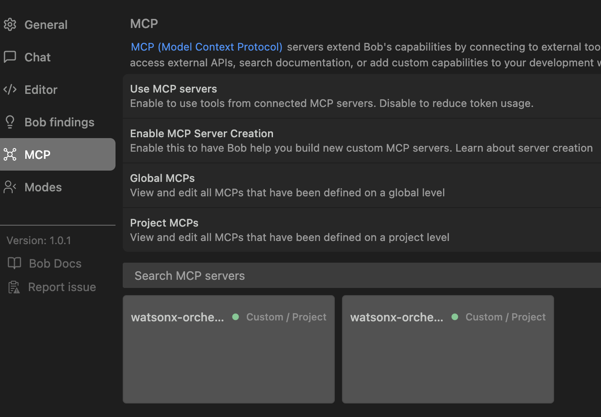

>**NOTE**: It may take a couple of seconds after installation for both MCP servers to appear in the list.

The MCP servers provide:

- Access to the watsonx Orchestrate documentation
- Integration with the watsonx Orchestrate ADK
- Tools to list agents, tools and other resources
- Enhanced Bob capabilities for watsonx Orchestrate development

## Step 10: Import the WXO Agent Architect mode

Import a preconfigured custom mode specialized in building watsonx Orchestrate agents.

>**NOTE**: IBM Bob Marketplace has many preconfigured modes for IBM Bob IDE, including a mode for building watsonx Orchestrate agents. Unfortunately, the marketplace is not currently available to people outside IBM, although it will be in the near future. This step will guide you on how to import a custom mode manually.

Download the mode configuration file:

1. The file is at: [wxo_agent_architect_export.yaml](../../part1-setup/files/wxo_agent_architect_export.yaml)
2. Click the **Download raw file** button

      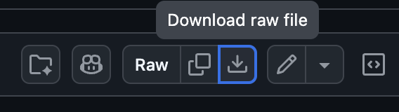

3. Save the file in your Downloads folder or in an easily accessible location
4. Open the Command Palette in IBM Bob IDE (press `Cmd+Shift+P` on Mac / `Ctrl+Shift+P` on Windows/Linux)
5. Type "**Modes**" and select it
6. Click the **Import** icon in the modes panel

      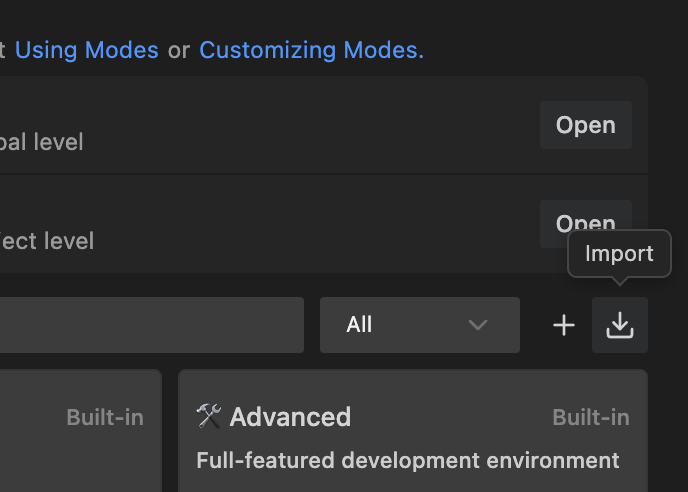

7. Select the `wxo_agent_architect_export.yaml` file you downloaded and click **Open**
8. You should see a confirmation message indicating that the mode was imported successfully and see it appear in the modes panel

The imported "WXO Agent Architect" mode includes:

- **Role definition**: Specialized in building watsonx Orchestrate agents
- **Custom instructions**: Guidance on using MCP servers for agent development
- **MCP server integration**: Automatically uses the `watsonx-orchestrate-adk` and `watsonx-orchestrate-adk-docs` servers
- **Tool groups**: Access to read, edit, browser, command and MCP tools

**Verify the mode:**

1. Open the Bob chat panel if it is not already open
2. Click the mode selector (it normally shows the current mode as "Code" or "Ask")
3. You should see "WXO Agent Architect" in the list of available modes
4. Select the "**WXO Agent Architect**" mode
5. Ask Bob: "What can you help me with in this mode?"
6. Bob should respond with information about building watsonx Orchestrate agents and mention the available MCP servers

## Step 11: Get your watsonx Orchestrate API key and API URL

For the workshop, we will use the watsonx Orchestrate ADK to interact with a watsonx Orchestrate SaaS instance. The ADK requires your API key and API URL to authenticate and connect to your watsonx Orchestrate instance.

> **_Note:_** `Your instructor will provide you with the API key and API URL for your watsonx Orchestrate instance.` If you are using your own instance, you can follow the instructions below to get the required API key and URL.

### OPTIONAL: Use your own watsonx Orchestrate SaaS instance

<ins>To generate an API key for the ADK:</ins>

1. In your watsonx Orchestrate console, click the **profile icon** in the top right corner
2. Select **Settings** from the dropdown menu
3. Navigate to the **API details** tab
4. Click the **Generate API key** button

      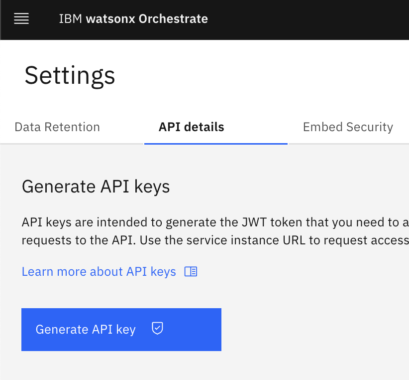

5. When the key is generated, click **Copy** to save it to your clipboard
6. **Important**: Copy the API key immediately and _save_ it securely
   - The key will only be shown once
   - If you lose it, you will need to create a new one

> **Security best practice**: Treat your API key like a password. Never commit it to a version control repository or share it publicly.

<ins>To get the API URL:</ins>

Copy the **Service instance URL** from the API details information. This is the base URL of your watsonx Orchestrate instance.

   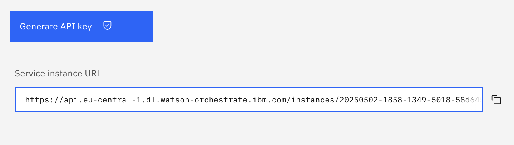

## Step 12: Configure the ADK environment

#### Option A: Using the ADK CLI — take a look at Option B before deciding which one to use 😉

1. Open a terminal window inside Bob IDE:

   - From Bob's main menu bar, select **Terminal** > **New Terminal**

      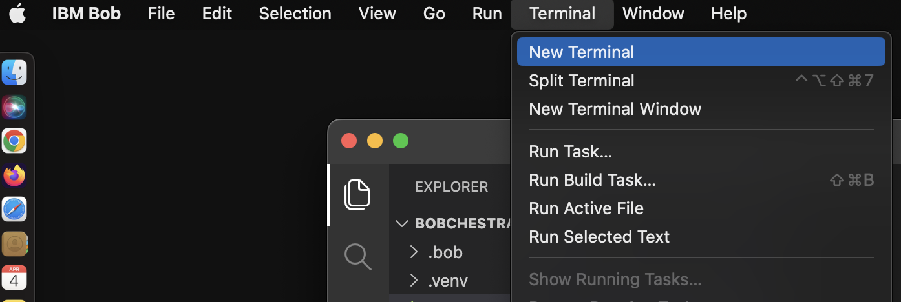
   
   - A terminal window will open in Bob IDE — notice that your Python virtual environment is activated automatically

      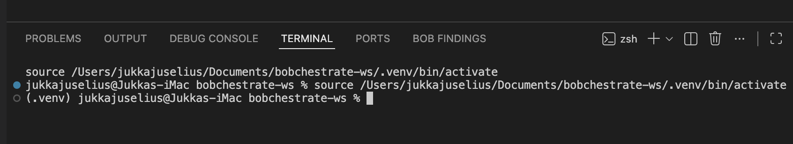

2. Run the following command in your terminal to **add** your environment:

   ```bash
   orchestrate env add -n <your-env-name> -u <your-api-url>
   ```
   Where `<your-env-name>` is the name you choose for your environment (for example, "my-wxo-cloud") and `<your-api-url>` is the URL you obtained in Step 11.
   
   After running the command, you should see the message: `[INFO] Environment '<your-env-name>' has been created`

3. Run the following command to **activate** the environment:

   ```bash
   orchestrate env activate <your-env-name> -a <your-api-key>
   ```
   Where `<your-env-name>` is the name you chose for your environment (for example, "my-wxo-cloud") and `<your-api-key>` is the API key you obtained in Step 11.
   
   After running the command, you should see the message: `[INFO] Environment '<your-env-name>' is now active`. This means your environment is active and ready to use with the ADK. You can ignore the warning about the Auth Type.

#### ❗️ IMPORTANT ❗️ ####
> Authentication against a remote environment expires every two hours. After it expires, you must run orchestrate env activate again. Therefore, keep your API key available and ready to use.

#### Option B: Using Bob to help you 😃

Now that you have the watsonx Orchestrate MCP servers and the WXO Agent Architect mode enabled, you can use Bob to help you with the setup.

1. Make sure you have the **WXO Agent Architect** mode selected in your Bob chat. Then ask Bob to create a script to add and activate a new watsonx Orchestrate environment for the ADK:

      ```
      Create a simple shell script to add and activate new watsonx Orchestrate SaaS environment for the ADK. I have the environment URL and API key ready.
      ```

      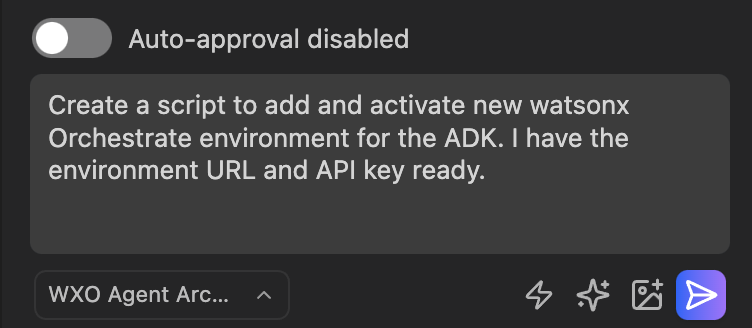

2. When Bob starts working, it will ask for permission to access the watsonx-orchestrate-adk-docs MCP server. Click the **Approve** button to allow Bob to access the documentation.

      >**NOTE**: You can also check the **Always allow** box to always allow Bob to access the MCP server. Another option is to enable **auto-approve**. If you do, you can specify the different options you want to allow.

      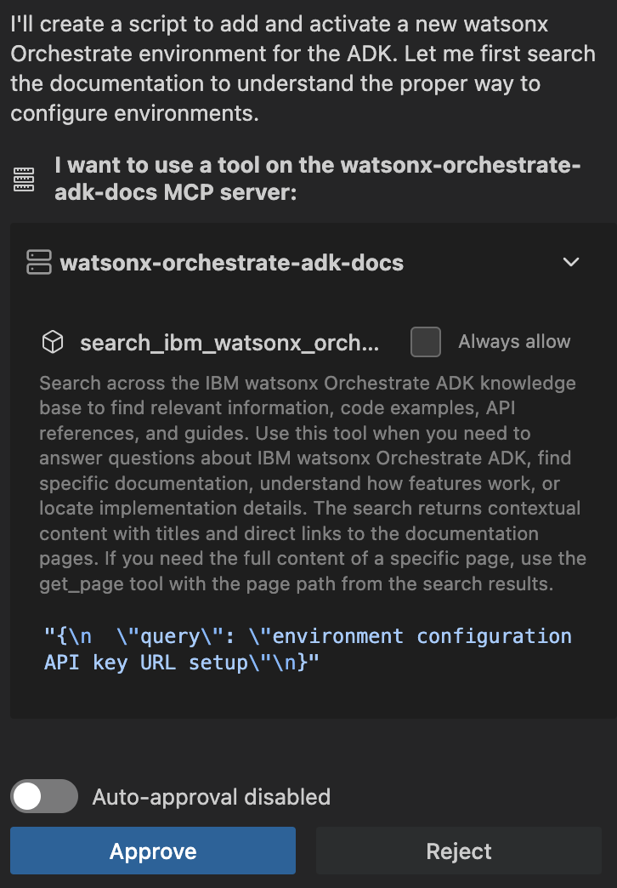

      >**NOTE**: Bob may ask you to approve access to the MCP server several times. This happens because Bob tries to access the MCP server to get more detailed information after learning about the environment configuration. It is recommended to enable **auto-approve** for MCP servers so you avoid granting permission manually each time.

3. After Bob has created the script (for example, _add_wxo_env.sh_; the name might be different in your case), it will ask for permission to save it. Click the **Save** button to save the script.

4. Next, Bob will create (or not, depends on the day 😅) a documentation — an MD file — for the script. Click the **Save** button to save the documentation.

5. After Bob has saved the documentation, it will ask for permission to make the script executable. Click **Run** to execute the command.

6. Finally, Bob will summarize the task for you

    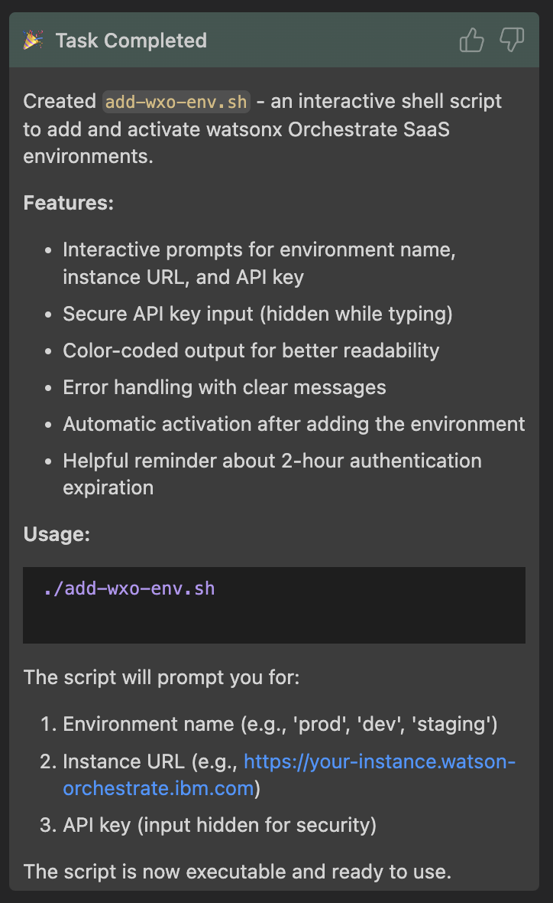

7. Open a terminal window inside Bob IDE

   - From Bob's main menu bar, select **Terminal** > **New Terminal**

      
   
   - A terminal window will open in Bob IDE — notice that your Python environment is activated automatically

      

8. Run the script you created in your terminal to **add** your environment

      `./<name_of_your_created_script>, e.g. ./add_wxo_env.sh`

9. When prompted, provide a name for your environment, for example `my-wxo-cloud`

      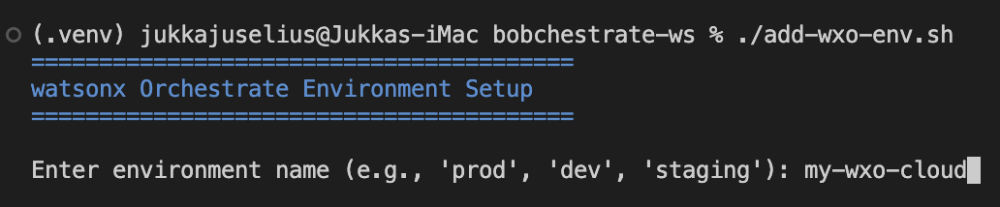

10. When prompted, provide the URL of your Orchestrate instance that you obtained earlier

      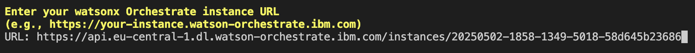

11. When prompted, provide the API key of your Orchestrate instance that you obtained earlier. The script will create a new environment and activate it.

      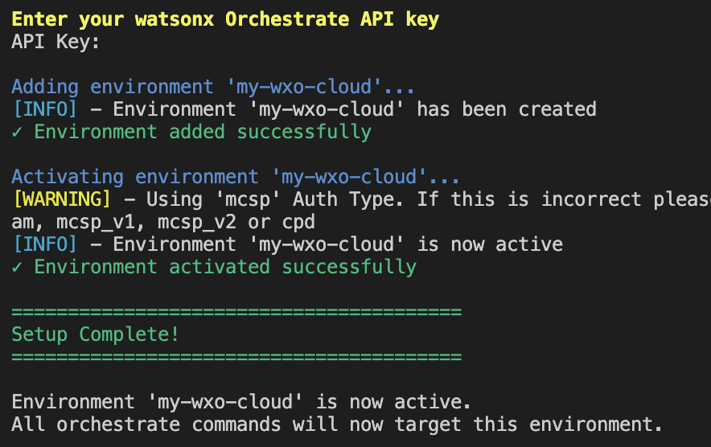

12. Verify that your connection works. Run the following command in your Bob IDE terminal

      ```bash
      orchestrate agents list
      ```

      If it is configured correctly, this command will list the agents in your environment (or show an empty list if you haven't created any agents yet).

#### ❗️ IMPORTANT ❗️ ####
> Authentication against a remote environment expires every two hours. After it expires, you must run orchestrate env activate again. Therefore, keep your API key available and ready to use.

## Using Bob during the workshop

Bob is your AI assistant programmer for this workshop. Here is how to use Bob effectively:

### Good prompts for Bob:
✅ "Bob, create a Python tool that checks order status given an order ID"  
✅ "Bob, why is my agent not responding to user messages?"  
✅ "Bob, explain what agent instructions do in watsonx Orchestrate"  
✅ "Bob, refactor this tool to handle errors better"  

### Less effective prompts:
❌ "Bob, fix this" (too vague)  
❌ "Bob, make it work" (no context)  
❌ "Bob, do everything for me" (you won't learn!)  

### Bob's superpowers:
- 🔍 **Search documentation**: Bob can search the watsonx Orchestrate documentation
- 💻 **Write code**: Bob can create Python tools and agent specifications
- 🐛 **Debug**: Bob can analyze errors and suggest solutions
- 📚 **Explain**: Bob can explain concepts and best practices
- 🔧 **Refactor**: Bob can improve your code

### Managing Bob chat sessions:
- ✅ **Continue in the same session**: When you work on related tasks or the same topic/artifacts, continue in the same Bob chat session to keep the context
- 🆕 **Start a new task**: When you switch to a completely different topic or unrelated work, start a new task with Bob to get a clean context
  - Click the "Start New Task" button in the Bob chat panel to start a new task
  - This helps Bob focus on the new topic without confusion from the previous context
- 💡 **Best practice**: Think of each Bob session as a focused work session — keep related work together, separate unrelated work

## Troubleshooting

### Problem: "orchestrate: command not found"

#### macOS / Linux
Make sure your virtual environment is activated — `(.venv)` should appear in your prompt. Then reinstall:
```bash
pip install --upgrade ibm-watsonx-orchestrate
```
If the `orchestrate` command is still not found after reinstalling, your venv may not be activated. Open a new terminal in IBM Bob IDE (which automatically activates `.venv`) and try again.

#### Windows 11
Make sure your virtual environment is activated — `(.venv)` should appear in your prompt. Then reinstall:
```powershell
pip install --upgrade ibm-watsonx-orchestrate
```
If the `orchestrate` command is still not found, add the Scripts folder to your PATH:
```powershell
# Find the Scripts path
where.exe orchestrate

# If not found, manually add the venv Scripts folder to PATH
$env:PATH += ";C:\Users\YourName\bobchestrate-ws\.venv\Scripts"
```

### Problem: "Authentication failed"
**Solution:** Check your environment configuration:
```bash
# List environments
orchestrate env list

# Add/update environment
orchestrate env add

# Activate environment
orchestrate env activate <name>
```

### Problem: Bob does not respond
**Solution:**

1. Restart Bob IDE
2. Check Bob's output panel for errors

### Problem: The option to install the ADK does not appear in the Status Bar
**Solution:** Click the item that appears in the Status Bar and select **Initialize Workspace** from the command list. Then follow [Step 8](#step-8-install-the-watsonx-orchestrate-adk) again to install the ADK.

### Problem: The `watsonx-orchestrate-adk-docs` MCP server shows as "Disconnected"
**Solution:** Open the `.bob/mcp.json` file and add these two lines at the beginning of the `args` array of the `watsonx-orchestrate-adk-docs` server:

```json
"--with",
"mcp<2.0.0",
```

The result should look like this:

```json
"watsonx-orchestrate-adk-docs": {
  "command": "uvx",
  "args": [
    "--with",
    "mcp<2.0.0",
    "--from",
    "mcp-proxy==0.8.1",
    "mcp-proxy",
    "--transport",
    "streamablehttp",
    "https://developer.watson-orchestrate.ibm.com/mcp"
  ],
  ...
}
```

Save the file and reconnect the server from Bob's MCP panel (or restart Bob IDE).

## Quick reference

### Useful commands
```bash
# Add environment
orchestrate env add

# List environments
orchestrate env list

# Activate environment
orchestrate env activate <name>

# List agents
orchestrate agents list

# List tools
orchestrate tools list

# Get help
orchestrate --help

# Check version
orchestrate --version
```
**Remember that you can always ask Bob for help!**

## Next steps

Once your setup is verified:

1. ✅ You can connect to watsonx Orchestrate
2. ✅ Bob answers your questions
3. ✅ Your workspace is ready for development

**You are ready to build your first agent!**

Continue with [Part 2: Build your first agent](../../part2-first-agent/README.md) →

## Additional resources

- [Installation guide](https://developer.watson-orchestrate.ibm.com/getting_started/installing)
- [Environment configuration](https://developer.watson-orchestrate.ibm.com/environment/initiate_environment)
- [Developer Edition setup](https://developer.watson-orchestrate.ibm.com/developer_edition/wxOde_setup)

---

**💡 Pro tip:** Keep the Bob chat panel open throughout the whole workshop. When you get stuck, just ask Bob for help!

---

## 🙏 Acknowledgments

Special thanks to **Ryan Sparks** and **Mike McMahon** for their Windows-specific contributions to this setup guide.
