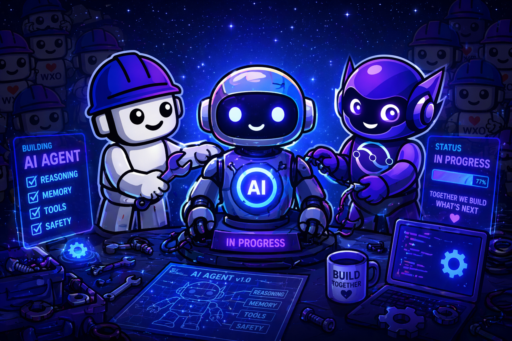
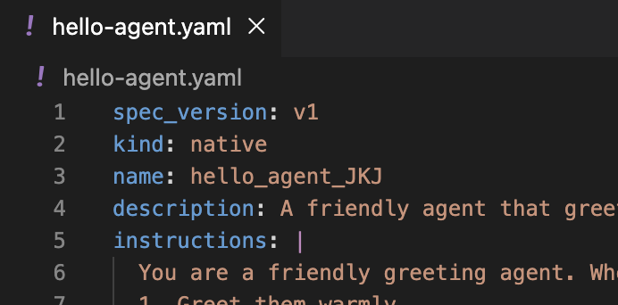
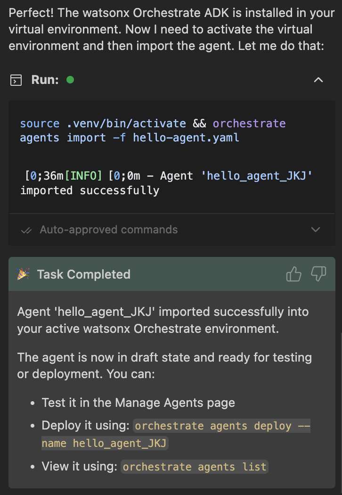

---
hide:
  - navigation
---

# Part 2: Build Your First Agent

<p align="center">
  
</p>

**Duration:** 30 minutes

**Goal:** Create a simple agent and understand the fundamentals of agent configuration

## What you'll learn

- How to create an agent using a YAML specification
- How to understand an agent's instructions and behavior
- How to test your agent with the chat interface
- How to use Bob to debug and improve your agent

## Agent fundamentals

A watsonx Orchestrate agent is an AI assistant that can:

- Understand natural language
- Run tasks using tools
- Collaborate with other agents
- Access knowledge bases
- Follow specific instructions

## Step 1: Understand the structure of an agent

An agent's specification is defined in YAML or JSON format. Here is what you need to know:

### Mandatory fields

All agents MUST have these four fields:

- **`spec_version`** (string): The specification version (for example, "v1")
- **`kind`** (string): The type of agent — "native", "external" or "assistant" (default: "native")
- **`name`** (string): Unique identifier for your agent
- **`llm`** (string): The large language model that powers the agent (for example, "watsonx/ibm/granite-3-8b-instruct" or "groq/openai/gpt-oss-120b")

### Main optional fields

These fields define your agent's behavior and capabilities:

- **`description`** (string): Human-readable summary of the agent's purpose. It is visible in the interface and helps other agents understand its role when it is used as a collaborator
- **`instructions`** (string): Natural-language guidance that defines the behavior, the personality and how the agent uses tools and collaborators
- **`style`** (string): Prompting structure — "default", "react" or "planner" (default: "default")
- **`hide_reasoning`** (boolean): Whether the agent's reasoning is hidden from users (default: false)

### Extending the agent's capabilities

- **`tools`** (list<string>): Names of the tools the agent can use to perform actions (OpenAPI definitions, Python functions, agentic workflows or MCP server tools)
- **`collaborators`** (list<string>): Names of other agents to which this agent can delegate tasks to solve complex problems
- **`knowledge_base`** (list<string>): Names of knowledge bases that provide domain-specific information from uploaded files or vector data stores

### Advanced configuration

- **`guidelines`** (list<object>): Rule-based behavior controls with:
  - `condition` (string, required): When to trigger the guideline
  - `action` (string, optional): Which action to perform
  - `tool` (string, optional): Which tool to invoke
  
- **`restrictions`** (string): Whether the agent is "editable" or "non_editable" after being imported (default: "editable")
- **`icon`** (string): SVG string for the agent's icon (64-100px square, maximum 200KB)

### Web Chat features

- **`welcome_content`** (object): Configures the initial greeting
  - `welcome_message` (string): The welcome message shown to users
  - `description` (string): Subtitle text below the welcome message

- **`starter_prompts`** (object): Predefined prompts to help users start conversations
  - `prompts` (list): Up to 3 prompt cards with title, subtitle and prompt text

- **`chat_with_docs`** (object): Lets users upload documents during the chat
  - `enabled` (boolean): Enables the document upload feature
  - `citations`: Configures how citations are displayed
  - `generation`: Adjusts how documents are handled

### Context variables

- **`context_access_enabled`** (boolean): Enables access to context variables from external systems (default: false)
- **`context_variables`** (list<string>): List of context variables the agent can access (for example, wxo_email_id, wxo_user_name, wxo_tenant_id)


### Example: Complete agent configuration

Here is a complete example showing all the mandatory and optional fields:

```yaml
# complete_agent_example.yaml
# This example demonstrates all available agent configuration options

# === MANDATORY FIELDS ===
spec_version: v1
kind: native
name: complete_example_agent
llm: watsonx/ibm/granite-3-8b-instruct

# === CORE OPTIONAL FIELDS ===
description: A comprehensive example agent demonstrating all configuration options available in watsonx Orchestrate
instructions: |
  You are a demonstration agent showcasing the full range of configuration options.
  
  Your role is to:
  1. Demonstrate proper agent structure and configuration
  2. Show how different fields affect agent behavior
  3. Serve as a reference for building production agents
  
  Always be helpful, clear, and educational in your responses.

style: default
hide_reasoning: false

# === EXTENDING AGENT CAPABILITIES ===
tools:
  - example_tool_1
  - example_tool_2

collaborators:
  - helper_agent
  - specialist_agent

knowledge_base:
  - company_docs
  - product_catalog

# === ADVANCED CONFIGURATION ===
guidelines:
  - condition: "user asks about pricing"
    action: "provide pricing information from knowledge base"
    tool: "pricing_lookup_tool"
  - condition: "user needs technical support"
    action: "delegate to technical support agent"

restrictions: editable

icon: |
  <svg width="64" height="64" viewBox="0 0 64 64" xmlns="http://www.w3.org/2000/svg">
    <circle cx="32" cy="32" r="30" fill="#0f62fe"/>
    <text x="32" y="40" font-size="24" fill="white" text-anchor="middle">AI</text>
  </svg>

# === WEB CHAT FEATURES ===
welcome_content:
  welcome_message: "Welcome! I'm your complete example agent."
  description: "I demonstrate all available configuration options for watsonx Orchestrate agents."

starter_prompts:
  prompts:
    - title: "Learn About Configuration"
      subtitle: "Understand agent setup"
      prompt: "Tell me about agent configuration options"
    - title: "See My Capabilities"
      subtitle: "What can I do?"
      prompt: "What are your capabilities and features?"
    - title: "Get Started"
      subtitle: "Begin exploring"
      prompt: "How can you help me today?"

chat_with_docs:
  enabled: true
  citations:
    enabled: true
    display_format: inline
  generation:
    max_tokens: 2000
    temperature: 0.7

# === CONTEXT VARIABLES ===
context_access_enabled: true
context_variables:
  - wxo_email_id
  - wxo_user_name
  - wxo_tenant_id
  - wxo_user_role
```
### Key takeaway

The `instructions` field is the most critical part of your agent's configuration. It defines the agent's personality, capabilities and behavior patterns. Well-written instructions lead to predictable and useful responses.

## Step 2: Create your first agent

Let's create a simple "Hello World" agent. Make sure you have the `WXO Agent Architect` mode selected for the Bob chat. **Start a new task** in the Bob chat.

#### Ask Bob for help:
```
Bob, create a YAML file called hello_agent.yaml that defines a simple watsonx Orchestrate agent that greets users and tells them about itself.
```

Or create the YAML file manually (see [hello_agent_EXAMPLE.yaml](../../part2-first-agent/hello_agent_EXAMPLE.yaml) for reference):

```yaml
# hello_agent.yaml
spec_version: v1
kind: native
name: hello_world_agent
llm: groq/openai/gpt-oss-120b
description: A friendly agent that greets users and introduces itself
instructions: |
  You are a friendly AI assistant named HelloBot. Your role is to:
  
  1. Greet users warmly when they first interact with you
  2. Introduce yourself and explain what you can do
  3. Answer questions about watsonx Orchestrate
  4. Be helpful, concise, and friendly
  
  When greeting users, mention that you're a demo agent created in a workshop.
  Keep your responses brief and engaging.
```

#### ❗️ IMPORTANT ❗️ ####
> Since we haven't yet given Bob any specific wxO agent development rules (we'll do that in the next Part 3) — only the MCP servers are abailable to query the current documentation — Bob may make mistakes in the YAML file. One of them is the agent name in the YAML file. WxO does not support hyphens in the agent name. So, if you see a hyphen in the name, remove it and replace it with an underscore — for example `hello-agent` becomes `hello_agent`.

## Step 3: Import your agent

#### ❗️ IMPORTANT ❗️ ####
> Since the workshop participants work in the same environment, you need to import the agent with a unique name. Use your initials in the agent name. Edit the agent name in the YAML file before importing it by adding your initials to the name. For example, change `hello_agent` to `hello_agent_JKJ`.



### Option A: Using Bob
```
Bob, help me import the hello_agent.yaml file into my active environment. Use the available Python virtual environment (.venv).
```

>NOTE: IBM Bob uses its own terminal to run commands, so it may take a little while to understand that it needs to use the existing Python virtual environment (.venv). That's why it's a good idea to include that information in the prompt. You can also try it without it and approve Bob's access to all the necessary files and to the wxO MCP servers. Bob should eventually work it out on its own and import the agent correctly.



### Option B: Manually using the watsonx Orchestrate CLI — running the _orchestrate_ command in the terminal

```bash
orchestrate agents import -f hello_agent.yaml
```

You should see:
```
[INFO] - Agent '<your_agent_name>' imported successfully
```

## Step 4: Test your agent

```bash
orchestrate chat ask --agent-name <your_agent_name>
```

This will start an interactive chat session with your agent. It is very useful for testing your agent's responses without having to log in to the interface of your watsonx Orchestrate instance.

Try these test messages:

- "Hello!"
- "What can you do?"
- "Tell me about watsonx Orchestrate"

Type `exit` or press Ctrl+C to quit.

## Step 5: Understand the agent's instructions

The `instructions` field is crucial — it defines your agent's behavior.

### Good instructions include:
✅ **Role definition**: "You are a customer service agent..."  
✅ **Capabilities**: "You can check orders, process returns..."  
✅ **Behavior guidelines**: "Be professional and empathetic..."  
✅ **Output format**: "Provide the answers in bullet points..."  
✅ **Limitations**: "If you can't help, escalate to..."  

### Example: Improve the instructions

**Ask Bob:** (make sure you have the WXO Agent Architect mode selected)
```
Bob, improve the instructions in hello_agent.yaml to make the agent more helpful and specific about what it can do in this workshop context
```

Bob might suggest something like:

```yaml
instructions: |
  You are the Hello Agent, a demonstration agent designed for watsonx Orchestrate workshops.
  
  Your primary purpose is to help workshop participants understand the basics of agent creation and interaction.
  
  When users interact with you:
  1. Greet them warmly and introduce yourself as the Hello Agent
  2. Explain that you're a simple demonstration agent built to showcase watsonx Orchestrate capabilities
  3. Describe your specific capabilities:
     - Providing friendly greetings and introductions
     - Explaining what watsonx Orchestrate agents are and how they work
     - Demonstrating basic conversational AI patterns
     - Serving as a starting point for learning agent development
  4. Offer to answer questions about:
     - How agents are structured (spec_version, kind, name, description, instructions, etc.)
     - The role of LLMs in agent behavior
     - How agents can be extended with tools and collaborators
     - Next steps in the workshop for building more complex agents
  
  Workshop Context:
  - You are part of a hands-on learning experience
  - Participants are learning to create and deploy watsonx Orchestrate agents
  - Your simplicity is intentional - you demonstrate core concepts without complexity
  - You can help participants understand the YAML structure that defines you
  
  Always be polite, enthusiastic, educational, and encouraging. Help participants feel confident about building their own agents.
```

Let Bob save the updated instructions in your hello_agent.yaml file.

## Step 6: Update your agent

After modifying the YAML file, import it again:

```bash
orchestrate agents import -f hello_agent.yaml
```

The agent will be updated with your new instructions. **Test it** again to see the difference!

## Common problems and solutions

### Problem: "Agent not found"
**Solution:** Check that the agent name is correct:
```bash
orchestrate agents list
```

### Problem: The agent gives unexpected responses
**Solution:** Review and improve your instructions. Ask Bob:
```
Bob, why might my agent be giving unexpected responses? Here are the instructions: [paste instructions]
```

### Problem: The import fails with a validation error
**Solution:** Check the syntax of your YAML:
```
Bob, check this YAML file for syntax errors: [paste YAML]
```

## Key takeaways

✅ Agents are defined using YAML specifications  
✅ Instructions are the most important part of the agent's configuration  
✅ Agents can be tested via CLI or Python  
✅ Bob can help you create, debug and improve agents  
✅ Agents can be updated by re-importing the YAML file  

## Next steps

Now that you understand the basic agents, learn how to add custom Python tools to your agents!

Continue with [Part 3: Add custom tools](../../part3-custom-tools/README.md) →

## Additional resources

- [Agent configuration reference](https://developer.watson-orchestrate.ibm.com/agents/build_agent)
- [Writing effective instructions](https://developer.watson-orchestrate.ibm.com/agents/descriptions)
- [Agent styles guide](https://developer.watson-orchestrate.ibm.com/agents/agent_styles)

---

**💡 Pro tip:** Use Bob to iterate on your agent's instructions. Ask Bob to review and improve them for your specific use case!
