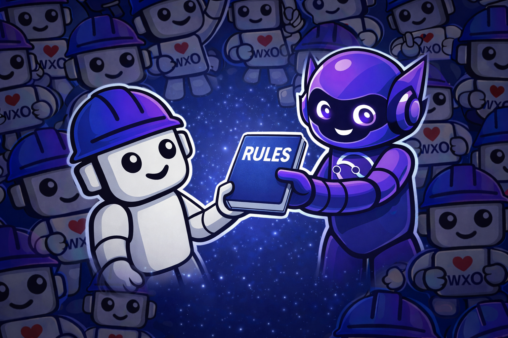

---
hide:
  - navigation
---

# Parte 3: Usar Reglas Personalizadas con Bob IDE

<p align="center">
  
</p>

**Duración:** 10 minutos  

**Objetivo:** Aprender a configurar Bob IDE con reglas de desarrollo personalizadas para proyectos de watsonx Orchestrate

## Lo que aprenderás

- Cómo crear reglas personalizadas para Bob IDE
- Cómo configurar Bob para seguir convenciones específicas del proyecto
- Cómo aprovechar las reglas personalizadas para prácticas de desarrollo consistentes
- Cómo usar la regla de desarrollo de watsonx Orchestrate

## Por qué importan las reglas personalizadas

Bob IDE puede configurarse con reglas personalizadas que guíen su comportamiento cuando trabaja en tus proyectos. Estas reglas ayudan a Bob a:

- Seguir convenciones y patrones específicos del proyecto
- Usar la estructura de carpetas correcta para los distintos tipos de artefactos
- Aplicar buenas prácticas automáticamente
- Aprovechar las herramientas y servidores MCP adecuados para tu stack tecnológico

## Comprender las reglas personalizadas de Bob

Bob IDE admite reglas personalizadas a través de ficheros `.md` que definen directrices específicas del proyecto. Estas reglas se aplican automáticamente cuando Bob trabaja en el directorio de tu proyecto.

Para más información, consulta la [documentación oficial de Bob sobre reglas personalizadas](https://bob.ibm.com/docs/ide/configuration/rules).

### Ubicación del fichero de reglas

Las reglas personalizadas deben colocarse en el directorio `.bob/` de tu proyecto:
```
your-project/
├── .bob/
│   └── rules/
│       └── your-rule.md
├── agents/
├── tools/
└── ...
```

## Paso 1: Comprender la regla de desarrollo de watsonx Orchestrate

Examinemos la regla de desarrollo de watsonx Orchestrate que ayuda a Bob a trabajar eficazmente con proyectos ADK.

### Estructura de una regla

Una buena regla personalizada incluye:

1. **Contexto**: Cuándo aplica la regla
2. **Estructura del proyecto**: Convenciones de carpetas y organización
3. **Patrones clave**: Patrones de código y decoradores a usar
4. **Integración de herramientas**: Qué herramientas y servidores aprovechar

### Ejemplo: Regla de desarrollo de watsonx Orchestrate

Aquí tienes un ejemplo simple de una regla de desarrollo para proyectos de watsonx Orchestrate:

```markdown
## watsonx Orchestrate Development Rule

When working with IBM watsonx Orchestrate or watsonx Orchestrate ADK projects:

1. **Project Structure and folders**: Follow ADK conventions when creating and saving artefacts:
   - tools/ for flows and Python tools
   - agents/ for YAML configurations
   - knowledge_bases/ for knowledge bases
   - models/ for LLM configurations
   - toolkits/ for MCP toolkits
   - import-all.sh for deployment
   - README.md with architecture + workflow diagrams

2. **Key Patterns**:
   - Use @flow decorator for flows
   - Use @tool decorator for Python tools
   - Include inline KVP schemas for document processing
   - Create native agents for document handling
   - Preferably use Command Line Interface to import the agents and tools

3. **MCP Server Integration**:
   - Use `watsonx-orchestrate-adk-docs` MCP server to search IBM watson Orchestrate ADK documentation
   - Leverage MCP tools for finding API references, code examples, and implementation guides
   - Query the knowledge base when uncertain about ADK features or best practices
```

## Paso 2: Configurar las reglas personalizadas en tu entorno

### Descargar el fichero de reglas mejorado

1. **Crea la estructura de directorios para las reglas:**
   ```bash
   mkdir -p .bob/rules
   ```

2. **Descarga el fichero de reglas mejorado:**
   
      Descarga el fichero más completo <a href="https://github.com/juseljuk/bobchestrate-workshop/blob/main/part3-bob-custom-rules/wxo-dev-rule-enhanced.md" target="_blank">wxo-dev-rule-enhanced.md</a> del repositorio del taller.

      Haz clic en el enlace de arriba para ver el fichero, luego haz clic en el botón "Download raw file" en GitHub para descargarlo y guardarlo en tu máquina local.

3. **Coloca el fichero en tu directorio de reglas:**
   ```bash
   # Move the downloaded file to your .bob/rules directory
   mv ~/Downloads/wxo-dev-rule-enhanced.md .bob/rules/
   ```

### ¿Qué contiene el fichero de reglas mejorado?

El fichero de reglas mejorado incluye guía exhaustiva sobre:

- **Estructura del proyecto** - Organización completa de directorios
- **Patrones de desarrollo** - Manejo de errores, registro, conexiones
- **Pruebas y QA** - Estrategias de evaluación y métricas
- **Seguridad y salvaguardas** - Plugins pre/post-invocación, gestión de credenciales
- **Despliegue y canales** - Patrones de despliegue multicanal
- **Integración MCP** - Patrones de servidores MCP locales y remotos
- **Estándares de documentación** - Plantillas README, documentación YAML
- **Resolución de problemas** - Errores comunes y estrategias de depuración
- **Optimización de rendimiento** - Uso de tokens, caché, selección de modelos
- **Referencia rápida** - Todos los comandos CLI con la sintaxis correcta

## Paso 3: Verificar que Bob reconoce tus reglas

Pídele a Bob que confirme que está usando tus reglas personalizadas:

```
Bob, what custom rules are you following for this watsonx Orchestrate project?
```

Bob debería reconocer la regla de desarrollo de watsonx Orchestrate y explicar cómo aplicará las convenciones.


## Paso 4: Probar las reglas personalizadas

Vamos a comprobar que Bob sigue las reglas personalizadas pidiéndole que cree un nuevo agente:

```
Bob, create a new agent called "test-rules-agent" that demonstrates you're following the watsonx Orchestrate development conventions.
```
>NOTA: Bob puede trabajar un rato. Ten paciencia 😇 y deja que cree el agente y todos los demás ficheros. Presta atención al chat, ya que Bob podría pedirte que confirmes algunas de las acciones.

**Qué observar:**

- ✅ Bob debería guardar el YAML del agente en el directorio `agents/`
- ✅ Bob debería usar las convenciones ADK adecuadas en la especificación del agente (como la convención de nombres de agentes)
- ✅ Bob debería consultar la documentación del servidor MCP cuando sea necesario

## Paso 5: Crear tus propias reglas personalizadas

Puedes crear reglas personalizadas adicionales para tus necesidades específicas. Aquí tienes una plantilla:

```markdown
## [Your Rule Name]

When working with [technology/framework]:

1. **Project Structure**:
   - [folder1]/ for [purpose]
   - [folder2]/ for [purpose]
   - [file] for [purpose]

2. **Key Patterns**:
   - Use [pattern] for [use case]
   - Follow [convention] when [scenario]
   - Prefer [approach] over [alternative]

3. **Tool Integration**:
   - Use [tool/server] for [purpose]
   - Leverage [feature] when [condition]
   - Query [resource] for [information]

4. **Best Practices**:
   - Always [practice]
   - Never [anti-pattern]
   - Consider [guideline] when [situation]
```

## Beneficios de las reglas personalizadas

### Consistencia
- Todos los miembros del equipo (y Bob) siguen las mismas convenciones
- Reduce la fricción en las revisiones de código
- Mantiene la integridad de la estructura del proyecto

### Eficiencia
- Bob aplica automáticamente las buenas prácticas
- Menos tiempo explicando las convenciones del proyecto
- Incorporación más rápida de nuevos desarrolladores

### Calidad
- Refuerza los patrones arquitectónicos
- Previene errores comunes
- Aprovecha correctamente las herramientas específicas del proyecto

## Casos de uso comunes para reglas personalizadas

1. **Convenciones específicas del framework**
   - Estructura de componentes React
   - Organización de aplicaciones Django
   - Estructura de proyectos FastAPI

2. **Estándares de empresa**
   - Convenciones de nombres
   - Requisitos de documentación
   - Patrones de pruebas

3. **Integración del stack tecnológico**
   - Patrones de acceso a bases de datos
   - Directrices de diseño de API
   - Procedimientos de despliegue

4. **Patrones específicos del dominio**
   - Requisitos de cumplimiento en sanidad
   - Manejo de datos financieros
   - Flujos de trabajo de comercio electrónico

## Consejos para escribir reglas personalizadas efectivas

### Lo que sí debes hacer ✅
- **Sé específico**: "Usa el decorador `@tool` para herramientas Python" vs "Usa decoradores"
- **Proporciona contexto**: Explica cuándo y por qué aplican las reglas
- **Incluye ejemplos**: Muestra implementaciones concretas
- **Referencia herramientas**: Menciona servidores MCP o utilidades específicas
- **Sé conciso**: Céntrate en las directrices esenciales

### Lo que no debes hacer ❌
- **No seas vago**: Evita "sigue las buenas prácticas" sin especificaciones
- **No sobrecargues**: Demasiadas reglas son difíciles de seguir
- **No te contradigas**: Asegúrate de que las reglas funcionen juntas de forma armoniosa
- **No olvides actualizarlas**: Mantén las reglas al día con la evolución del proyecto

## Resolución de problemas

### Bob no sigue mis reglas

**Comprueba:**

1. El fichero de reglas está en el directorio `.bob/rules/`
3. La sintaxis de la regla es markdown válido
4. Bob se ha reiniciado o actualizado

**Solución:**
```
Bob, please reload your custom rules and confirm you can see the watsonx Orchestrate development rule.
```

### Las reglas entran en conflicto entre sí

**Solución:**

- Revisa todos los ficheros de reglas en `.bob/rules/`
- Consolida las reglas que se solapan
- Establece un orden de prioridad claro
- Elimina o actualiza las directrices en conflicto

### Bob malinterpreta una regla

**Solución:**

- Hazla más específica
- Añade ejemplos para aclarar la intención
- Divide las reglas complejas en pasos más simples
- Prueba con Bob e itera

## Puntos clave

✅ Las reglas personalizadas guían el comportamiento de Bob en tus proyectos  
✅ Las reglas deben ser específicas, contextuales y accionables  
✅ El directorio `.bob/rules/` contiene las directrices específicas del proyecto  
✅ Los proyectos de watsonx Orchestrate se benefician de reglas específicas del ADK  
✅ Las buenas reglas mejoran la consistencia, la eficiencia y la calidad del código  

## Próximos pasos

¡Ahora que entiendes cómo configurar Bob con reglas personalizadas, estás listo para añadir capacidades más potentes a tus agentes!

Continúa con [Parte 4: Orquestación multi-agente](../part4-multi-agent-orchestration/README.md) →

## Recursos adicionales

- [Documentación de Bob IDE](https://docs.bob-ide.com/custom-rules)
- [Buenas prácticas del ADK de watsonx Orchestrate](https://developer.watson-orchestrate.ibm.com/getting_started/best_practices)
- [Directrices de estructura del proyecto](https://developer.watson-orchestrate.ibm.com/getting_started/project_structure)

---

**💡 Consejo profesional:** Empieza con un fichero de reglas simple y amplíalo a medida que descubres patrones en tu proyecto. ¡Deja que Bob te ayude a refinar las reglas según el uso real!
