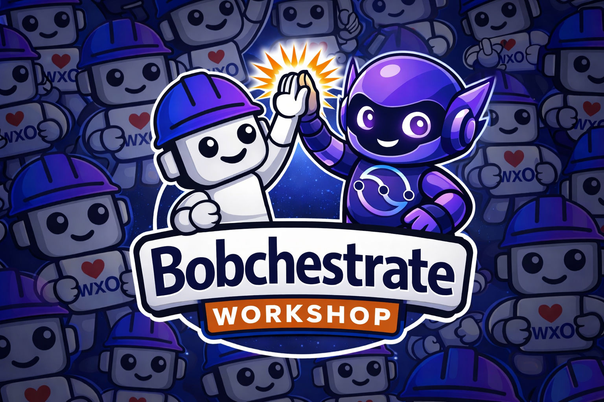

# Bobchestrate Workshop - Creación de agentes de IA con watsonx Orchestrate e IBM Bob

<p align="center">
  
</p>


## Un taller práctico de desarrollo de IA agéntica

¡Te damos la bienvenida! Este taller te guiará en la creación de agentes de IA con IBM watsonx Orchestrate. Por el camino contarás con IBM Bob, un asistente de programación basado en IA, que te echará una mano.

## Resumen del taller

**Duración:** 75-90 minutos

Esta estimación incluye:

- Tiempo de instrucción principal: 55-65 minutos (todas las partes)
- Configuración y resolución de problemas: 10-15 minutos
- Preguntas y debate: 10-15 minutos

**Nivel:** Principiante (Partes 1-3) a Avanzado (Parte 4)

**Requisitos previos:** 
- Ordenador con acceso a internet, sistema operativo Windows, macOS o Linux, al menos 8 GB de RAM y 500 MB de espacio libre en disco
- Conocimientos básicos de Python y Python 3.11-3.13 instalado (https://www.python.org/downloads/)
- uv instalado (https://pypi.org/project/uv/)
- Acceso a watsonx Orchestrate SaaS (proporcionado por tu instructor o puedes usar el tuyo propio)
- IBM Bob IDE instalado (versión de prueba o la que te facilite tu instructor)

## Qué vas a construir

### 1. Agente «Hello World» (Parte 2)
Tu primer agente sencillo para entender los fundamentos de la configuración y el comportamiento de un agente.

### 2. Un Bob que conoce tu proyecto (Parte 3)
Reglas personalizadas que enseñan a Bob las convenciones del ADK de watsonx Orchestrate, de modo que el código que genere sea coherente desde el principio.

### 3. Sistema Travel Concierge (Parte 4)
Un **sistema multiagente** con un orquestador y cuatro agentes especialistas:
- Especialistas en vuelos, hoteles, actividades y presupuesto, cada uno con herramientas específicas de su dominio
- Un agente orquestador con enrutamiento inteligente
- Gestión del contexto y traspasos entre agentes

## Estructura del taller

### [Parte 1: Configuración y entorno](./part1-setup/README.md) (15 min)
- Configurar las credenciales de watsonx Orchestrate
- Comprobar que Bob funciona como tu compañero de desarrollo con IA
- Entender la estructura del proyecto
- Preparar tu entorno de desarrollo

### [Parte 2: Creación de tu primer agente](./part2-first-agent/README.md) (20 min)
- Crear un sencillo agente «Hello World»
- Entender las instrucciones y el comportamiento de un agente
- Probar tu agente con la interfaz de chat
- Aprender a usar Bob para depurar problemas

### [Parte 3: Uso de reglas personalizadas con Bob IDE](./part3-bob-custom-rules/README.md) (10 min)
- Aprender a configurar Bob con reglas de desarrollo personalizadas
- Entender la regla de desarrollo de watsonx Orchestrate
- Definir convenciones específicas del proyecto para Bob
- Crear tus propias reglas personalizadas para un desarrollo coherente

### [Parte 4: Orquestación multiagente](./part4-multi-agent-orchestration/README.md) (30 min)
- Entender cuándo y por qué usar sistemas multiagente
- Diseñar agentes especialistas centrados en dominios concretos
- Crear agentes orquestadores con enrutamiento inteligente
- Gestionar el contexto y los traspasos entre agentes
- Implementar flujos de trabajo multiagente complejos
- Conocer las mejores prácticas para jerarquías de agentes
- **Ejercicio avanzado**: construir un sistema completo de planificación de viajes

## Taller avanzado

Hay un taller avanzado independiente en [`advanced/`](./advanced/README.md). Da por hecho que dispones de un entorno watsonx Orchestrate SaaS operativo y de la CLI del ADK:

| Parte | Tema |
|-------|------|
| [0 — Configuración y entorno](./advanced/part0-setup/README.md) | Bob IDE, servidores MCP, conexión con wxO, claves de API |
| [1 — Agentes LangGraph](./advanced/part1-langgraph/README.md) | Crear, empaquetar y desplegar agentes LangGraph personalizados |
| [2 — Agentes de IA basados en eventos](./advanced/part2-confluent/README.md) | Confluent Cloud + Flink SQL + watsonx Orchestrate (usa [`retail-inventory-optimization/`](./retail-inventory-optimization/README.md)) |

## Cómo te ayuda Bob

A lo largo del taller usarás a Bob para:
- **Generar código**: «Bob, crea una herramienta en Python que consulte el estado de un pedido»
- **Depurar problemas**: «Bob, ¿por qué mi agente no llama a la herramienta de reembolsos?»
- **Explicar conceptos**: «Bob, explícame cómo funcionan las instrucciones de un agente»
- **Refactorizar código**: «Bob, mejora la gestión de errores de mi herramienta»
- **Crear pruebas**: «Bob, escribe pruebas para mi herramienta de estado de pedidos»

## Estructura del repositorio

```
bobchestrate-workshop/
├── README.md
├── intro.md (este archivo, versión en español)
├── Bobchestrate_Workshop_logo_new.png
├── mkdocs.yml                               # Configuración del sitio del taller básico
├── mkdocs-advanced.yml                      # Configuración del sitio del taller avanzado
│
├── bob-prompts/
│   └── helpful-prompts.md                   # Prompts útiles de Bob para el taller
│
├── part1-setup/                             # Configuración y entorno (15 min)
│   ├── README.md
│   ├── verify-setup.py
│   ├── files/
│   │   └── wxo-agent-architect-export.yaml  # Exportación del modo preconfigurado
│   └── images/
│
├── part2-first-agent/                       # Creación de tu primer agente (20 min)
│   ├── README.md
│   ├── hello-agent-EXAMPLE.yaml
│   ├── exercises.md
│   └── images/
│
├── part3-bob-custom-rules/                  # Uso de reglas personalizadas con Bob (10 min)
│   ├── README.md
│   ├── wxo-dev-rule.md
│   └── wxo-dev-rule-enhanced.md
│
├── part4-multi-agent-orchestration/         # Orquestación multiagente (30 min)
│   ├── README.md
│   ├── travel-concierge-agent.yaml          # Agente orquestador
│   ├── flight-specialist-agent.yaml         # Agentes especialistas
│   ├── hotel-specialist-agent.yaml
│   ├── activity-planner-agent.yaml
│   ├── budget-advisor-agent.yaml
│   └── *_tools.py                           # Herramientas específicas de cada dominio
│
├── advanced/                                # Contenido del taller avanzado
│   ├── README.md
│   ├── part0-setup/
│   ├── part1-langgraph/
│   └── part2-confluent/
│
├── retail-inventory-optimization/           # Código de laboratorio ya preparado para la Parte 2 avanzada
│
├── docs/                                    # Origen de MkDocs (enlaces simbólicos a las carpetas anteriores)
└── docs-advanced/                           # Origen de MkDocs avanzado (enlaces simbólicos a advanced/)
```

### Sitio de documentación

El sitio web del taller se genera con MkDocs. `docs/` y `docs-advanced/` contienen **enlaces simbólicos** a las carpetas de contenido anteriores, de modo que cada archivo existe en un único lugar. Edita las carpetas de nivel superior (`part*/`, `advanced/`, `bob-prompts/`), nunca los enlaces simbólicos. Al hacer push a `main`, ambos sitios se construyen y se despliegan mediante GitHub Actions.

Para previsualizarlo en local:

```bash
pip install mkdocs-material mkdocs-glightbox
mkdocs serve                                  # taller básico
mkdocs serve -f mkdocs-advanced.yml           # taller avanzado
```

## Primeros pasos

1. Clona o descarga este repositorio del taller
2. Abre la carpeta del taller en Bob IDE
3. Asegúrate de que Bob está instalado y activo
4. Empieza por la [Parte 1: Configuración](./part1-setup/README.md)

## Objetivos de aprendizaje

Al terminar este taller, habrás conseguido:

✅ Entender la arquitectura de agentes de watsonx Orchestrate
✅ Crear y configurar agentes mediante especificaciones YAML
✅ Enseñar a Bob las convenciones de tu proyecto para generar código coherente
✅ Diseñar y orquestar sistemas multiagente
✅ Aprovechar a Bob como compañero de programación con IA

## Consejos para sacarle el máximo partido

1. **Pide ayuda a Bob**: No dudes en hacerle preguntas durante todo el taller
2. **Experimenta**: Prueba a modificar los ejemplos para ver qué ocurre
3. **Lee los mensajes de error**: Muchas veces te dicen exactamente qué falla
4. **Prueba de forma incremental**: Construye y prueba una funcionalidad cada vez
5. **Consulta la documentación**: Bob puede buscar en la documentación de watsonx Orchestrate por ti

## Recursos adicionales

- [Prompts útiles de Bob](./bob-prompts/helpful-prompts.md)
- [Documentación de watsonx Orchestrate](https://developer.watson-orchestrate.ibm.com/)
- [Guía de herramientas en Python](https://developer.watson-orchestrate.ibm.com/tools/create_tool)
- [Referencia de la API de Agent Builder](https://developer.watson-orchestrate.ibm.com/apis/agents/)
- [Foro de la comunidad](https://community.ibm.com/community/user/groups/community-home?CommunityKey=3ad46381-9535-462e-85c9-568b21f4b067)

## ¿Necesitas ayuda?

- Pregunta a Bob: «Bob, estoy atascado con [problema concreto]»
- Consulta la [guía de bob-prompts](./bob-prompts/helpful-prompts.md) para ver prompts útiles
- Consulta la documentación de watsonx Orchestrate

¡Vamos a empezar! Ve a la [Parte 1: Configuración](./part1-setup/README.md) →
