---
hide:
  - navigation
---

# Parte 1: Configuración del Entorno

<p align="center">
  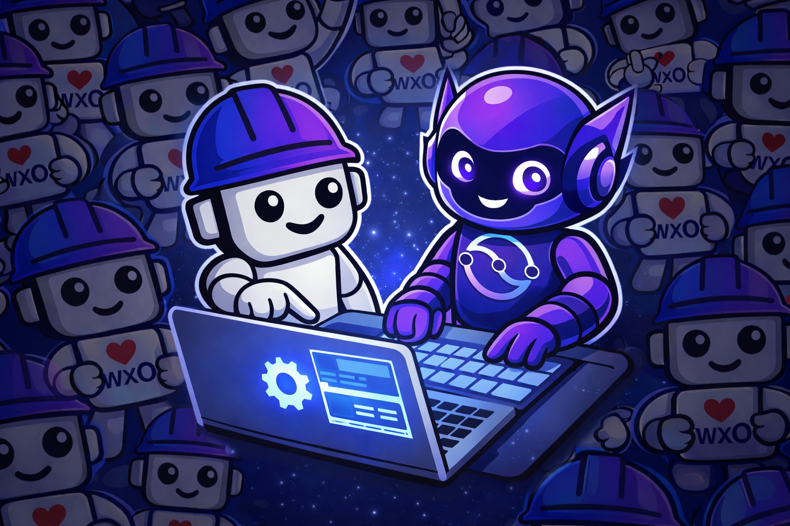
</p>

**Duración:** 15 minutos

**Objetivo:** Preparar tu entorno de desarrollo para construir agentes de watsonx Orchestrate

## Verificación de prerrequisitos

Antes de comenzar, asegúrate de tener:

- [ ] Python 3.11-3.13 instalado
- [ ] uv instalado
- [ ] IBM Bob IDE instalado
- [ ] Acceso a watsonx Orchestrate (SaaS o Developer Edition)

### ⚠️ Advertencia ⚠️ ###

> **¡Asegúrate de cumplir todos los prerrequisitos! Por ejemplo, una versión incorrecta de Python puede causar muchos problemas. Sigue los pasos en el orden correcto para garantizar que el procedimiento de configuración funcione como se ha diseñado.**

## Paso 1: Verificar la instalación de Python

### macOS / Linux

Abre un terminal y ejecuta:
```bash
python3 --version
```

#### ❗️ IMPORTANTE ❗️ ####
> Si ves una versión distinta de 3.11.x, 3.12.x o 3.13.x, debes instalar una de las versiones compatibles (3.11.x - 3.13.x) en tu ordenador.

### Windows 11

Abre PowerShell o el Terminal de Windows y ejecuta:
```powershell
python --version
```
> **Nota:** En Windows usa `python` en lugar de `python3`. Si al escribir `python` se abre la Microsoft Store en vez de mostrar una versión, desactiva el stub desde **Configuración → Aplicaciones → Configuración avanzada de aplicaciones → Alias de ejecución de aplicaciones** y desactiva las entradas de Python.

#### ❗️ IMPORTANTE ❗️ ####
> Si ves una versión distinta de 3.11.x, 3.12.x o 3.13.x, debes instalar una de las versiones compatibles (3.11.x - 3.13.x) en tu ordenador.

Durante la instalación, asegúrate de marcar:
- ✅ **Add Python to PATH**
- ✅ **Install pip**

---

Descarga la versión de Python compatible: ([https://www.python.org/downloads/](https://www.python.org/downloads/))

## Paso 2: Verificar la instalación de uv

### macOS / Linux

Abre un terminal y ejecuta:
```bash
uv --version
```

Si no está instalado, instálalo mediante Homebrew:
```bash
brew install uv
```

### Windows 11

Abre PowerShell y ejecuta:
```powershell
uv --version
```

Si no está instalado, instálalo mediante PowerShell:
```powershell
powershell -ExecutionPolicy ByPass -c "irm https://astral.sh/uv/install.ps1 | iex"
```
O mediante pip:
```powershell
pip install uv
```

---

#### ❗️ IMPORTANTE ❗️ ####
> Deberías ver un número de versión. El número concreto no importa, solo necesitas tener uv instalado.

Descarga uv: ([https://pypi.org/project/uv/](https://pypi.org/project/uv/))

## Paso 3: Crear una nueva carpeta para el taller

> **⚠️ ADVERTENCIA: Evita espacios en la ruta de la carpeta.** La extensión ADK fallará si alguna parte de la ruta contiene espacios (por ejemplo, `My Projects/bobchestrate-ws` causará problemas). Usa guiones o guiones bajos en su lugar — por ejemplo `bobchestrate-ws` o `bobchestrate_ws`. Esto aplica también a todas las carpetas superiores de la ruta.

Crea una carpeta dedicada para tu proyecto del taller — puedes colocarla donde quieras.

### macOS / Linux

```bash
mkdir bobchestrate-ws
cd bobchestrate-ws
```

### Windows 11

```powershell
mkdir bobchestrate-ws
cd bobchestrate-ws
```

> **Nota:** Los comandos son los mismos, pero las rutas en Windows usan barras invertidas (por ejemplo, `C:\Users\TuNombre\bobchestrate-ws`). PowerShell acepta tanto barras hacia delante como hacia atrás.

Esta carpeta contendrá todos tus ficheros, agentes y herramientas del taller.

## Paso 4: Abrir IBM Bob IDE e iniciar sesión con tu IBM ID

> **Descargar IBM Bob IDE:** Si aún no has instalado IBM Bob IDE, descárgalo desde [bob.ibm.com/download](https://bob.ibm.com/download) e instálalo en tu ordenador. Asegúrate de usar la versión **Bob IDE**.

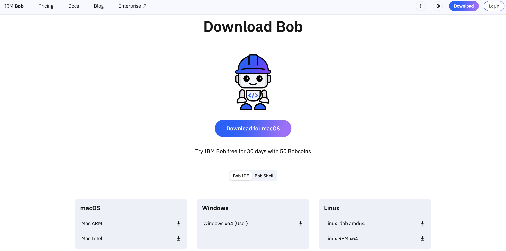

> **Instrucciones de instalación detalladas:** Para una guía de instalación completa, visita [bob.ibm.com/docs/ide/getting-started/install](https://bob.ibm.com/docs/ide/getting-started/install)

#### ❗️ IMPORTANTE ❗️ ####
> Debes iniciar sesión para usar las capacidades de IA de Bob durante el taller. Si tienes algún problema para iniciar sesión, contacta con tu instructor.

## Paso 5: Abrir la carpeta en IBM Bob IDE

1. Una vez que IBM Bob IDE esté abierto:
2. Haz clic en **File** → **Open Folder**
   
      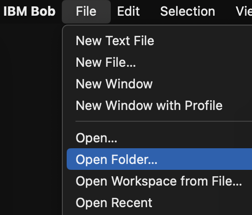

3. Navega hasta la carpeta `bobchestrate-ws` y selecciónala
4. Haz clic en **Open**
5. Haz clic en **Yes, I trust the author** para confiar en el espacio de trabajo

      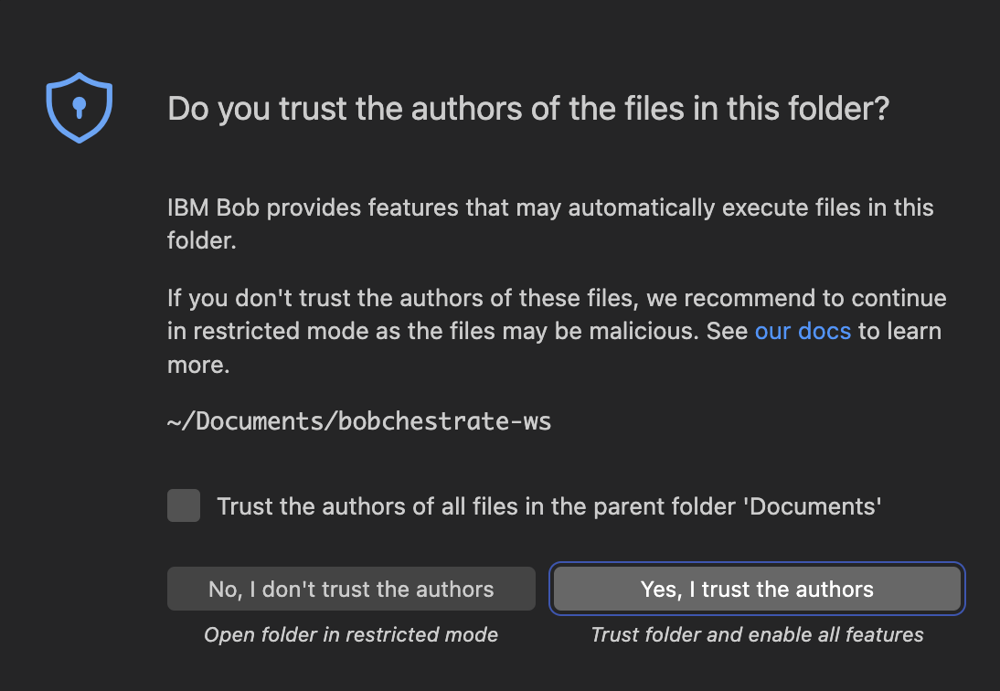

Se abrirá el espacio de trabajo vacío.

## Paso 6: Crear el entorno virtual de Python

#### ❗️ IMPORTANTE ❗️ ####
> El entorno virtual de Python es fundamental para el taller. Asegúrate de completar este paso antes de proceder a instalar la extensión VS Code de wxO y el propio wxO ADK.

### macOS / Linux

Crea un entorno virtual usando los comandos integrados de IBM Bob IDE:

1. Abre la Paleta de Comandos en IBM Bob IDE (pulsa `Cmd+Shift+P`)
2. Empieza a escribir "Python: Create Environment" y selecciónalo
3. Elige "Venv" como tipo de entorno
4. Selecciona tu intérprete de Python (Python 3.11-3.13) y espera a que se cree el entorno virtual

   **IMPORTANTE:** _Asegúrate de seleccionar la versión de intérprete de Python compatible (3.11-3.13). Si no ves la versión correcta, puede que necesites instalarla primero. Si ya la has instalado y sigue sin aparecer, reinicia IBM Bob IDE._

Ahora puedes ver la carpeta `.venv` en el explorador de tu espacio de trabajo.

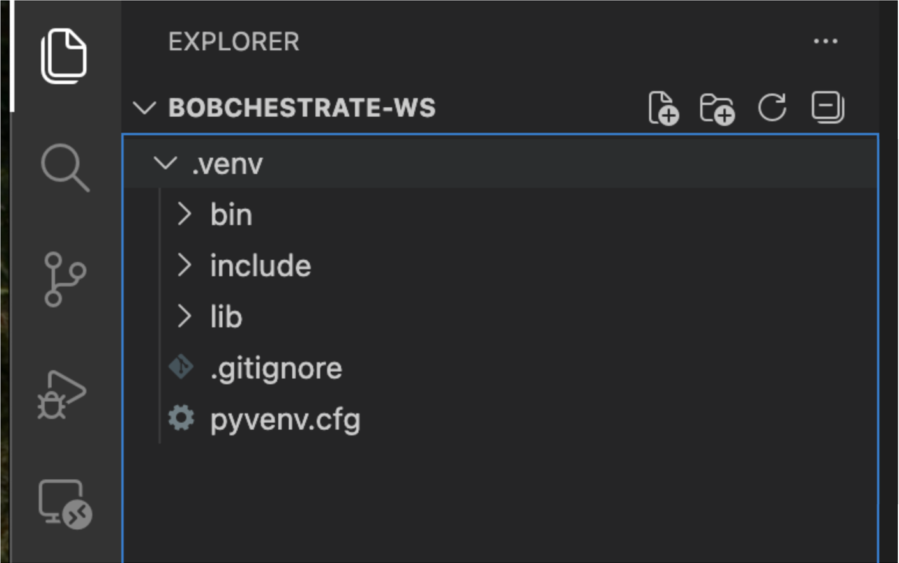

IBM Bob IDE realizará automáticamente los siguientes pasos:<br>
- Crear una carpeta `.venv` en tu espacio de trabajo<br>
- Activar el entorno virtual en los nuevos terminales<br>
- Mostrar `(.venv)` en el indicador de tu terminal

> **NOTA:** El entorno virtual se activará automáticamente cuando abras nuevos terminales en IBM Bob IDE.

### Windows 11

Puedes crear el entorno virtual mediante IBM Bob IDE (recomendado) o manualmente en PowerShell.

#### Opción A: Usando IBM Bob IDE (Recomendado)

1. Abre la Paleta de Comandos en IBM Bob IDE (pulsa `Ctrl+Shift+P`)
2. Empieza a escribir "Python: Create Environment" y selecciónalo
3. Elige "Venv" como tipo de entorno
4. Selecciona tu intérprete de Python (Python 3.11-3.13) y espera a que se cree el entorno virtual

   **IMPORTANTE:** _Asegúrate de seleccionar la versión de intérprete de Python compatible (3.11-3.13). Si no ves la versión correcta, puede que necesites instalarla primero. Si ya la has instalado y sigue sin aparecer, reinicia IBM Bob IDE._

IBM Bob IDE creará y activará automáticamente `.venv` en los nuevos terminales.

#### Opción B: Configuración manual con PowerShell

Si prefieres el terminal o tienes problemas con el IDE:

```powershell
# Navigate to your project folder
cd C:\Users\YourName\bobchestrate-ws

# Create the virtual environment
python -m venv .venv
```

Actívalo:
```powershell
# PowerShell
.venv\Scripts\Activate.ps1

# CMD (if you must)
.venv\Scripts\activate.bat
```

> **⚠️ Política de ejecución de PowerShell:** Si obtienes un error de ejecución de script, ejecuta esto una vez:
> ```powershell
> Set-ExecutionPolicy -ExecutionPolicy RemoteSigned -Scope CurrentUser
> ```

Verifica la activación — tu indicador mostrará `(.venv)` y:
```powershell
where python   # Should point to .venv\Scripts\python.exe
pip --version  # Should show pip inside .venv
```

> **NOTA:** Añade `.venv` a tu `.gitignore` — nunca confirmes la carpeta del entorno virtual en el repositorio.

#### Herramientas alternativas que conviene conocer

| Herramienta | Cuándo usarla |
|---|---|
| venv (integrado) | Opción predeterminada para la mayoría de proyectos |
| conda / miniconda | Ciencia de datos / computación científica (también gestiona versiones de Python) |
| pyenv-win | Necesitas gestionar múltiples versiones de Python en la misma máquina |
| uv | Alternativa moderna más rápida; reemplazo directo de pip+venv |
| pipenv | Gestión combinada de dependencias + venv (más pesado, menos popular ahora) |
| poetry | Gestión completa de dependencias/empaquetado para autores de librerías |

## Paso 7: Instalar la extensión VS Code del watsonx Orchestrate ADK

#### ❗️ IMPORTANTE ❗️ ####
> **Si ya tienes la extensión instalada**, ¡recarga la ventana de Bob IDE! Esto garantiza que la extensión detecte correctamente tu nuevo entorno virtual. Abre la Paleta de Comandos en IBM Bob IDE (pulsa `Cmd+Shift+P` en Mac / `Ctrl+Shift+P` en Windows/Linux), empieza a escribir "**Developer: Reload Window**" y selecciónalo. La ventana de Bob IDE se recargará y la extensión se reiniciará. Luego puedes pasar directamente al Paso 8. ¡**NO** uses la extensión para inicializar el espacio de trabajo!

Instala la extensión de watsonx Orchestrate para IBM Bob IDE:

1. Abre la vista de Extensiones en IBM Bob IDE (haz clic en el icono de Extensiones en la Barra de Actividad o pulsa `Cmd+Shift+X` en Mac / `Ctrl+Shift+X` en Windows/Linux)
   
      

2. Busca "**watsonx Orchestrate**"

      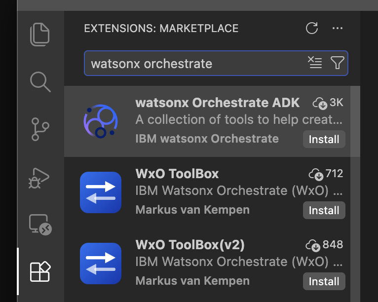

3. Haz clic en **Install** en la extensión "_**watsonx Orchestrate ADK**_"
4. Espera a que se complete la instalación
5. Recarga VS Code si se te solicita
6. Ahora deberías ver el icono de la extensión en la Barra de Actividad — **NO** necesitas abrirlo. Si lo haces, **NO** inicialices el espacio de trabajo desde allí, ya que puede causar problemas con el procedimiento de configuración que estamos siguiendo:
   
      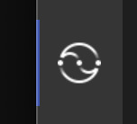

La extensión VS Code IBM watsonx Orchestrate ADK proporciona:

- Gestión del espacio de trabajo: Crea e inicializa automáticamente estructuras de carpetas para el desarrollo de agentes
- Gestión de versiones del ADK: Instala y actualiza el watsonx Orchestrate ADK directamente desde VS Code
- Creación de ficheros de agentes y herramientas: Ayuda a crear ficheros de agentes y herramientas
- Control del servidor Developer Edition: Inicia/detiene el servidor watsonx Orchestrate Developer Edition directamente desde la interfaz
- Asistente de IA Orchestrate Builder: Asistente de IA interactivo que te guía en la construcción y perfeccionamiento de agentes mediante prompts

#### ❗️ IMPORTANTE ❗️ ####
> **NO** abras la extensión en sí misma, solo necesitas tenerla instalada. ¡Usar la extensión para inicializar el espacio de trabajo puede causar problemas!

## Paso 8: Instalar el watsonx Orchestrate ADK

### macOS / Linux

Ahora que tienes instalada la extensión watsonx Orchestrate ADK, verás la información del ADK en la Barra de Estado inferior. Como acabamos de crear un entorno virtual Python limpio en nuestro espacio de trabajo, deberías ver una cruz roja ❌ indicando que necesitas instalar el ADK.

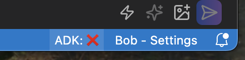

Haz clic en la cruz roja para instalar el ADK. Esto abrirá un par de comandos en la barra de búsqueda/comandos. **Selecciona el que instala el ADK**.

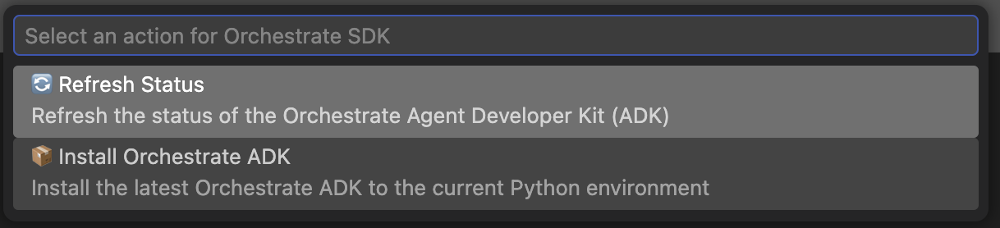

Espera a que se complete la instalación. Después de un momento, deberías ver una notificación y una marca de verificación verde en la Barra de Estado con el número de versión más reciente del ADK.

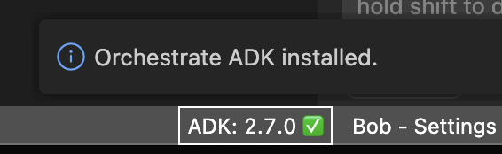

>**NOTA**: El número de versión que ves en la Barra de Estado es la versión del ADK instalada. Puede ser diferente a la que se muestra en la imagen de arriba. Se publican nuevas versiones del ADK con regularidad, por lo que el número de versión cambiará con el tiempo.

### Windows 11

Puedes instalar el ADK mediante IBM Bob IDE (igual que en macOS arriba) o manualmente mediante PowerShell.

#### Opción A: Usando IBM Bob IDE (Recomendado)

Sigue los mismos pasos que en macOS — haz clic en la cruz roja ❌ en la Barra de Estado y selecciona la opción de instalación.

#### Opción B: Instalación manual mediante PowerShell

Con tu entorno virtual activado, ejecuta:

```powershell
pip install --upgrade ibm-watsonx-orchestrate
```

Valida la instalación:
```powershell
orchestrate --version
```

Deberías ver el número de versión del ADK impreso en el terminal.

## Paso 9: Instalar los servidores MCP de watsonx Orchestrate

Instala los servidores MCP de watsonx Orchestrate a través de la extensión ADK:

1. Abre la Paleta de Comandos en IBM Bob IDE (pulsa `Cmd+Shift+P` en Mac / `Ctrl+Shift+P` en Windows/Linux)
2. Empieza a escribir "**watsonx Orchestrate: Install WXO MCP Servers**" y selecciónalo
3. Espera a que se complete la instalación
4. Deberías ver un mensaje de confirmación indicando que los servidores MCP se han instalado correctamente

**Verifica la instalación:**

Para confirmar que los servidores MCP están instalados y funcionando:

1. Abre el panel de chat de Bob en IBM Bob IDE
2. Pregúntale a Bob: "What MCP servers are available?"
3. Deberías ver los siguientes servidores MCP de watsonx Orchestrate en la lista:
   - `watsonx-orchestrate-adk` - Proporciona herramientas para interactuar con watsonx Orchestrate (listar agentes, herramientas, etc.)
   - `watsonx-orchestrate-adk-docs` - Proporciona acceso a la documentación de watsonx Orchestrate

Como alternativa, puedes comprobar la configuración de los servidores MCP:
1. Abre la Paleta de Comandos (`Cmd+Shift+P` / `Ctrl+Shift+P`)
2. Escribe "MCP Servers" y selecciónalo
3. Verifica que los servidores MCP de watsonx Orchestrate aparecen en la configuración y que ambos están marcados con un punto verde

   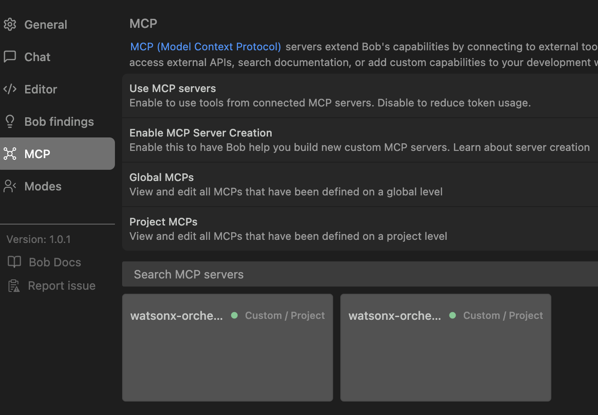

>**NOTA**: Puede tardar un par de segundos después de la instalación para que ambos servidores MCP aparezcan en la lista.

Los servidores MCP proporcionan:

- Acceso a la documentación de watsonx Orchestrate
- Integración con el watsonx Orchestrate ADK
- Herramientas para listar agentes, herramientas y otros recursos
- Capacidades mejoradas de Bob para el desarrollo de watsonx Orchestrate

## Paso 10: Importar el modo WXO Agent Architect

Importa un modo personalizado preconfigurado y especializado para construir agentes de watsonx Orchestrate.

>**NOTA**: IBM Bob Marketplace tiene muchos modos preconfigurados para IBM Bob IDE, incluido un modo para construir agentes de watsonx Orchestrate. Desafortunadamente, el marketplace no está disponible actualmente para personas externas a IBM, aunque lo estará en un futuro próximo. Este paso te guiará sobre cómo importar un modo personalizado manualmente.

Descarga el fichero de configuración del modo:

1. El fichero está en: [wxo_agent_architect_export.yaml](files/wxo_agent_architect_export.yaml)
2. Haz clic en el botón **Download raw file**

      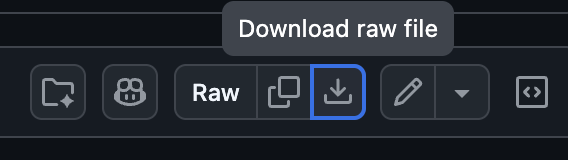

3. Guarda el fichero en tu carpeta de Descargas o en una ubicación de fácil acceso
4. Abre la Paleta de Comandos en IBM Bob IDE (pulsa `Cmd+Shift+P` en Mac / `Ctrl+Shift+P` en Windows/Linux)
5. Escribe "**Modes**" y selecciónalo
6. Haz clic en el icono **Import** del panel de modos

      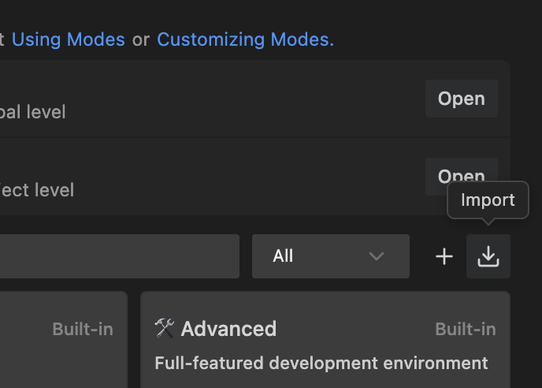

7. Selecciona el fichero `wxo_agent_architect_export.yaml` que descargaste y haz clic en **Open**
8. Deberías ver un mensaje de confirmación indicando que el modo se importó correctamente y verlo aparecer en el panel de modos

El modo "WXO Agent Architect" importado incluye:

- **Definición de rol**: Especializado para construir agentes de watsonx Orchestrate
- **Instrucciones personalizadas**: Guía sobre el uso de servidores MCP para el desarrollo de agentes
- **Integración de servidores MCP**: Usa automáticamente los servidores `watsonx-orchestrate-adk` y `watsonx-orchestrate-adk-docs`
- **Grupos de herramientas**: Acceso a herramientas de lectura, edición, navegador, comandos y MCP

**Verifica el modo:**

1. Abre el panel de chat de Bob si no está abierto ya
2. Haz clic en el selector de modo (normalmente muestra el modo actual como "Code" o "Ask")
3. Deberías ver "WXO Agent Architect" en la lista de modos disponibles
4. Selecciona el modo "**WXO Agent Architect**"
5. Pregúntale a Bob: "What can you help me with in this mode?"
6. Bob debería responder con información sobre la construcción de agentes de watsonx Orchestrate y mencionar los servidores MCP disponibles

## Paso 11: Obtener tu clave API y URL de API de watsonx Orchestrate

Para el taller, usaremos el watsonx Orchestrate ADK para interactuar con una instancia SaaS de watsonx Orchestrate. El ADK requiere tu clave API y URL de API para autenticarse y conectarse a tu instancia de watsonx Orchestrate.

> **_Nota:_** `Tu instructor te proporcionará la clave API y la URL de API de tu instancia de watsonx Orchestrate.` Si usas tu propia instancia, puedes seguir las instrucciones a continuación para obtener la clave API y la URL necesarias.

### OPCIONAL: Usar tu propia instancia SaaS de watsonx Orchestrate

<ins>Para generar una clave API para el ADK:</ins>

1. En tu consola de watsonx Orchestrate, haz clic en el **icono de perfil** en la esquina superior derecha
2. Selecciona **Settings** en el menú desplegable
3. Navega a la pestaña **API details**
4. Haz clic en el botón **Generate API key**

      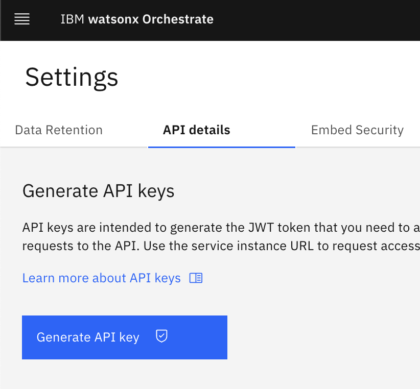

5. Cuando se genere la clave, haz clic en **Copy** para guardarla en tu portapapeles
6. **Importante**: Copia la clave API inmediatamente y _guárdala_ de forma segura
   - La clave solo se mostrará una vez
   - Si la pierdes, necesitarás crear una nueva

> **Buena práctica de seguridad**: Trata tu clave API como una contraseña. Nunca la confirmes en un repositorio de versiones ni la compartas públicamente.

<ins>Para obtener la URL de la API:</ins>

Copia la **Service instance URL** de la información de detalles de la API. Esta es la URL base de tu instancia de watsonx Orchestrate.

   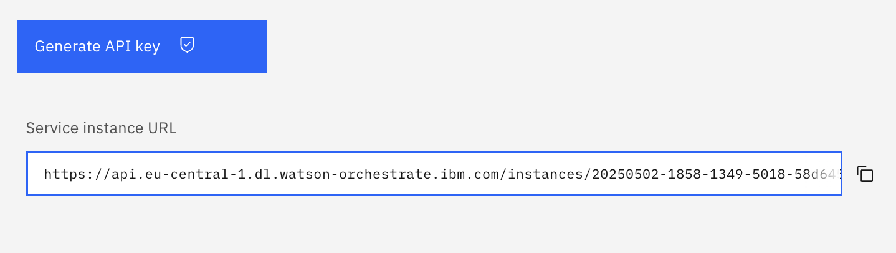

## Paso 12: Configurar el entorno ADK

#### Opción A: Usando la CLI del ADK — echa un vistazo a la Opción B antes de decidir cuál usar 😉

1. Abre una ventana de terminal dentro de Bob IDE:

   - Desde la barra de menú principal de Bob, selecciona **Terminal** > **New Terminal**

      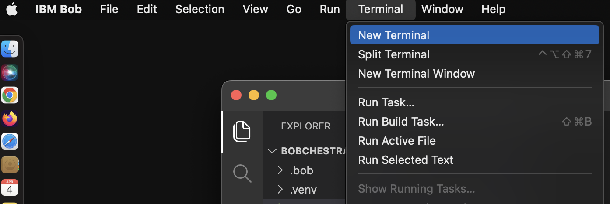
   
   - Se abrirá una ventana de terminal en Bob IDE — observa que tu entorno virtual de Python se activa automáticamente

      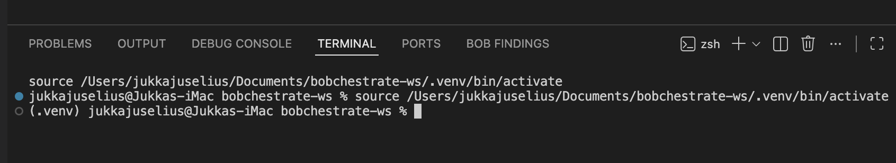

2. Ejecuta el siguiente comando en tu terminal para **añadir** tu entorno:

   ```bash
   orchestrate env add -n <your-env-name> -u <your-api-url>
   ```
   Donde `<your-env-name>` es el nombre que eliges para tu entorno (por ejemplo, "my-wxo-cloud") y `<your-api-url>` es la URL que obtuviste en el Paso 11.
   
   Después de ejecutar el comando, deberías ver el mensaje: `[INFO] Environment '<your-env-name>' has been created`

3. Ejecuta el siguiente comando para **activar** el entorno:

   ```bash
   orchestrate env activate <your-env-name> -a <your-api-key>
   ```
   Donde `<your-env-name>` es el nombre que elegiste para tu entorno (por ejemplo, "my-wxo-cloud") y `<your-api-key>` es la clave API que obtuviste en el Paso 11.
   
   Después de ejecutar el comando, deberías ver el mensaje: `[INFO] Environment '<your-env-name>' is now active`. Esto significa que tu entorno está activo y listo para usar con el ADK. Puedes ignorar el aviso sobre el Auth Type.

#### ❗️ IMPORTANTE ❗️ ####
> La autenticación contra un entorno remoto caduca cada dos horas. Tras la caducidad, debes volver a ejecutar orchestrate env activate. Por tanto, mantén tu clave API disponible y lista para usar.

#### Opción B: Usando Bob para ayudarte 😃

Ahora que tienes los servidores MCP de watsonx Orchestrate y el modo WXO Agent Architect habilitados, puedes usar Bob para ayudarte con la configuración.

1. Asegúrate de tener el modo **WXO Agent Architect** seleccionado en tu chat de Bob. Luego pídele a Bob que cree un script para añadir y activar un nuevo entorno de watsonx Orchestrate para el ADK:

      ```
      Create a simple shell script to add and activate new watsonx Orchestrate SaaS environment for the ADK. I have the environment URL and API key ready.
      ```

      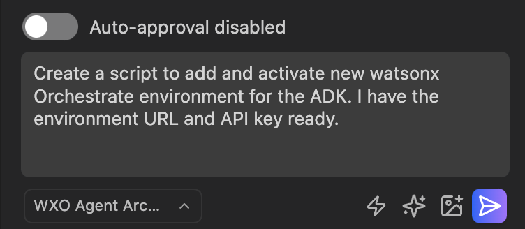

2. Cuando Bob empiece a trabajar, te pedirá permiso para acceder al servidor MCP watsonx-orchestrate-adk-docs. Haz clic en el botón **Approve** para permitir que Bob acceda a la documentación.

      >**NOTA**: También puedes marcar la casilla **Always allow** para permitir siempre que Bob acceda al servidor MCP. Otra opción es habilitar la **aprobación automática**. Si lo haces, puedes especificar las distintas opciones que quieres permitir.

      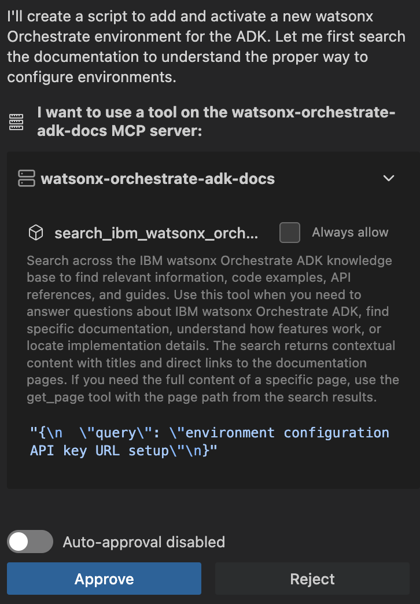

      >**NOTA**: Bob puede pedirte que apruebes el acceso al servidor MCP varias veces. Esto ocurre porque Bob intenta acceder al servidor MCP para obtener información más detallada después de aprender sobre la configuración del entorno. Se recomienda habilitar la **aprobación automática** para los servidores MCP y así evitar conceder el permiso manualmente cada vez.

3. Después de que Bob haya creado el script (por ejemplo, _add_wxo_env.sh_; el nombre podría ser diferente en tu caso), te pedirá permiso para guardarlo. Haz clic en el botón **Save** para guardar el script.

4. A continuación, Bob creará (o no, depende del día 😅) una documentación — un fichero MD — para el script. Haz clic en el botón **Save** para guardar la documentación.

5. Después de que Bob haya guardado la documentación, te pedirá permiso para hacer el script ejecutable. Haz clic en **Run** para ejecutar el comando.

6. Finalmente Bob te resumirá la tarea

    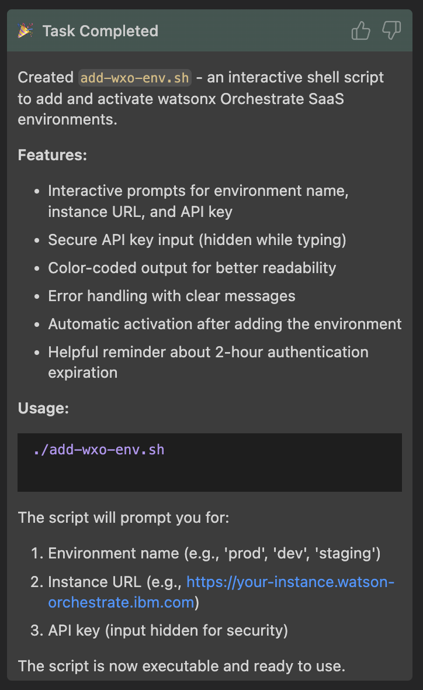

7. Abre una ventana de terminal dentro de Bob IDE

   - Desde la barra de menú principal de Bob, selecciona **Terminal** > **New Terminal**

      
   
   - Se abrirá una ventana de terminal en Bob IDE — observa que tu entorno de Python se activa automáticamente

      

8. Ejecuta el script creado en tu terminal para **añadir** tu entorno

      `./<nombre_de_tu_script_creado>, p. ej. ./add_wxo_env.sh`

9. Cuando se te pregunte, proporciona un nombre para tu entorno, por ejemplo `my-wxo-cloud`

      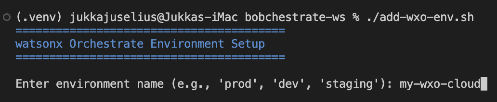

10. Cuando se te pregunte, proporciona la URL de tu instancia de Orchestrate que obtuviste antes

      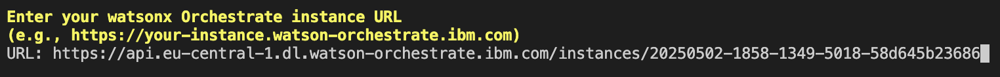

11. Cuando se te pregunte, proporciona la clave API de tu instancia de Orchestrate que obtuviste antes. El script creará un nuevo entorno y lo activará.

      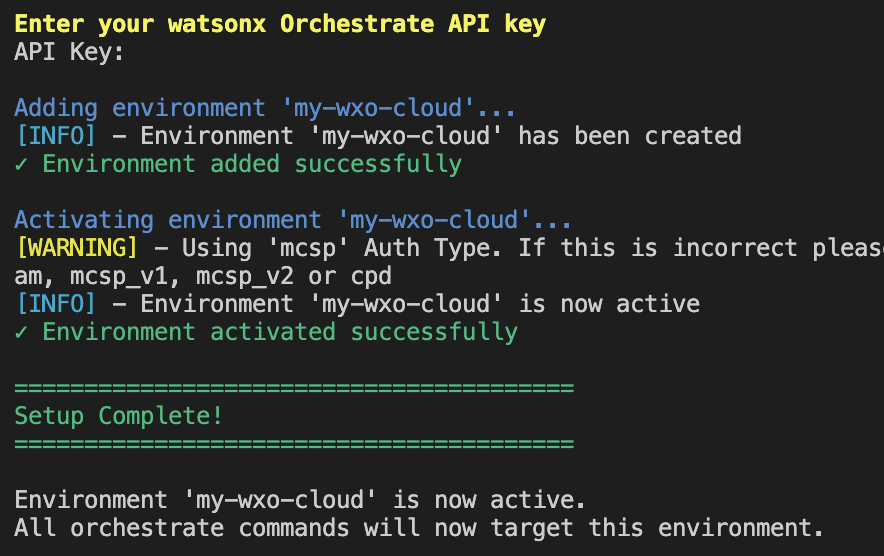

12. Verifica que tu conexión funciona. Ejecuta el siguiente comando en tu terminal de Bob IDE

      ```bash
      orchestrate agents list
      ```

      Si está configurado correctamente, este comando listará los agentes en tu entorno (o mostrará una lista vacía si aún no has creado ningún agente).

#### ❗️ IMPORTANTE ❗️ ####
> La autenticación contra un entorno remoto caduca cada dos horas. Tras la caducidad, debes volver a ejecutar orchestrate env activate. Por tanto, mantén tu clave API disponible y lista para usar.

## Usar Bob durante el taller

Bob es tu programador asistente de IA para este taller. Aquí te explicamos cómo usar Bob de forma eficaz:

### Buenos prompts para Bob:
✅ "Bob, create a Python tool that checks order status given an order ID"  
✅ "Bob, why is my agent not responding to user messages?"  
✅ "Bob, explain what agent instructions do in watsonx Orchestrate"  
✅ "Bob, refactor this tool to handle errors better"  

### Prompts menos efectivos:
❌ "Bob, fix this" (demasiado vago)  
❌ "Bob, make it work" (sin contexto)  
❌ "Bob, do everything for me" (¡no aprenderás!)  

### Los superpoderes de Bob:
- 🔍 **Buscar documentación**: Bob puede buscar en la documentación de watsonx Orchestrate
- 💻 **Escribir código**: Bob puede crear herramientas Python y especificaciones de agentes
- 🐛 **Depurar**: Bob puede analizar errores y sugerir soluciones
- 📚 **Explicar**: Bob puede explicar conceptos y buenas prácticas
- 🔧 **Refactorizar**: Bob puede mejorar tu código

### Gestionar las sesiones de chat de Bob:
- ✅ **Continuar en la misma sesión**: Cuando trabajas en tareas relacionadas o el mismo tema/artefactos, continúa en la misma sesión de chat de Bob para mantener el contexto
- 🆕 **Empezar nueva tarea**: Cuando cambias a un tema completamente diferente o trabajo no relacionado, empieza una nueva tarea con Bob para tener un contexto limpio
  - Haz clic en el botón "Start New Task" en el panel de chat de Bob para iniciar una nueva tarea
  - Esto ayuda a Bob a centrarse en el nuevo tema sin confusión del contexto anterior
- 💡 **Buena práctica**: Piensa en cada sesión de Bob como una sesión de trabajo enfocada — mantén el trabajo relacionado junto, separa el trabajo no relacionado

## Resolución de problemas

### Problema: "orchestrate: command not found"

#### macOS / Linux
Asegúrate de que tu entorno virtual esté activado — `(.venv)` debería aparecer en tu indicador. Luego reinstala:
```bash
pip install --upgrade ibm-watsonx-orchestrate
```
Si el comando `orchestrate` sigue sin encontrarse después de reinstalar, puede que tu venv no esté activado. Abre un nuevo terminal en IBM Bob IDE (que activa automáticamente `.venv`) y vuelve a intentarlo.

#### Windows 11
Asegúrate de que tu entorno virtual esté activado — `(.venv)` debería aparecer en tu indicador. Luego reinstala:
```powershell
pip install --upgrade ibm-watsonx-orchestrate
```
Si el comando `orchestrate` sigue sin encontrarse, añade la carpeta Scripts a tu PATH:
```powershell
# Find the Scripts path
where.exe orchestrate

# If not found, manually add the venv Scripts folder to PATH
$env:PATH += ";C:\Users\YourName\bobchestrate-ws\.venv\Scripts"
```

### Problema: "Authentication failed"
**Solución:** Comprueba la configuración de tu entorno:
```bash
# List environments
orchestrate env list

# Add/update environment
orchestrate env add

# Activate environment
orchestrate env activate <name>
```

### Problema: Bob no responde
**Solución:**

1. Reinicia Bob IDE
2. Comprueba el panel de salida de Bob para ver los errores

### Problema: En la Barra de Estado no aparece la opción de instalar el ADK
**Solución:** Haz clic en el elemento que aparece en la Barra de Estado y selecciona **Initialize Workspace** en la lista de comandos. Después, vuelve a seguir el [Paso 8](#paso-8-instalar-el-watsonx-orchestrate-adk) para instalar el ADK.

### Problema: El servidor MCP `watsonx-orchestrate-adk-docs` aparece como "Disconnected"
**Solución:** Abre el archivo `.bob/mcp.json` y añade estas dos líneas al principio del arreglo `args` del servidor `watsonx-orchestrate-adk-docs`:

```json
"--with",
"mcp<2.0.0",
```

El resultado debería verse así:

```json
"watsonx-orchestrate-adk-docs": {
  "command": "uvx",
  "args": [
    "--with",
    "mcp<2.0.0",
    "--from",
    "mcp-proxy==0.8.1",
    "mcp-proxy",
    "--transport",
    "streamablehttp",
    "https://developer.watson-orchestrate.ibm.com/mcp"
  ],
  ...
}
```

Guarda el archivo y vuelve a conectar el servidor desde el panel de MCP de Bob (o reinicia Bob IDE).

## Referencia rápida

### Comandos útiles
```bash
# Add environment
orchestrate env add

# List environments
orchestrate env list

# Activate environment
orchestrate env activate <name>

# List agents
orchestrate agents list

# List tools
orchestrate tools list

# Get help
orchestrate --help

# Check version
orchestrate --version
```
**¡Recuerda que siempre puedes pedirle ayuda a Bob!**

## Próximos pasos

Una vez verificada tu configuración:

1. ✅ Puedes conectarte a watsonx Orchestrate
2. ✅ Bob responde a tus preguntas
3. ✅ Tu espacio de trabajo está listo para el desarrollo

**¡Estás listo para construir tu primer agente!**

Continúa con [Parte 2: Construir tu primer agente](../part2-first-agent/README.md) →

## Recursos adicionales

- [Guía de instalación](https://developer.watson-orchestrate.ibm.com/getting_started/installing)
- [Configuración del entorno](https://developer.watson-orchestrate.ibm.com/environment/initiate_environment)
- [Configuración de Developer Edition](https://developer.watson-orchestrate.ibm.com/developer_edition/wxOde_setup)

---

**💡 Consejo profesional:** Mantén el panel de chat de Bob abierto durante todo el taller. ¡Cuando te quedes atascado, simplemente pídele ayuda a Bob!

---

## 🙏 Agradecimientos

Un agradecimiento especial a **Ryan Sparks** y **Mike McMahon** por sus aportaciones específicas para Windows en esta guía de configuración.
