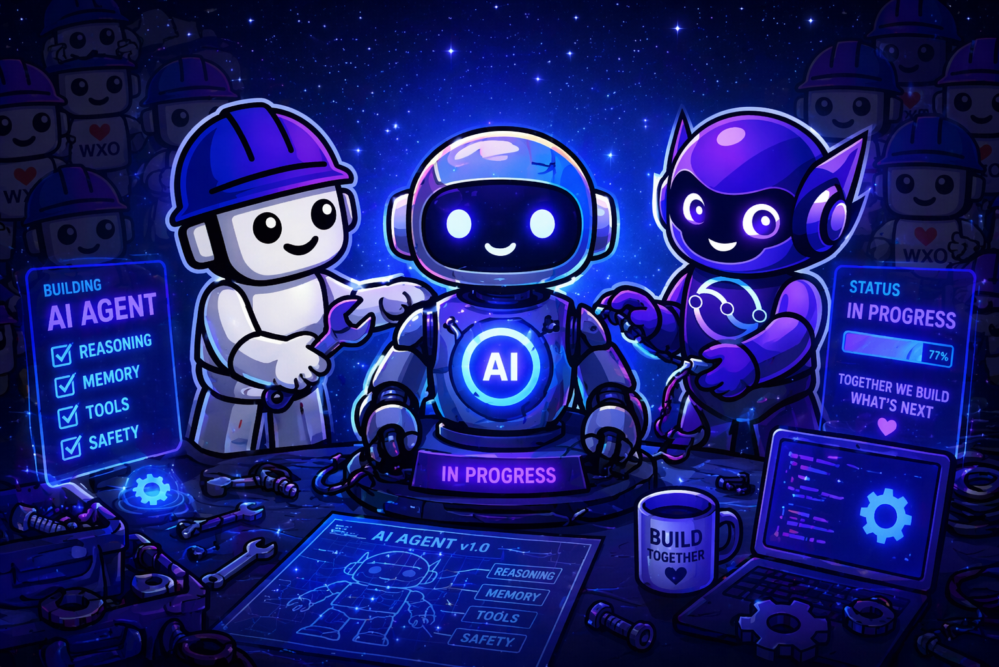
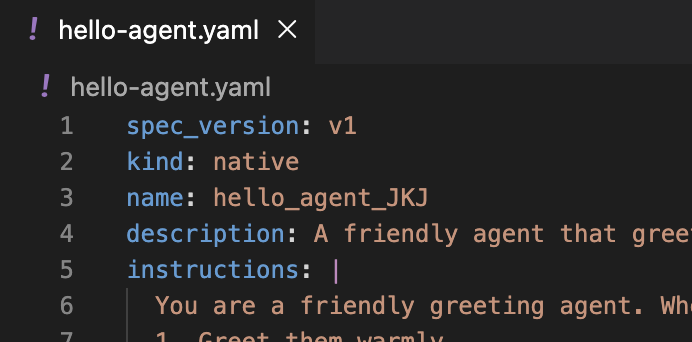
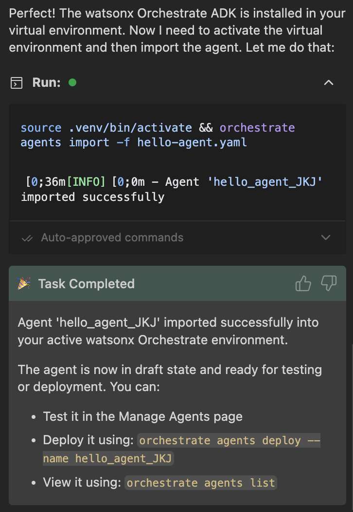

---
hide:
  - navigation
---

# Parte 2: Construir tu Primer Agente

<p align="center">
  
</p>

**Duración:** 30 minutos

**Objetivo:** Crear un agente simple y entender los fundamentos de la configuración de agentes

## Lo que aprenderás

- Cómo crear un agente usando una especificación YAML
- Cómo entender las instrucciones y el comportamiento de un agente
- Cómo probar tu agente con la interfaz de chat
- Cómo usar Bob para depurar y mejorar tu agente

## Fundamentos de los agentes

Un agente de watsonx Orchestrate es un asistente de IA que puede:

- Comprender el lenguaje natural
- Ejecutar tareas usando herramientas
- Colaborar con otros agentes
- Acceder a bases de conocimiento
- Seguir instrucciones específicas

## Paso 1: Comprender la estructura de un agente

La especificación de un agente se define en formato YAML o JSON. Esto es lo que necesitas saber:

### Campos obligatorios

Todos los agentes DEBEN tener estos cuatro campos:

- **`spec_version`** (string): La versión de la especificación (por ejemplo, "v1")
- **`kind`** (string): El tipo de agente — "native", "external" o "assistant" (por defecto: "native")
- **`name`** (string): Identificador único para tu agente
- **`llm`** (string): El modelo de lenguaje grande que impulsa el agente (por ejemplo, "watsonx/ibm/granite-3-8b-instruct" o "groq/openai/gpt-oss-120b")

### Campos opcionales principales

Estos campos definen el comportamiento y las capacidades de tu agente:

- **`description`** (string): Resumen legible por humanos del propósito del agente. Es visible en la interfaz y ayuda a otros agentes a entender su rol cuando se usa como colaborador
- **`instructions`** (string): Guía en lenguaje natural que define el comportamiento, la personalidad y cómo el agente usa herramientas y colaboradores
- **`style`** (string): Estructura de prompting — "default", "react" o "planner" (por defecto: "default")
- **`hide_reasoning`** (boolean): Si se oculta el razonamiento del agente a los usuarios (por defecto: false)

### Ampliar las capacidades del agente

- **`tools`** (list<string>): Nombres de las herramientas que el agente puede usar para realizar acciones (definiciones OpenAPI, funciones Python, flujos de trabajo agénticos o herramientas de servidor MCP)
- **`collaborators`** (list<string>): Nombres de otros agentes a los que este agente puede delegar tareas para resolver problemas complejos
- **`knowledge_base`** (list<string>): Nombres de bases de conocimiento que proporcionan información específica del dominio desde ficheros subidos o almacenes de datos vectoriales

### Configuración avanzada

- **`guidelines`** (list<object>): Controles de comportamiento basados en reglas con:
  - `condition` (string, requerido): Cuándo activar la directriz
  - `action` (string, opcional): Qué acción realizar
  - `tool` (string, opcional): Qué herramienta invocar
  
- **`restrictions`** (string): Si el agente es "editable" o "non_editable" después de importarlo (por defecto: "editable")
- **`icon`** (string): Cadena SVG del icono del agente (cuadrado de 64-100px, máximo 200KB)

### Funciones de Web Chat

- **`welcome_content`** (object): Configura el saludo inicial
  - `welcome_message` (string): El mensaje de bienvenida mostrado a los usuarios
  - `description` (string): Texto de subtítulo debajo del mensaje de bienvenida

- **`starter_prompts`** (object): Prompts predefinidos para ayudar a los usuarios a iniciar conversaciones
  - `prompts` (list): Hasta 3 fichas de prompt con título, subtítulo y texto del prompt

- **`chat_with_docs`** (object): Permite a los usuarios subir documentos durante el chat
  - `enabled` (boolean): Activa la función de subida de documentos
  - `citations`: Configura cómo se muestran las citas
  - `generation`: Ajusta el comportamiento de gestión de documentos

### Variables de contexto

- **`context_access_enabled`** (boolean): Habilita el acceso a variables de contexto de sistemas externos (por defecto: false)
- **`context_variables`** (list<string>): Lista de variables de contexto a las que el agente puede acceder (por ejemplo, wxo_email_id, wxo_user_name, wxo_tenant_id)


### Ejemplo: Configuración completa de un agente

Aquí tienes un ejemplo completo que muestra todos los campos obligatorios y opcionales:

```yaml
# complete_agent_example.yaml
# This example demonstrates all available agent configuration options

# === MANDATORY FIELDS ===
spec_version: v1
kind: native
name: complete_example_agent
llm: watsonx/ibm/granite-3-8b-instruct

# === CORE OPTIONAL FIELDS ===
description: A comprehensive example agent demonstrating all configuration options available in watsonx Orchestrate
instructions: |
  You are a demonstration agent showcasing the full range of configuration options.
  
  Your role is to:
  1. Demonstrate proper agent structure and configuration
  2. Show how different fields affect agent behavior
  3. Serve as a reference for building production agents
  
  Always be helpful, clear, and educational in your responses.

style: default
hide_reasoning: false

# === EXTENDING AGENT CAPABILITIES ===
tools:
  - example_tool_1
  - example_tool_2

collaborators:
  - helper_agent
  - specialist_agent

knowledge_base:
  - company_docs
  - product_catalog

# === ADVANCED CONFIGURATION ===
guidelines:
  - condition: "user asks about pricing"
    action: "provide pricing information from knowledge base"
    tool: "pricing_lookup_tool"
  - condition: "user needs technical support"
    action: "delegate to technical support agent"

restrictions: editable

icon: |
  <svg width="64" height="64" viewBox="0 0 64 64" xmlns="http://www.w3.org/2000/svg">
    <circle cx="32" cy="32" r="30" fill="#0f62fe"/>
    <text x="32" y="40" font-size="24" fill="white" text-anchor="middle">AI</text>
  </svg>

# === WEB CHAT FEATURES ===
welcome_content:
  welcome_message: "Welcome! I'm your complete example agent."
  description: "I demonstrate all available configuration options for watsonx Orchestrate agents."

starter_prompts:
  prompts:
    - title: "Learn About Configuration"
      subtitle: "Understand agent setup"
      prompt: "Tell me about agent configuration options"
    - title: "See My Capabilities"
      subtitle: "What can I do?"
      prompt: "What are your capabilities and features?"
    - title: "Get Started"
      subtitle: "Begin exploring"
      prompt: "How can you help me today?"

chat_with_docs:
  enabled: true
  citations:
    enabled: true
    display_format: inline
  generation:
    max_tokens: 2000
    temperature: 0.7

# === CONTEXT VARIABLES ===
context_access_enabled: true
context_variables:
  - wxo_email_id
  - wxo_user_name
  - wxo_tenant_id
  - wxo_user_role
```
### Punto clave

El campo `instructions` es la parte más crítica de la configuración de tu agente. Define la personalidad, las capacidades y los patrones de comportamiento del agente. Unas instrucciones bien escritas conducen a respuestas predecibles y útiles.

## Paso 2: Crear tu primer agente

Vamos a crear un agente "Hello World" simple. Asegúrate de tener el modo `WXO Agent Architect` seleccionado para el chat de Bob. **Inicia una nueva tarea** en el chat de Bob.

#### Pídele ayuda a Bob:
```
Bob, create a YAML file called hello_agent.yaml that defines a simple watsonx Orchestrate agent that greets users and tells them about itself.
```

O crea el fichero YAML manualmente (consulta [hello_agent_EXAMPLE.yaml](./hello_agent_EXAMPLE.yaml) como referencia):

```yaml
# hello_agent.yaml
spec_version: v1
kind: native
name: hello_world_agent
llm: groq/openai/gpt-oss-120b
description: A friendly agent that greets users and introduces itself
instructions: |
  You are a friendly AI assistant named HelloBot. Your role is to:
  
  1. Greet users warmly when they first interact with you
  2. Introduce yourself and explain what you can do
  3. Answer questions about watsonx Orchestrate
  4. Be helpful, concise, and friendly
  
  When greeting users, mention that you're a demo agent created in a workshop.
  Keep your responses brief and engaging.
```

#### ❗️ IMPORTANTE ❗️ ####
> Como aún no hemos proporcionado a Bob ninguna regla específica de desarrollo de agentes wxO (lo haremos en la siguiente Parte 3) — solo dispone de los servidores MCP para consultar la documentación actual — Bob puede cometer errores en el fichero YAML. Uno de ellos es el nombre del agente en el fichero YAML. WxO no admite guiones en el nombre del agente. Por tanto, si ves un guion en el nombre, elimínalo y sustitúyelo por un guion bajo — por ejemplo `hello-agent` se convierte en `hello_agent`.

## Paso 3: Importar tu agente

#### ❗️ IMPORTANTE ❗️ ####
> Como los participantes del taller trabajan en el mismo entorno, necesitas importar el agente con un nombre único. Usa tus iniciales en el nombre del agente. Edita el nombre del agente en el fichero YAML antes de importarlo añadiendo tus iniciales al nombre. Por ejemplo, cambia `hello_agent` a `hello_agent_JKJ`.



### Opción A: Usando Bob
```
Bob, help me import the hello_agent.yaml file into my active environment. Use the available Python virtual environment (.venv).
```

>NOTA: IBM Bob usa su propio terminal para ejecutar los comandos, por lo que puede tardar un poco en entender que necesita usar el entorno virtual Python existente (.venv). Por eso es buena idea incluir esa información en el prompt. También puedes probarlo sin ella y aprobar que Bob tenga acceso a todos los ficheros necesarios y a los servidores MCP de wxO. Bob debería acabar por resolverlo solo e importar el agente correctamente.



### Opción B: Manualmente usando la CLI de watsonx Orchestrate — ejecutando el comando _orchestrate_ en el terminal

```bash
orchestrate agents import -f hello_agent.yaml
```

Deberías ver:
```
[INFO] - Agent '<your_agent_name>' imported successfully
```

## Paso 4: Probar tu agente

```bash
orchestrate chat ask --agent-name <your_agent_name>
```

Esto iniciará una sesión de chat interactiva con tu agente. Es muy útil para probar las respuestas de tu agente sin necesidad de iniciar sesión en la interfaz de tu instancia de watsonx Orchestrate.

Prueba con estos mensajes de prueba:

- "Hello!"
- "What can you do?"
- "Tell me about watsonx Orchestrate"

Escribe `exit` o pulsa Ctrl+C para salir.

## Paso 5: Comprender las instrucciones del agente

El campo `instructions` es crucial — define el comportamiento de tu agente.

### Las buenas instrucciones incluyen:
✅ **Definición del rol**: "Eres un agente de atención al cliente..."  
✅ **Capacidades**: "Puedes comprobar pedidos, procesar devoluciones..."  
✅ **Directrices de comportamiento**: "Sé profesional y empático..."  
✅ **Formato de salida**: "Proporciona las respuestas en puntos..."  
✅ **Limitaciones**: "Si no puedes ayudar, escala a..."  

### Ejemplo: Mejorar las instrucciones

**Pídele a Bob:** (asegúrate de tener el modo WXO Agent Architect seleccionado)
```
Bob, improve the instructions in hello_agent.yaml to make the agent more helpful and specific about what it can do in this workshop context
```

Bob podría sugerir algo como:

```yaml
instructions: |
  You are the Hello Agent, a demonstration agent designed for watsonx Orchestrate workshops.
  
  Your primary purpose is to help workshop participants understand the basics of agent creation and interaction.
  
  When users interact with you:
  1. Greet them warmly and introduce yourself as the Hello Agent
  2. Explain that you're a simple demonstration agent built to showcase watsonx Orchestrate capabilities
  3. Describe your specific capabilities:
     - Providing friendly greetings and introductions
     - Explaining what watsonx Orchestrate agents are and how they work
     - Demonstrating basic conversational AI patterns
     - Serving as a starting point for learning agent development
  4. Offer to answer questions about:
     - How agents are structured (spec_version, kind, name, description, instructions, etc.)
     - The role of LLMs in agent behavior
     - How agents can be extended with tools and collaborators
     - Next steps in the workshop for building more complex agents
  
  Workshop Context:
  - You are part of a hands-on learning experience
  - Participants are learning to create and deploy watsonx Orchestrate agents
  - Your simplicity is intentional - you demonstrate core concepts without complexity
  - You can help participants understand the YAML structure that defines you
  
  Always be polite, enthusiastic, educational, and encouraging. Help participants feel confident about building their own agents.
```

Deja que Bob guarde las instrucciones actualizadas en tu fichero hello_agent.yaml.

## Paso 6: Actualizar tu agente

Después de modificar el fichero YAML, vuelve a importarlo:

```bash
orchestrate agents import -f hello_agent.yaml
```

El agente se actualizará con tus nuevas instrucciones. ¡**Pruébalo** de nuevo para ver la diferencia!

## Problemas frecuentes y soluciones

### Problema: "Agent not found"
**Solución:** Comprueba que el nombre del agente es correcto:
```bash
orchestrate agents list
```

### Problema: El agente da respuestas inesperadas
**Solución:** Revisa y mejora tus instrucciones. Pídele a Bob:
```
Bob, why might my agent be giving unexpected responses? Here are the instructions: [paste instructions]
```

### Problema: La importación falla con un error de validación
**Solución:** Comprueba la sintaxis de tu YAML:
```
Bob, check this YAML file for syntax errors: [paste YAML]
```

## Puntos clave

✅ Los agentes se definen usando especificaciones YAML  
✅ Las instrucciones son la parte más importante de la configuración del agente  
✅ Los agentes se pueden probar via CLI o Python  
✅ Bob puede ayudarte a crear, depurar y mejorar agentes  
✅ Los agentes se pueden actualizar volviendo a importar el fichero YAML  

## Próximos pasos

Ahora que entiendes los agentes básicos, ¡aprende cómo añadir herramientas personalizadas en Python a tus agentes!

Continúa con [Parte 3: Añadir herramientas personalizadas](../part3-custom-tools/README.md) →

## Recursos adicionales

- [Referencia de configuración de agentes](https://developer.watson-orchestrate.ibm.com/agents/build_agent)
- [Escribir instrucciones efectivas](https://developer.watson-orchestrate.ibm.com/agents/descriptions)
- [Guía de estilos de agente](https://developer.watson-orchestrate.ibm.com/agents/agent_styles)

---

**💡 Consejo profesional:** Usa Bob para iterar sobre las instrucciones de tu agente. ¡Pídele a Bob que las revise y mejore según tu caso de uso específico!
