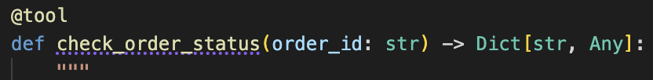
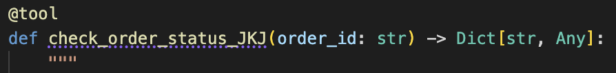

---
hide:
  - navigation
---

# Parte 3: Añadir Herramientas Personalizadas

<p align="center">
  
</p>

**Duración:** 30 minutos

**Objetivo:** Crear herramientas personalizadas en Python para que tus agentes puedan realizar acciones

## Lo que aprenderás

- Cómo crear herramientas Python para watsonx Orchestrate
- La estructura de las herramientas y las buenas prácticas
- Cómo conectar herramientas a los agentes
- Cómo usar Bob para generar y depurar herramientas

## ¿Por qué herramientas personalizadas?

Las herramientas amplían las capacidades de tu agente más allá de la conversación. Permiten a los agentes:

- 🔍 Consultar bases de datos y APIs
- 📊 Procesar y analizar datos
- 📝 Crear y modificar archivos
- 🔧 Realizar cálculos y transformaciones
- 🌐 Integrarse con sistemas externos

## Estructura de una herramienta

Una herramienta Python de watsonx Orchestrate tiene esta estructura:

```python
from ibm_watsonx_orchestrate.agent_builder.tools import tool

@tool
def my_tool(param1: str) -> dict:
    """Tool description that helps the agent understand when to use it.
    
    Args:
        param1 (str): What this parameter is for
        
    Returns:
        dict: The result of the tool execution
    """
    # Your code here
    return {
        "result": "success",
        "data": "your result"
    }
```

**Alternativa: usar el parámetro description del decorador:**

```python
from ibm_watsonx_orchestrate.agent_builder.tools import tool

@tool(
    name="my_custom_tool",
    description="Tool description that helps the agent understand when to use it"
)
def my_tool(param1: str) -> dict:
    """
    Args:
        param1 (str): What this parameter is for
        
    Returns:
        dict: The result of the tool execution
    """
    # Your code here
    return {
        "result": "success",
        "data": "your result"
    }
```

**Puntos clave:**

- Usa el decorador `@tool` para definir herramientas
- El nombre de la herramienta es por defecto el nombre de la función (o se especifica con `@tool(name="custom_name")`)
- La descripción se puede proporcionar de dos formas:
  - **Mediante el docstring** (recomendado): se extrae del docstring de la función
  - **Mediante un parámetro del decorador**: se pasa directamente al decorador como `@tool(description="Your description here")`
- Los tipos y las descripciones de los parámetros provienen de las anotaciones de tipo y de la sección Args del docstring
- Si usas el docstring, debes emplear docstrings de estilo Google para documentar bien los parámetros
- El decorador `@tool` también acepta otros parámetros opcionales, como `expect_credentials`, para herramientas que requieren autenticación

> 📖 **Referencia:** Para ver todos los detalles del decorador `@tool` y sus parámetros, consulta la documentación [Authoring Python-Based Tools](https://developer.watson-orchestrate.ibm.com/tools/create_tool#authoring-python-based-tools).

## Paso 1: Crear una herramienta de estado de pedido

Vamos a crear una herramienta que consulte el estado de un pedido (simulada para este taller).

### Pregúntale a Bob:
```
Bob, create a Python tool for watsonx Orchestrate that checks order status. It should take an order_id parameter and return mock order information including status, items, and delivery date.
```

O créala manualmente:

```python
# order_status_tool.py
from ibm_watsonx_orchestrate.agent_builder.tools import tool
from datetime import datetime, timedelta
import random

@tool
def check_order_status(order_id: str) -> dict:
    """
    Retrieves the current status and details of a customer order by order ID.
    Use this when customers ask about their order status, delivery date, or order details.
    
    Args:
        order_id (str): The unique order identifier (e.g., ORD-12345)
        
    Returns:
        dict: Dictionary with order details including status, items, dates, and tracking
    """
    # Validate order ID format
    if not order_id.startswith("ORD-"):
        return {
            "success": False,
            "error": "Invalid order ID format. Must start with 'ORD-'"
        }
    
    # Simulate order lookup
    statuses = ["Processing", "Shipped", "Out for Delivery", "Delivered"]
    status = random.choice(statuses)
    
    # Generate mock order data
    order_date = datetime.now() - timedelta(days=random.randint(1, 10))
    delivery_date = order_date + timedelta(days=random.randint(3, 7))
    
    items = [
        {"name": "Laptop", "quantity": 1, "price": 999.99},
        {"name": "Mouse", "quantity": 1, "price": 29.99},
        {"name": "Keyboard", "quantity": 1, "price": 79.99}
    ]
    
    total = sum(item["price"] * item["quantity"] for item in items)
    
    return {
        "success": True,
        "order_id": order_id,
        "status": status,
        "order_date": order_date.strftime("%Y-%m-%d"),
        "estimated_delivery": delivery_date.strftime("%Y-%m-%d"),
        "items": items,
        "total": f"${total:.2f}",
        "tracking_number": f"TRK{random.randint(100000, 999999)}"
    }
```

## Paso 2: Crear una herramienta de procesamiento de reembolsos

Ahora vamos a crear una herramienta que procese solicitudes de reembolso.

### Pregúntale a Bob:
```
Bob, create a Python tool that processes refund requests. It should take order_id, reason, and amount parameters, validate them, and return a refund confirmation.
```
Un ejemplo de lo que Bob podría generar:
```python
# refund_tool.py
from ibm_watsonx_orchestrate.agent_builder.tools import tool
from datetime import datetime
import random

@tool
def process_refund(order_id: str, reason: str, amount: float) -> dict:
    """
    Processes a refund request for a customer order.
    Use this when customers request refunds or returns.
    
    Args:
        order_id (str): The order ID to refund (format: ORD-XXXXX)
        reason (str): Reason for the refund request (must be at least 10 characters)
        amount (float): Refund amount in dollars (must be positive and under $10,000)
        
    Returns:
        dict: Refund confirmation details including refund ID, status, and processing time
    """
    # Validation
    if not order_id.startswith("ORD-"):
        return {
            "success": False,
            "error": "Invalid order ID format"
        }
    
    if amount <= 0:
        return {
            "success": False,
            "error": "Refund amount must be greater than 0"
        }
    
    if amount > 10000:
        return {
            "success": False,
            "error": "Refund amount exceeds maximum. Please contact manager.",
            "requires_approval": True
        }
    
    if not reason or len(reason) < 10:
        return {
            "success": False,
            "error": "Please provide a detailed reason (at least 10 characters)"
        }
    
    # Process refund (simulated)
    refund_id = f"REF-{random.randint(10000, 99999)}"
    processing_time = "3-5 business days"
    
    return {
        "success": True,
        "refund_id": refund_id,
        "order_id": order_id,
        "amount": f"${amount:.2f}",
        "reason": reason,
        "status": "Approved",
        "processing_time": processing_time,
        "refund_method": "Original payment method",
        "confirmation_date": datetime.now().strftime("%Y-%m-%d %H:%M:%S")
    }
```

>NOTA: Es posible que Bob cree también pruebas para las herramientas y algo de documentación relacionada. Si es así, puedes explorar esos archivos también.

## Paso 3: Importar tus herramientas

### IMPORTANTE: Como los participantes del taller usarán el mismo entorno de watsonx Orchestrate, RENOMBRA los _nombres de tus herramientas_ (nombres de las funciones) dentro de los archivos Python añadiendo tus iniciales como sufijo. ¡RECUERDA guardar los cambios! ###

>Por ejemplo, `def check_order_status` pasa a ser `def check_order_status_JKJ`. Asegúrate de usar el mismo sufijo en todas tus herramientas.



⬇︎



Fíjate en que, ahora que Bob usa la regla personalizada de desarrollo para wxO, las herramientas se guardan en el directorio _**tools**_.

Importa las herramientas en watsonx Orchestrate:

```bash
orchestrate tools import -k python -f tools/check_order_status.py
orchestrate tools import -k python -f tools/process_refund.py
```

>NOTA: Los nombres de los archivos Python generados por Bob pueden ser distintos de los que se muestran aquí. Usa los nombres de archivo tal como Bob los creó.

💡 O pídele a Bob que lo haga por ti:

```bash
Import the created tools to my active wxO environment
```


Si ves mensajes [WARNING], no pasa nada. Los causa un error de Langchain al analizar los docstrings.

Verifica que se importaron:
```
orchestrate tools list | grep -E "<your_initials>", for example: orchestrate tools list | grep -E "JKJ"
```

¡Deberías ver tus herramientas en la lista!

## Paso 4: Crear un agente de atención al cliente con herramientas

Ahora crea un agente que use estas herramientas. Puedes usar la definición de abajo; también la creó Bob.

1. Crea un nuevo archivo `customer_support_agent.yaml` en el directorio `agents` de tu espacio de trabajo. Bob debería haber creado ese directorio al crear las herramientas. Si no existe, créalo manualmente.
2. Copia el contenido de abajo en el archivo y guárdalo.


También puedes crear tu propia definición de agente si lo prefieres.

## IMPORTANTE: ¡Asegúrate de cambiar los nombres de las herramientas en la definición del agente para que coincidan con los nombres de las herramientas que importaste! ¡Y añade también tus iniciales como sufijo al nombre del agente! ###

```yaml
# customer_support_agent.yaml
spec_version: v1
kind: native
name: customer_support_agent_<your_initials_here>
description: A customer support agent that can check orders and process refunds

instructions: |
  You are a helpful customer support agent for an e-commerce company.
  
  Your capabilities:
  - Check order status using the check_order_status tool
  - Process refund requests using the process_refund tool
  - Answer general customer service questions
  
  When a customer asks about their order:
  1. Ask for their order ID if they haven't provided it
  2. Use the check_order_status tool to get order details
  3. Present the information clearly and helpfully
  
  When processing refunds:
  1. Confirm the order ID
  2. Ask for the reason if not provided
  3. Confirm the refund amount
  4. Use the process_refund tool to process the request
  5. Provide the refund confirmation details
  
  Always be professional, empathetic, and helpful. If you encounter errors,
  explain them clearly and offer alternatives.

llm: groq/openai/gpt-oss-120b

# Specify which tools this agent can use
tools:
  - check_order_status_<your_initials_here>
  - process_refund_<your_initials_here>

```

Importa el agente:
```bash
orchestrate agents import -f agents/customer_support_agent.yaml
```

## Paso 5: Probar tu agente con herramientas

Prueba el agente:

```bash
orchestrate chat ask -n customer_support_agent_<your_initials_here>
```

Prueba estos escenarios:

**Escenario 1: Consultar el estado de un pedido**
```
User: Can you check the status of order ORD-12345?
```

El agente debería llamar a la herramienta `check_order_status` y presentar los resultados.

**Escenario 2: Procesar un reembolso**
```
User: I need to request a refund for order ORD-12345
Agent: [asks for reason]
User: The product arrived damaged
Agent: [provides you with the refund amount / asks for confirmation]
User: $99.99
```

El agente debería llamar a la herramienta `process_refund` y proporcionar la confirmación.

**Escenario 3: Manejo de errores**
```
User: Check order status for ABC123
```

El agente debería gestionar con elegancia el ID de pedido no válido.

## Paso 6: Depurar problemas con las herramientas

Si tus herramientas no funcionan, pídele ayuda a Bob:

```
Bob, my agent isn't calling the check_order_status tool. Here's the agent YAML and tool code: [paste code]
```

Problemas frecuentes:<br>
- El nombre de la herramienta no coincide entre el YAML del agente y la definición de la herramienta<br>
- Descripciones de parámetros ausentes o incorrectas<br>
- La herramienta no se importó correctamente<br>
- Las instrucciones del agente no mencionan cuándo usar la herramienta

## Buenas prácticas para herramientas

### ✅ HAZ:
- Usa nombres de herramienta claros y descriptivos
- Escribe descripciones detalladas de los parámetros
- Incluye validación de entradas
- Devuelve respuestas estructuradas y coherentes
- Gestiona los errores con elegancia
- Añade mensajes de error útiles

### ❌ NO HAGAS:
- Usar descripciones de herramienta vagas
- Omitir la validación de parámetros
- Devolver formatos de respuesta inconsistentes
- Ignorar los casos de error
- Hacer que las herramientas hagan demasiadas cosas (mantenlas enfocadas)

## Avanzado: Herramientas con APIs externas

Las herramientas pueden llamar a APIs reales. Aquí tienes un ejemplo de estructura:

```python
import requests
from ibm_watsonx_orchestrate.agent_builder.tools import PythonTool

class WeatherTool(PythonTool):
    """Get weather information"""
    
    def __init__(self):
        super().__init__(
            name="get_weather",
            description="Get current weather for a city",
            parameters={
                "city": {
                    "type": "string",
                    "description": "City name",
                    "required": True
                }
            },
            # Specify credentials needed
            expect_credentials={
                "api_key": "Weather API key"
            }
        )
    
    def run(self, city: str, credentials: dict = None) -> dict:
        """Get weather data"""
        api_key = credentials.get("api_key") if credentials else None
        
        if not api_key:
            return {"error": "API key not configured"}
        
        # Call external API
        response = requests.get(
            f"https://api.weather.com/v1/current",
            params={"city": city, "key": api_key}
        )
        
        return response.json()
```

## Puntos clave

✅ Las herramientas amplían las capacidades de los agentes con lógica personalizada
✅ Las herramientas tienen nombres claros, descripciones y parámetros
✅ Los agentes deben listar las herramientas que pueden usar en su especificación YAML
✅ Las herramientas deben validar entradas y gestionar errores
✅ Bob puede ayudarte a generar, depurar y mejorar herramientas

## Próximos pasos

Ahora que tu agente tiene herramientas, ¡es hora de combinar varios agentes en un sistema multiagente!

Continúa con [Parte 5: Orquestación multiagente](../part4-multi-agent-orchestration/README.md) →

## Recursos adicionales

- [Guía de herramientas en Python](https://developer.watson-orchestrate.ibm.com/tools/create_tool)
- [Gestión de herramientas](https://developer.watson-orchestrate.ibm.com/tools/manage_tool)
- [Asociar conexiones a herramientas Python](https://developer.watson-orchestrate.ibm.com/connections/associate_connection_to_tool/python_connections)

## 🎙️ Bonus: ¡Pídele al profesor que te muestre el agente de voz!

¿Has terminado la Parte 3? Antes de pasar a la siguiente parte, **levanta la mano y pídele a tu profesor que te enseñe el agente de voz**. Verás cómo un agente de watsonx Orchestrate puede mantener una conversación hablada, usando herramientas como las que acabas de crear.


---

**💡 Consejo profesional:** Usa Bob para generar plantillas de herramientas y luego personalízalas según tus necesidades.